# Copy circuits in the GRU: how a token at position i is output at step L + i

Circuit analysis of the copy-task GRU (hidden size 128) with its three transcoders (reset, update, candidate), in the
style of Ameisen et al. (2025), *Circuit Tracing*. Mostly length 4 (L = 4), some length 3 and 7.
Feature labels come from `docs/interpretability_findings.md` (firing labels) and from the magnitude pass below.

**Task layout.** A sequence is L tokens, then `<DEL>` at step L, then the model's own outputs fed back. At step L + j the
model outputs token j. Step names: `in0 … in(L-1)` (inputs), `DEL`, `out1 … out(L-1)`. At `out k` the input is the
token output one step earlier (token k-1) and the model outputs token k. Token j is written at `in j` and output at
`L + j` (output 0 at `DEL`).

## Summary

1. **The model is a queue, not a position counter.** Each output depends only on its own input token. The model
   outputs the oldest token still in memory, and a token leaves memory only when it is fed back ("pop"). Skipping a
   copy step delays the rest of the output by one; it never skips.
2. **The circuit has four stages**, all in candidate features:
   - **write:** mostly sparse "input X" features (47% of the output logit's dependence on the token passes through
     them at the write step, against 36% through dense token-set features);
   - **relay:** dense features hold it and hand it on (about half the dependence passes through them at each relay
     step; the rest is carried past in h by the update gate);
   - **read-out:** dense "flipper" features write it into the logit at its output step;
   - **pop:** the fed-back token cancels its own stored copy in the candidate's next write; for most tokens one
     token-specific "fed-back X" feature carries this.

   About 10 candidate features per step (of 512) are both sufficient and necessary to carry a token from input i to
   output L + i, even with the rest of the model held fixed (§3, minimal circuit).
3. **The token's code turns about 180° between write and read-out.** Two groups of dense features do this: "keepers"
   hold the token in roughly its input orientation, and "flippers" read the keepers with the opposite sign. The stored
   code ends up opposite to the input code, and that is exactly why feeding the token back cancels it.
4. **The gates only do timing.** Update-gate features clock how fast memory turns over. Reset-gate features clock how
   much memory the candidate reads, and matter mainly for longer sequences. Both are computed from candidate features
   (mainly the `<DEL>` feature 123 and the positional part of the dense relay features). Neither carries token content.
5. **After the write step the circuit runs on dense candidate features** (active in almost every sequence). Their
   information is in their magnitude, so they needed magnitude explanations; most of these can be said in a sentence
   ("a signed tally of recent inputs; in the copy phase, of the queue"), and their predicted effects hold: shifting a
   feature up makes the model output the tokens its explanation says raise it (15 of 16 features; §3, per-feature
   clamp tests). Many of them merge a timing signal with a token set, which is a transcoder-training issue.
6. **Labels are not use.** Measured where each feature takes part, 190 of 512 candidate features cost ≥ 20%, most of
   them sparse (an average over all sequences found 22); 226 (44%) do nothing measurable, mostly low-norm duplicates
   of a used feature with the same label (§3).

---

## 0. Setup and code

Models: `data/models/copy_train/copy_128_high/copy_128_high.ckpt`; transcoders in `copy_transcoders/`
(`reset_512_sparse_e100.ckpt`, `candidate_1024_sparse_dpi_final.ckpt` = **update**, `candidate_512_updatelike_e100.ckpt`
= **candidate**). Data: `features/copy_transcoder_v2_1of5/1M_128_high_seq{3,4,7}.pt` (the 1/5 subsample). Unless
stated, results use sequences with distinct tokens and the real GRU. Outputs are in `features/copy_circuits/` (index:
`features/copy_circuits/README.md`; all copy-task data: `features/README.md`); figures: `docs/figures/README.md`.

| file | what it does | output |
|---|---|---|
| `circuit/edge_att.py` | attribution graphs (frozen gates, hidden state folded into edges), gate-feature decompositions; `gate_scores` split out of `gate_feature_ranking` | used by the scripts below |
| `circuit/copy_task/copy_circuits.py` | per-output attribution graphs, swap tests, contrastive graphs (`--sections graphs swaps contrast`) | `circuits.json` |
| `circuit/copy_task/slot_absorption.py` | is "slot filled" its own feature or absorbed into token features | `absorption_L{3,4}.json` |
| `circuit/copy_task/gate_mechanism.py` | the token's trace in h: kept / written / gate split, gate features vs gate units | `gates.json` |
| `circuit/copy_task/feature_circuits.py` | slot-token tables, exact contrastive flow (DeepLIFT rescale), carrier ablations, steering by token tables | `feature_circuits_L4.json` |
| `circuit/copy_task/token_circuits.py` | the circuit for one real sequence and slot, with labels | `token_circuits_L4_g.json` |
| `circuit/copy_task/magnitude_scores.py` | additive token-table magnitude explanations for dense features, held-out R² | `magnitude_scores_{hidden,update,reset}.json` |
| `circuit/copy_task/autointerp_magnitude.py` + workflow | agent-written magnitude explanations (one agent per feature + skeptic) | `features/copy_gru_v1_candiff_magnitude/` |
| `circuit/copy_task/circuit_tests.py` | interventions: `<DEL>`, pop, freezing, carry, gate time-shifts, pop matching, resample, reset combinations | `circuit_tests_L4.json`, `reset_combos_L{4,7}.json` |
| `circuit/copy_task/rotation_edges.py` | rotation by edges, feature angles (keepers / flippers), sign test, reversal decomposition, reversal interventions | `rotation_edges_L4.json`, `rotation_phases_L4.json`, `reversal_tests_L4.json` |
| `circuit/copy_task/gate_features.py` | what drives the gate features, which reads / writes they open | `gate_features_L4.json` |
| `circuit/copy_task/circuit_sufficiency.py` | minimal circuit: sufficiency and necessity patching (free and clamped) against circuit size | `circuit_sufficiency_L4.json` |
| `circuit/copy_task/clamp_tests.py` | per-feature clamp tests: does each feature have the effect its firing or magnitude explanation predicts? | `clamp_tests.json` |
| `circuit/copy_task/verbal_rules.py` | a magnitude explanation as a verbal rule with nothing fitted, scored by rank correlation (feature 145) | `verbal_rules_145.json` |
| `circuit/copy_task/conditional_analyses.py` | importance, pop clamps and carrier flows measured only where a feature takes part, not averaged over all sequences | `conditional_{importance,pop,flows}.json` |
| `circuit/copy_task/circuit_extras.py` | trace cosine, pop split, early feedback, dense-carrier drops, token-conditional ablation | `circuit_extras.json` |
| `circuit/copy_task/autointerp_plots.py` | figures: subcommands `circuits`, `feature_circuit`, `token_circuit`, `rotation_wheel`, `circuit_summary` | `features/copy_circuits/plots/` |

Typical call (all scripts take the same model arguments):

```
PYTHONPATH=. python -m circuit.copy_task.circuit_tests --rnn data/models/copy_train/copy_128_high/copy_128_high.ckpt \
    --traces features/copy_transcoder_v2_1of5/1M_128_high_seq4.pt \
    --transcoders reset=copy_transcoders/reset_512_sparse_e100.ckpt \
        update=copy_transcoders/candidate_1024_sparse_dpi_final.ckpt \
        candidate=copy_transcoders/candidate_512_updatelike_e100.ckpt \
    --out features/copy_circuits/circuit_tests_L4.json
PYTHONPATH=. python -m circuit.copy_task.autointerp_plots circuit_summary features/copy_circuits
```

---

## 1. What the model does (behaviour, real GRU)

**Each output depends only on its own token.** Swap the token at position i (and the fed-back copy) and only output i
changes (logit of the original token −24 to −27); all other outputs change by at most 0.12.

**Memory and feedback have to agree.** Swap token i but leave the fed-back token unchanged: the next output is the
*stored* token at i in 82–93% of cases (the correct next token only 9–15%). The fed-back token pops whatever it
matches; if it matches nothing, the oldest token stays and is output again.

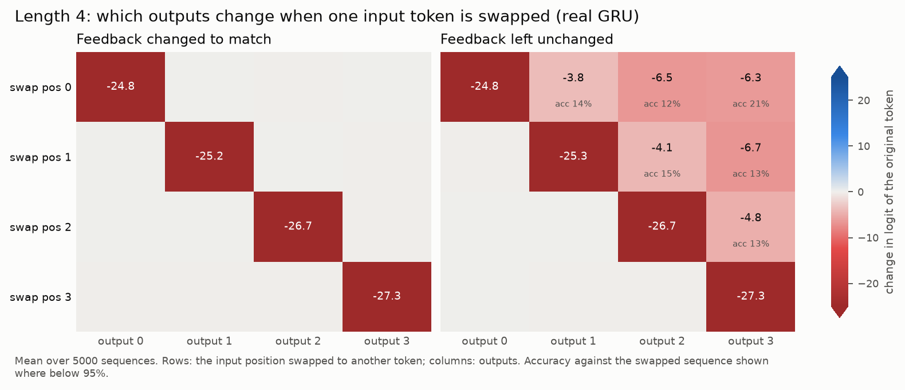
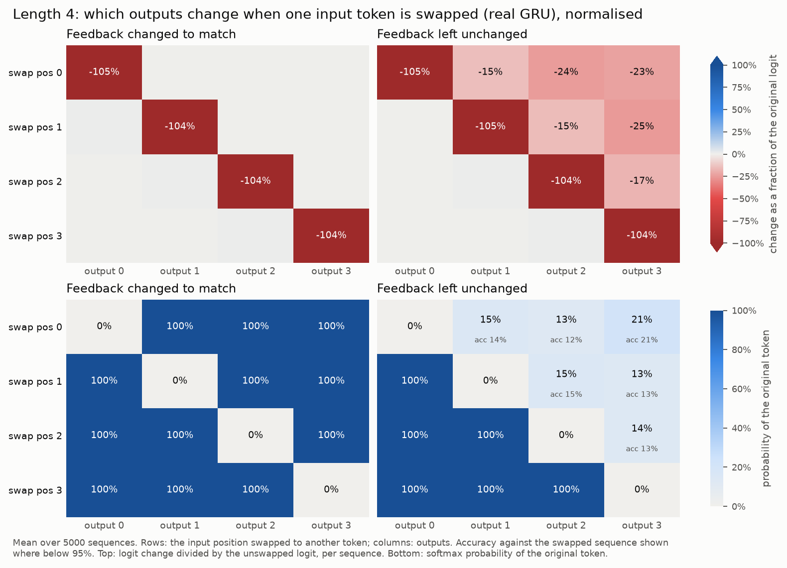

**Skipping a step delays, never skips.** Freeze the hidden state for one copy step (update gate z = 0). Running
free (the model's own outputs fed back), every later output is the previous token: the output is delayed by one.
Teacher-forced, the fed-back tokens no longer match the head, so nothing is popped and later outputs fail.

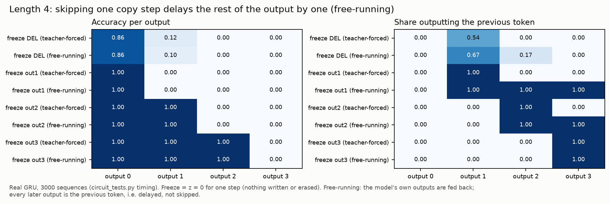

*Kind 1 (real GRU, no features). Code:* `copy_circuits.py` (`swaps`), `circuit_tests.py` (`timing`).

---

## 2. How the circuit was traced (method)

**Attribution graphs.** Gates are frozen at their real values (as the paper freezes attention), so the GRU is linear
in what gets written into h. Nodes are candidate features at each step, inputs, error nodes and logits; edges are
exact linear effects through the carry `(1 - z)` and the reset gate. Every decomposition sums exactly to the real
logit (residual ≤ 3e-4). Error nodes carry only 0.8–1.7% of the attribution (the analogue of the paper's replacement
score).

**Problem: AND-like features give "partner credit".** A single graph credits output 3 with +57 from token 0, but
swapping token 0 changes output 3 by 0.0. The read-out features fire only for "this token AND it is time for this
slot", and a linear graph splits credit over both inputs. See `identity_attribution_L4.png` (raw credit) next to the
swap test.

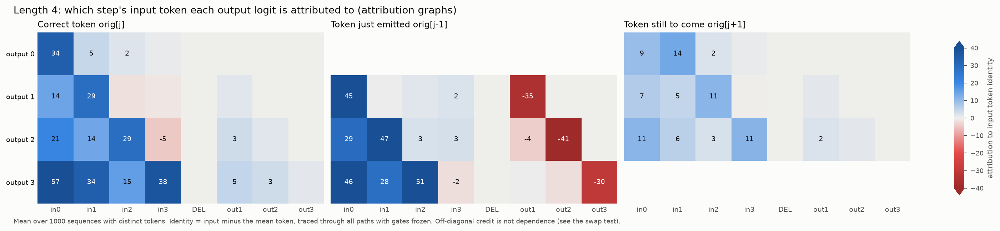

**Fix 1: contrastive graphs.** Subtract the graph of a run where token i is swapped. Off-diagonal totals drop to
≤ 0.33 (≤ ~1.8 at any one step). But on the diagonal, unchanged inputs still get credit when a read-out feature
switches off.

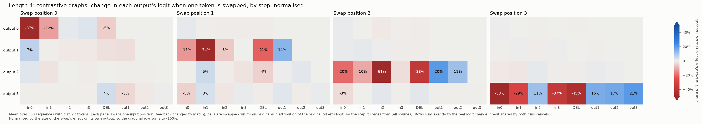

**Fix 2: exact contrastive flow (DeepLIFT rescale).** Feature *pre*activations are linear in what feeds them. Between
the two runs, each feature's preactivation change splits exactly into upstream activation changes, gate changes and
input changes. Each JumpReLU is replaced by its slope between the runs, Δa / Δp. Unchanged features and inputs then
carry exactly zero flow, and flows still sum exactly to the logit change (residual ≤ 5e-5). This is what the circuit
diagrams below use. *Code:* `feature_circuits.py` (`change_flow`).

**Slot-token tables.** For every candidate feature, step and slot, the mean activation given the token in that slot.
They give each carrier a magnitude code (which tokens raise / lower it) and let us *steer* features by magnitude.

### What goes into the graph: the choices, and why candidate features only

**Why a choice is needed.** An attribution graph adds up contributions, so every edge must be linear: the effect of a
node on another is a fixed number times the node's value. One GRU step is

  h_t = (1 − z_t) · h_{t−1} + z_t · n_t,  n_t = tanh(W x_t + U (r_t · h_{t−1}))

where z (update gate) decides how much new content is written, r (reset gate) how much memory the candidate reads, and
n (candidate) is the new content. The products z · n, (1 − z) · h and r · h are not linear: the effect of n depends on
z, and z itself depends on h. Transformer graphs have the same problem with attention (pattern × values); Ameisen et
al. freeze the attention pattern and explain why it is what it is separately (QK attributions, Kamath et al.). There
are three transcoders here (reset, update, candidate), so one has to choose which features become graph nodes.

**The options.**

| option | nodes | exact? | what it gives / costs |
|---|---|---|---|
| **A. Freeze the gates at their real values (what we did)** | candidate features, inputs, error nodes, logits | yes: with z and r fixed, everything written into h is linear | shows how token content moves; the gates appear only as fixed multipliers on edges, so their features are not nodes |
| B. Freeze the candidate, gate features as nodes | update / reset features | yes | shows what the gates do, but the token content (written through the candidate) becomes fixed multipliers: the wrong side for a copy task |
| C. Split every product at the midpoint of two runs | features of all three transcoders | yes, but only for a *contrast* between two runs (for two factors, a·b − a'·b' = ā·Δb + b̄·Δa exactly, with ā, b̄ the two runs' means) | every gate feature gets its share; no single-run graph. Used in the RL task (`rl_circuits.md` §3), where frozen gates left 3–7 of a 6–9 logit change unexplained |
| D. Linearise locally (gradient × activation through the gates) | all features | no: error grows with the nonlinearity | single-run graphs with gate nodes, but contributions no longer add up to the real change |
| E. GRU units instead of transcoder features | 128 units per gate | yes (with A or C) | no transcoder error, but units mix unrelated roles; the features were the point |

A further choice inside A: the 128 hidden coordinates are *folded* into the edges (as the paper folds the residual
stream), so an edge goes straight from a candidate feature at one step to one at a later step, through the carry and
the reset gate of the steps in between.

**Why A.** The token's content is written and rewritten through the candidate: 96–99% of the candidate's change comes
from reading the stored token through the reset gate, and gate changes add 0–5% (§5). The gate features are clocks
that carry no token content (§8). And measured directly, in the exact contrastive flow (Fix 2) the gates' changes
carry 1.8–3.3 logits of the 25–28 logit change per slot (7–12%), against 21–22 from the token's own input write; in
the pop, the gate part of the matched-vs-mismatched difference is −0.1 of −32.5 (§6). So freezing them loses little,
and in exchange every edge is exact.

**How the gate features were still analysed** (the gates' side, kept separate from the main graph, as the paper keeps
QK separate). Each transcoder outputs its gate value directly, so a gate value is an exact sum of its features plus a
bias and an error term. That gives exact gate-feature views without making them nodes (`circuit/edge_att.py`):
- **split an edge by a gate's features:** an edge that passes through one step's gate is split exactly into the shares
  of that gate's features (`split_edge_by_gate`);
- **rank gate features by their effect on a target:** how much the target logit would drop if one gate feature were
  removed from its gate, everything else fixed (`gate_feature_ranking` / `gate_scores`). An update feature counts twice:
  it lets the candidate in and erases the old memory;
- **why a gate feature fired:** its connections from earlier candidate features (carried through h), the input and
  its bias, averaged over the steps where it fires (`gate_features.py` drivers → §8: mainly `<DEL>` 123 and the
  positional part of the dense relay features). For one sequence, `gate_feature_graph` builds a graph rooted at a
  gate feature;
- **which gate features let the token through:** the reset features that let each candidate feature read the stored
  token, and the update features that admit or erase it (`gate_features.py` reads / writes, §8);
- in the contrastive flow, the gates' changes are a separate source per step ("gates" above), and in the circuit
  diagrams the gate features with the largest share at each step are grey tags (`gate_mechanism.py`);
- what the gate features *do* was then tested causally, not read off a graph: time-shifts and reset combinations (§8).

**Limitation.** With option A a gate feature can never show up as a carrier of content. If the gates term were large,
the graph would hide part of the computation; check its size before trusting a frozen-gate graph. In the copy task it
is small (above); in the RL task it was not, which is why that analysis used option C.

### Three kinds of intervention

Results in this doc come from three kinds of experiment. Each result below says which, or the code does.

| kind | what changes | used for |
|---|---|---|
| **1. Real GRU, no features** | inputs, or whole gate vectors (all 128 coordinates) | swap tests, feedback mismatch, early feedback, freezing a step (z = 0), the carry test's z = 1, the pop split and match test, the trace / rotation measurements in h, gate-*unit* ablations |
| **2. Real GRU, edited along feature directions** | the GRU computes its real gate or candidate value, then only the chosen features' share is changed: value − (a_f − replacement)·d_f. Everything else stays real, including the transcoder error. | `<DEL>` 123 and reset 31, pop-feature ablations, gate time-shifts, reset combinations, resample vs mean, reversal tests, own-carrier ablations, steering by token tables, gate feature vs unit ablations |
| **3. Spliced** | the transcoder *replaces* the candidate (some features mean-ablated); its error is not kept | dense-carrier drops, token-conditional ablations (`circuit_extras.py` via `explained_fidelity.py`), the earlier fidelity tests |

Why it matters: kind 2 isolates the feature (baseline = the exact model, 100%). Kind 3 adds the transcoder's own
error, which compounds over the recurrence (baseline 98.5–98.9%), so its numbers are a little harsher. Kind 1 says
what the model does, not which features do it. Most feature claims here rest on kind 2.

### How much the attribution graphs helped

The graph *machinery* was essential; the paper-style use (read off one pruned graph for one prompt) helped little and
at first misled us.

- **Direct help.** The graphs gave the first clues: the logit is written by read-out features at the output step; the
  fed-back token pushes its own logit down by 30–41 (first sign of the pop); the `<DEL>` feature 123 and the gate
  features (717, 650, 434, 31) first appeared in the graph's feature effects and gate rankings. The ~1% error share
  told us the features account for nearly all of the computation.
- **Help as infrastructure.** Freezing the gates makes the GRU exactly linear in what it writes. That exactness is what
  the contrastive flow (DeepLIFT rescale), the gate-feature splits (`gate_scores`, `gate_features.py`), and the
  rotation / reversal decompositions are built on.
- **Findings that came from the graph.** The rotation itself was first seen in the trace in h (the token's code turns
  about 180° between write and read-out, §5); *which features turn it, and why*, came from the graph. Two quantities
  were used, neither of which needs to know what a feature means (its label):
  1. **The angle of a feature's write.** Not a property of an edge: the direction of what one feature adds to h for
     one stored token, in a 2-D frame per token. e1 = the token's code as first written (original minus
     token-swapped run, in h, at the write step); e2 = the direction the output layer reads that token from, with its
     overlap with e1 removed. The angle of the write's projection on (e1, e2): 0° = writes the token as written, 180°
     = writes the opposite. This split the carriers into **keepers** (487, 283, 145, …: about +30°) and **flippers**
     (8, 426, 348, …: about 155°). The same projection of each step-to-step contribution shows which ones turn the
     code from e1 towards e2 (`rotation_edges.py`).
  2. **The signs of the edges between features.** An edge in the contrastive flow is how much of the change in one
     feature at one step carries into another feature at a later step, with its sign. Grouping a flipper's incoming
     edges by source: from keepers −0.40 / −0.49 (1 / 2 steps after the write), from the flipper's own response to the
     input +0.47 / −0.02. So flippers read the keepers' copy with the opposite sign. At the write step this is hidden,
     because the flipper's own response to the input points the same way; one step later the input is another token,
     the negative read dominates, and the code reverses.
  3. **How this helped.** Without the graph we had only the trace turning. The graph's exact decomposition gave, in
     order: *who* turns it (the write angles → keepers and flippers), *why* it reverses (the edge signs → flippers read
     keepers negatively, a hypothesis), and *what to test*: the interventions followed from that hypothesis (remove
     flippers at the write step → they reverse one step early; remove 10 keepers → the reversal weakens; random
     controls → no change; §5). The labels came in afterwards, to describe what the groups carry.
- **Where they misled or fell short.** Single graphs gave partner credit (+57 from a token that has no effect;
  feature effects of ±60–110 cancelling each other); this needed swap tests, contrast and the rescale to fix. Pruned
  graphs were never used; the diagrams come from flows averaged over 300 sequences. A graph explains one run, not
  what the model does on other inputs, so the queue rules (pop by match, a frozen step delays and never skips) came
  from behavioural tests (kind 1); the cancellation came from splitting the GRU step, and the gates' roles from
  interventions (kind 2).

In short: used contrastively, the graphs gave an exact account of *where* effects flow, and their edges gave the
keeper / flipper account of the rotation; the queue's behaviour and the causal checks came from counterfactuals and
interventions.

---

## 3. The circuit at a high level

For slot i the token's effect flows: **input at in_i → write features → relay features (each step) → read-out
features at L + i → logit**, then **pop** one step later. Mean over 300 sequences, L = 4:

| | flow |
|---|---|
| enters at the input of in_i | +21 to +22 of a total change of +25 to +28 |
| through each relay step's features | +12 to +17 (straight to the next step, plus skips through the update-gate carry) |
| read-out features → logit | +23 to +26 |
| gate changes, bias / error writes | 1–2 in total |

Features carrying 80% of the flow per sequence: 4–5 at the write step, 6–10 per relay step, about 6 at read-out.

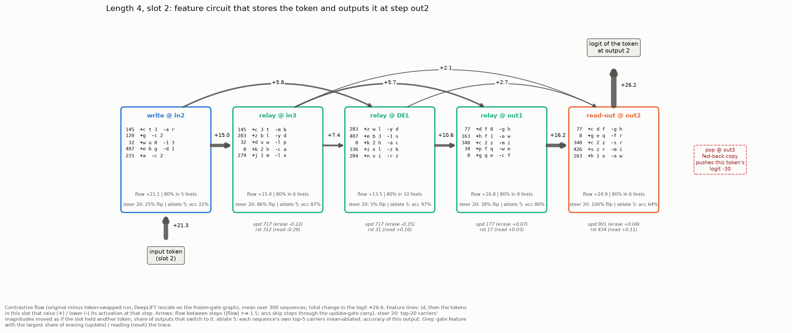

**One real sequence** (`p t g 2 <DEL> p t g`, slot 2 = `g`), with labels:

| step | what happens | features (how much `g` moves each, against `b`) |
|---|---|---|
| in2 (input g) | write | 120 "input g in the first five positions" (sparse) +2.00; 79 "{g,0,2,y,i} up" +0.82; 274 "{l,x,g,i} down" −1.32 |
| in3, DEL | relay | 79 +1.6; 349 "{g,r,j,o} up over the last ~6 inputs" +1.6; 274 −1.4; 8 +0.7 |
| out1 (g is next) | relay → read-out | 8 "token value read from the queue head (g > q > e > u)" +0.85; 212 "{0 ≫ g, r, i, 2, p}" +0.56 |
| out2 (output g) | read-out | 8 +1.82; 212 +1.46; 214 "o (also g, 3, u)" +1.15; 77 "c, d, f, 0 high; a, e, w low" −0.62 |

Every label's sign agrees with how `g` actually moves the feature.

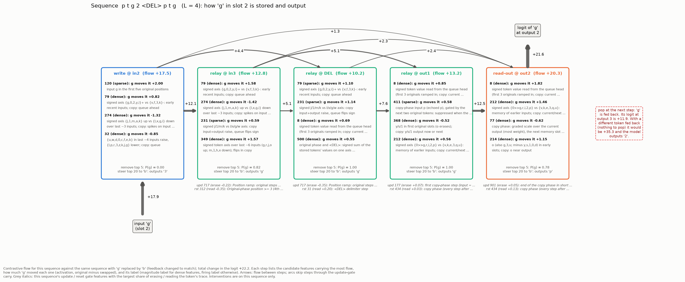

**Causal checks** (L = 4; kind 2, real GRU with feature edits):

| test | result |
|---|---|
| remove each sequence's own top-5 carriers at the **write** step | output i accuracy 19–41% (random 5: 92–100%); earlier outputs unaffected |
| same at the **read-out** step | 64–72% |
| same at a single **relay** step | 87–100% (the token is spread over many features, and the carry keeps a second copy) |
| **steer** the top-20 carriers' magnitudes by the token tables, as if the slot held another token | output switches to that token: 59–97% one step after the write, 100% at read-out |
| same with each feature's token rows shuffled (same size of push) | 0–3% |

*Code:* `feature_circuits.py`, `token_circuits.py`; plots via `autointerp_plots.py feature_circuit / token_circuit`.

### Is the circuit enough, and is it needed? (minimal circuit, activation patching)

For each sequence and slot i, take the original run (token v) and the run with v swapped for another token b
(feedback matched). The circuit is that sequence's top-k candidate features per step, at steps i … L+i, ranked by
|contrastive flow| (so features driving either token count). Patching sets a feature to its value in the other run, in
the real GRU (gates and transcoder error left as they are). Four modes:

| mode | run | circuit features | every other feature | question |
|---|---|---|---|---|
| sufficiency, free | swapped | set to original values | recomputed | does output i become v again? |
| sufficiency, clamped | original | held at original values | held at swapped values | does output i stay v? |
| necessity, free | original | set to swapped values | recomputed | does output i stop being v? |
| necessity, clamped | original | set to swapped values | held at original values | does output i stop being v? |

"Free" lets the rest of the model react to the patched circuit; "clamped" holds the rest fixed, so only the circuit's
own writes can change the result. Patching happens at every step from i to L + i, each step with its own top-k
features; the values patched in come from a clean run of the other sequence (e.g. in necessity, the circuit takes
the values it had in the clean swapped run). The update and reset gates and the transcoder error are never patched:
they are computed live from the patched state.

| features per step | share of \|flow\| | sufficiency free: output = v | sufficiency clamped: output = v | necessity free: output ≠ v | necessity clamped: output ≠ v |
|---|---|---|---|---|---|
| 1 | 29% | 39–51% | 1–2% | 86–93% | 16–37% |
| 3 | 55% | 91–97% | 31–41% | 100% | 76–82% |
| 5 | 68% | 97–100% | 75–84% | 100% | 96–97% |
| **10** | **84%** | **100%** | **97–100%** | **100%** | **100%** |
| 20 | 95% | 100% | 100% | 100% | 100% |
| random features outside the circuit (any k) | | 0% | 0% | 0–2% | 0–2% |

(Ranges over slots 0–3, 300 sequences each; about 38–48 features per step carry any flow, out of 512.)

- **About 10 features per step are both sufficient and necessary**, even with the rest of the model held fixed:
  clamped, they keep output i correct 97–100% of the time, and corrupting them changes it 100% of the time (to the
  swapped token b in 93–97%). Random features outside the circuit do nothing in any mode.
- **When the rest can react, far fewer are needed**: 3 per step written in restore the token 91–97% of the time, and
  corrupting just the top 1 per step changes the output 86–93% of the time. The other features follow the circuit.
- Corrupting slot i's circuit also breaks later outputs (other outputs 14–57% for slots 0–2): the stored token no
  longer matches the fed-back one, so it is not popped (§1).
- So the circuit is small relative to the dictionary (about 10 of 512 per step) but not a handful; the token is spread
  over a few dozen carriers per step, matching §5.

An earlier version of this test ("complement") let the circuit features themselves be recomputed while the rest was
held at swapped values; the corrupted rest then dragged the circuit along, so it needed about 20 features per step.
The clamped modes above hold the circuit at its values too.

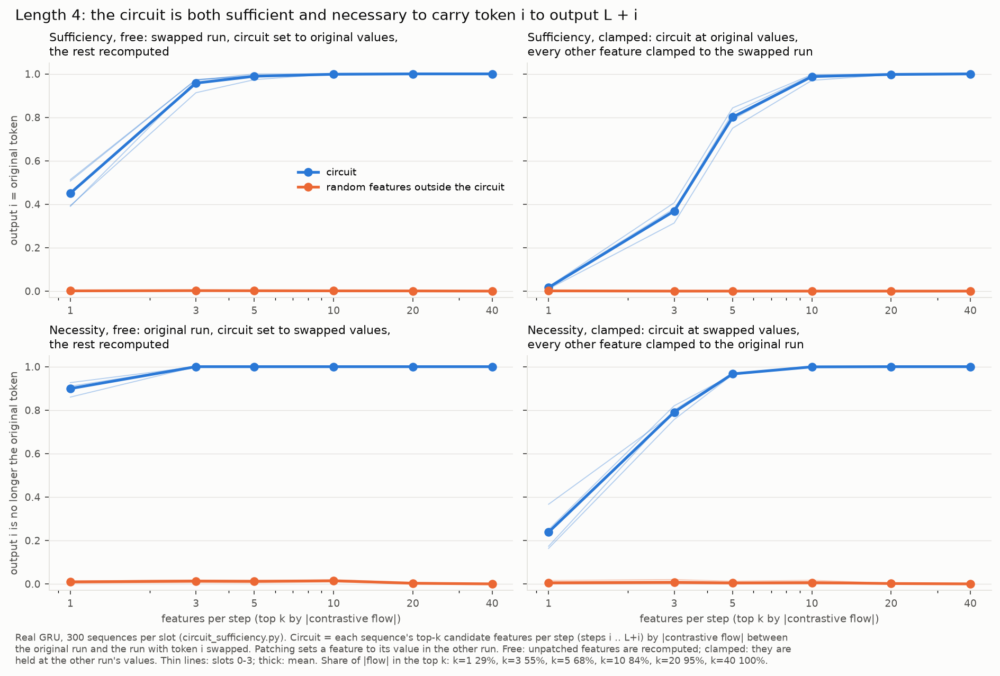

*Code:* `circuit_sufficiency.py`; output `circuit_sufficiency_L4.json`.

### Does each feature do what its explanation says? (per-feature clamp tests)

*Why:* an explanation is fitted to a feature's *activations*: it says what the feature correlates with. That does not
show the model uses the feature to mean that. A label can describe a feature's activity perfectly while the model
ignores the feature or reads it differently. This test checks the causal side: change the feature, and see whether
the model's behaviour changes the way the label says it should.

*What "clamp" means here* (kind 2): one candidate feature's activation is changed inside the real GRU and everything
downstream responds. The candidate value becomes n + (a_new − a) · d_f, where d_f is the feature's decoder direction and
a its activation; the rest of the computation, including the transcoder's error, is the model's own. For firing
features a_new is a fixed value (0, or the feature's mean active value); for magnitude features it is a **shift**,
a ± 1.5 standard deviations of its input-phase activation (floored at 0), at every input step. The situation and the
predicted effect come from the label alone. L = 4 and 7, 1000 sequences each:

| explanation | clamp | predicted effect |
|---|---|---|
| firing "input X" (e.g. 120 "input g in the first five positions") | **on** (mean active value) at a step where the label's other conditions hold but the input is not X | that slot's output moves towards X |
| | **off** (0) where the label holds | X's logit at that slot's output drops |
| firing "copy input X" (the fed-back token) | **off** where X is fed back | X is not popped: the next output repeats X |
| | **on** at a copy step before X's own output | X is popped early: X's logit at its output drops |
| magnitude (raising set S+, lowering set S−) | **boost / suppress** by 1.5 std at every input step | outputs move towards S+ / S− |

Control: the rank of X among all 30 tokens by logit change (1 = moved most in the predicted direction), or, for
magnitude features, the same change for 200 random token sets of the same sizes.

Tested: the 6 sparse features that matter most alone (120, 36, 215, 408, 95, 316), a random 25 other explained "input X"
features, a random 15 explained "copy input X" features, and the 16 magnitude features that matter most alone.

| features | as predicted | weaker / less specific | no effect | opposite sign |
|---|---|---|---|---|
| firing "input X" (29) | 13 (incl. 120, 36, 215, 408): X ranks 1st, logit ±8 … 20 | 9 (X ranks 2nd–20th, or small effects) | 4 (250, 275, 358, 370) | 3 (245, 292, 431) |
| firing "copy input X" (17) | 6 (95, 316, 304, 484, 345, 193): on → X's logit −11 … −42; off → X repeated (up to 71% for 316) | 1 | 10 | 0 |
| magnitude (16) | 15: boost moves the S+/S− logit gap by +9 … +27, z ≈ 4–5 against random sets, same sign in 97–100% of sequences; suppress the other way | | 1 (440) | |

**Worked example: feature 145.** Its magnitude explanation says it is high when recent inputs are in S+ = {c, 3, t,
2, v, j} and low when they are in S− = {n, r, i, m, b, 0}. If the model reads 145 that way, pushing it up should look
to the model like "S+ tokens were in the input", so the outputs should move towards S+ tokens; pushing it down, away
from them. Measured: the change in the mean logit of the S+ tokens minus that of the S− tokens at the output steps,
against the same measure for 200 random token sets of the same sizes (which rules out "any large push breaks the
outputs"). The boost is +1.28 (1.5 standard deviations).

| | L = 4 | L = 7 |
|---|---|---|
| boost: S+ minus S− logit gap | +16.2 (random sets −0.2 ± 3.5; about 4.7 SD) | +23.6 (about 4.6 SD) |
| boost: sequences moving the predicted way | 100% | 100% |
| boost: outputs that are S+ tokens | 20% → 51% | 20% → 85% |
| suppress: S+ minus S− logit gap | −11.1 (about 4.7 SD) | −12.3 |
| suppress: outputs that are S+ tokens | 20% → 14% | 20% → 9% |

So boosting 145 makes the model output c, 3, t, 2, v and j in place of the correct tokens: accuracy falls from 100% to
68% (L = 4) and 29% (L = 7), and the errors are the ones the label predicts.

What this says:
- **Most labels predict their feature's effect**, including magnitude labels. The one magnitude failure, 440, has the
  odd structure (it reads older memory, and a fresh input counts the other way), so a whole-input-phase boost is the
  wrong test of it.
- **A correct firing label does not mean the feature is used.** About a third of the "explained" token features have
  no effect or the opposite effect: they fire exactly as labelled but the model reads them weakly, or reads them as
  "not X".
- **There are token-specific pop features.** For some tokens (u, k, l, q, v, 3 in this sample) one "fed-back X"
  feature carries the pop: switch it off and X is output again, switch it on early and X is erased. Other fed-back
  features for the same tokens (e.g. 203 and 304 are both "fed-back k"; only 304 acts) do nothing. These are where the
  input-weight cancellation of §6 shows up in the transcoder's basis. The earlier pop-feature test missed them because
  it ranked features by pop flow averaged over all tokens (§6).

*Code:* `clamp_tests.py`; output `clamp_tests.json`.

### Measuring a feature where it matters, not averaged over every sequence

Several earlier rankings averaged a feature's effect over all sequences. A feature that matters only when its token is
present then looks unimportant. Three of them, redone with the average taken only where the feature takes part
(kind 2, real GRU; new figures, the earlier ones are unchanged):

**1. Single-feature importance.** Each candidate feature mean-ablated alone (replaced by its average value at each
step), 2000 sequences per length. Accuracy here is always per output: the share of individual outputs (sequence ×
output position) that are correct, not the share of sequences with every output correct. Measured three ways:
- **over all sequences** (the earlier ranking; the x-axis of the figure);
- **over the sequences where the feature is active** (above 0 at some step in the clean run), counting all of their
  outputs (figure, top row). Example: 94 "first input is b or f" is active only in sequences starting with b or f
  (about 6%); removing it makes about 70 percentage points more of their outputs wrong, while over all sequences that
  is only 4%;
- **on the outputs of the one token it hurts most:** for each token, the outputs whose correct answer is that token,
  over all sequences; the worst token is kept (figure, bottom row).

*Why two conditional measures:* the top row only helps sparse features. A dense feature is active in essentially every
sequence, so its "active sequences" are all sequences and it sits on the y = x line. The bottom row treats both kinds
alike: it asks which output token the feature's removal hurts most, so dense features that carry particular tokens show
up too (e.g. 162 hurts outputs of "o" by 70–79%).

| | L = 4 | L = 7 |
|---|---|---|
| features with drop ≥ 5% over all sequences | 7 | 22 |
| … ≥ 20% on the sequences where they are active | 34 (all sparse) | 79 |
| … ≥ 20% on their worst output token: dense / sparse | 18 / 27 | 26 / 32 |

- **The averaged ranking picks dense features only because dense features are never diluted.** Ranked by the drop over
  all sequences, the features costing ≥ 5% at L = 4 or 7 were 16 of the 70 dense magnitude features (0, 32, 54, 79, 91,
  140, 145, 162, 266, 274, 280, 283, 284, 440, 487, 488) plus 6 sparse ones (36, 95, 120, 215, 316, 408). Sparse
  token features are the single biggest points of failure: removing 94 "first input b or f" breaks 50–70% of the
  outputs of the sequences it is active in (overall: 4%); 465 "first input x", 299 "first input m", 321, 120, 36 and
  467 all reach 39–62%. No dense feature exceeds 26% on its sequences.
- **Dense features are token-specific too.** On their worst output token, 162 ("o trace") drops accuracy by 70–79%,
  145, 283, 487, 284 and 488 by 45–58%; their overall drops (≤ 26%) hid this as well.
- In total **115 candidate features** (26 dense, 89 sparse) drop accuracy by ≥ 20% on their own sequences or their
  worst token at L = 4 or 7; 21 of the 22 from the earlier ranking are among them. With zero / time-shift ablations
  and L = 9 added (item 4 below), 190.

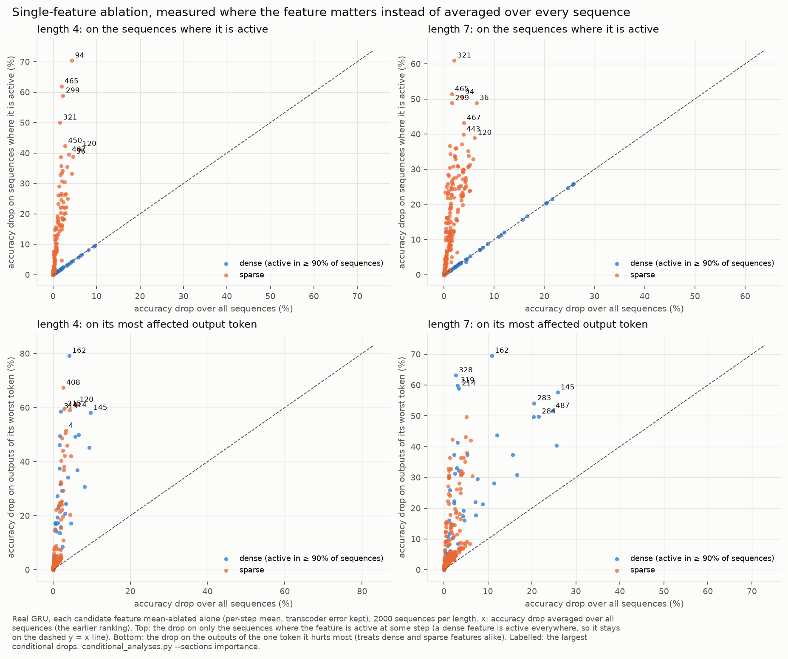

**2. Pop features, every token.** The clamp test (above) on all 210 features labelled "copy-phase input X".

- **For most tokens, one feature carries the pop**, often with a second one for the first copy steps: switch it off
  and X is output again, up to 58–70% for u (316), n (28) and g (89); switch it on before X's turn and X's logit drops
  by 20–42. Second features: 462 (u), 506 (n), 479 (g), 510 (z), 364 (2), 150 (k), mostly labelled "1st or 2nd copy
  step".
- **For about 8 tokens (b, f, 1, v, h, j, x, i) no single feature does it** (≤ 9% repeats), so their pop is spread out.
- **The other ~5–10 features per token with the same label do nothing** (56 of 210 have a measurable effect). They
  fire exactly like the active one but write almost nothing: decoder norm × mean activation is 0.03–0.56 (median 0.13)
  for the 154 inert ones and 0.76–2.89 (median 1.8) for the 56 that act, with no overlap. E.g. 304, 112, 261 and 276 are all "fed-back k, recall_idx ≥ 2";
  only 304 acts. Labels cannot tell them apart; only an effect test can.

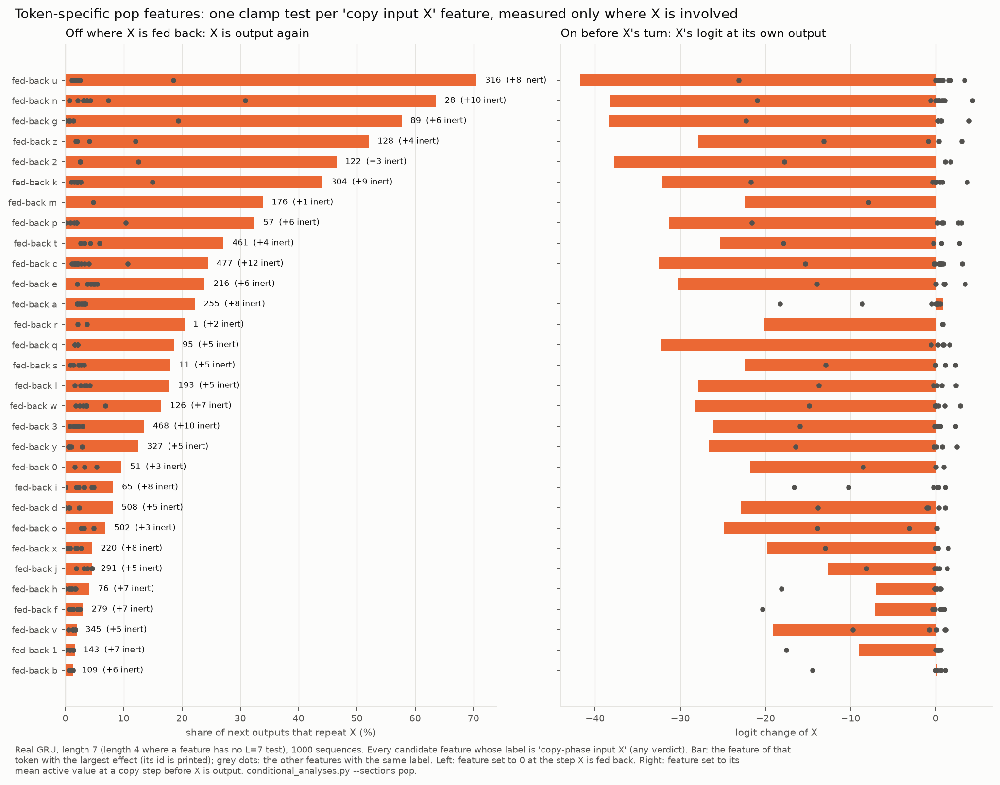

**3. Carrier flows and write angles.** The exact contrastive flow of each slot's token (300 sequences × 4 slots, L = 4),
averaged per feature over all (sequence, slot) pairs, as the circuit diagrams and supernodes did, and over only the
pairs the feature takes part in (|flow| > 0.1).

- **Sparse token features carry 3–7× more than any dense feature when they take part** (94 and 299: 21–22 per pair;
  120, 465, 443, 414, 408: 11–13; the top dense feature 8: 3.4). Averaged over all pairs none of them made the top 20.
- **They act at the write step only, writing at 0°** (the token's code as written). The rotation, relay and read-out
  stay dense, as in §5.
- So the write → relay → read-out picture holds, but the write is mostly sparse token features, which the averaged
  diagrams understated.

**How much of the output's dependence on the token passes through each step's features.** *Why:* the shares above
are of the flow *among features*, which says who is busy but not how much of the effect on the output a group
carries. *What "flow" means here:* compare the original run with one where the slot's token is swapped (feedback
matched). At the token's output step, the logit of the correct token differs between the two runs by about 26
logits: that difference is the target change, the 100% below. A feature's flow at a step is the part of it that
passes through that feature at that step, by any route to the output; features whose change never reaches this logit
get zero. Each step is a separate cut: the same flow passes through features at several steps (a sparse write
feature, then a keeper, then a flipper), so the rows do not add up. Mean over 100 sequences × 4 slots, L = 4
(dense = active in ≥ 90% of sequences):

| steps since the write | passes through that step's features | of which sparse | of which dense | not through them (carried past in h) | sum of \|flow\| (activity, incl. cancelling pushes) |
|---|---|---|---|---|---|
| 0 (write) | 82% | 47% | 36% | — | 138% |
| 1 | 57% | 4% | 54% | about 43% | 71% |
| 2 | 51% | 4% | 47% | about 49% | 66% |
| 3 | 57% | 5% | 52% | about 43% | 72% |
| 4 (output step) | 85% | 7% | 78% | — | 102% |

At the output step, 85% is written straight into the logit by that step's features. The rest of the 100% enters
through the gates and the transcoder's error and bias writes (§2).

- **At the write step** the sparse "input X" features carry the largest share (47% of the change, against 36% for
  dense token-set features); by absolute flow, 62% of the activity there.
- **After the write the sparse features drop out** (4–7%): they read the current input, which one step later is a
  different token. From then on the token exists only in h, and the features that read h are the dense memory
  features, so they carry it (47–54%). They do not carry *more* than the write features did; they carry the same
  token later, as the only ones still reading it.
- **At each relay step only about half the change passes through that step's features.** The other half is carried
  past them in h by the update gate's carry (the 30–60% that survives a step without being rewritten, §5) and reaches
  later steps or the output without passing through that step's features.
- **The absolute sums exceed the signed ones** (138% vs 82% at the write) because features push in opposite directions
  and partly cancel.

*Code:* `conditional_analyses.py --sections step_shares`; output `step_shares.json`.

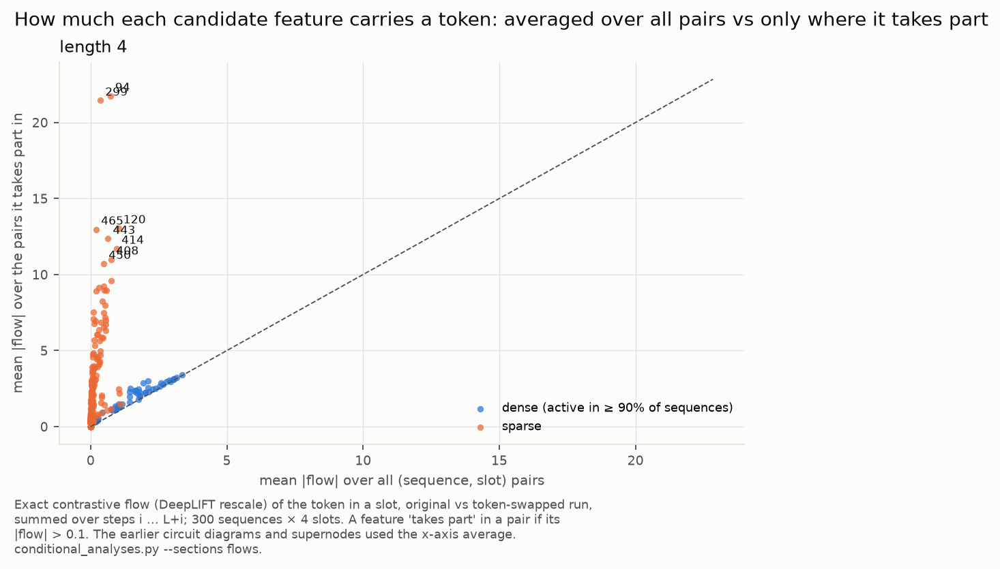
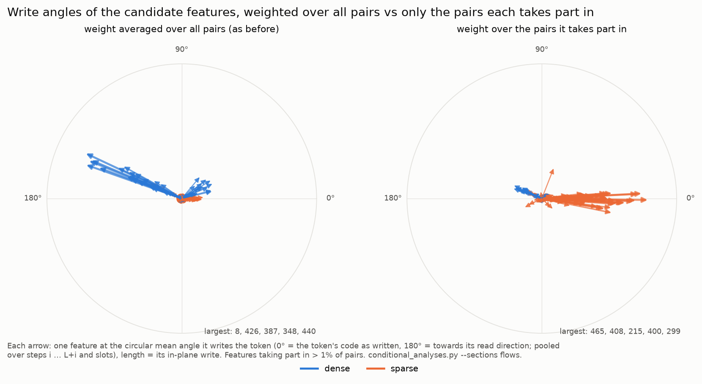

**4. Which features are inert, and why.** Mean ablation cannot remove a feature that has the same value in every
sequence at a step (§9), and features for late positions only exist in long sequences. So every candidate feature was
also zero-ablated and time-shifted (given its per-step mean from the step before or after), at L = 4, 7 and 9. Best
effect of the three ablations, on its own sequences or its worst output token:

| group | n | ≥ 20% | 5–20% | 1–5% | < 1% |
|---|---|---|---|---|---|
| copy-phase input X (pop candidates) | 208 | 40 | 15 | 3 | 150 |
| input X (write) | 178 | 95 | 29 | 19 | 35 |
| dense (active in ≥ 90% of sequences at some length) | 99 | 52 | 16 | 8 | 23 |
| other sparse | 23 | 3 | 3 | 3 | 14 |
| too sparse / never fire | 4 | 0 | 0 | 0 | 4 |
| **all** | **512** | **190** | **63** | **33** | **226** |

- **Zero / time-shift found the timing features mean ablation missed**: `<DEL>` 123 (85%), 397 "copy phase" (77%), 81,
  114, 138. Zeroing dense features also costs more than mean-ablating them (≥ 20%: 48 vs 26 at L = 4/7), because it
  removes their timing part as well as their token content.
- **L = 9 found 18 more**, all for late positions or long sequences (e.g. 55 "u at position ≥ 5": 27%; 267, 412: 21%).
- **Inert features write almost nothing.** Decoder norm × mean activation: inert features have medians of 0.15–0.23 in
  every group; used sparse features 1.1–2.0. Only 3 inert features write more than 0.76 (137 "`<DEL>` of L = 3–4", 277 and
  505, late positions), each specific to a length not tested. Dense features are the exception: the used ones also
  write little per step (median 0.47) but are active at every step.
- So about **226 of 512 candidate features (44%) do nothing measurable**, and most of them are low-norm near-duplicates of
  a used feature with the same label. That is a transcoder training issue, like the merged features in §4.

*Code:* `conditional_analyses.py` (`--sections importance ablations pop flows`); outputs
`conditional_{importance,ablations,pop,flows}.json`, L = 9 in `features/copy_circuits/L9/`; figures:
`autointerp_plots.py conditional`.

---

## 4. The dense carriers

**Most carriers are dense.** In the `g` example, 18 of 20 carriers are active in 97–100% of sequences; only 120
("input g") and 411 are sparse (10–15% of sequences). By count the carriers are dense; by size the write step is not:
when a sparse token feature takes part it carries 3–7× more than any dense one, and at the write step 47% of the
output logit's dependence on the token passes through sparse features, 36% through dense ones (§3, "Measuring a
feature where it matters"). Firing labels ("copy phase", F1 0.96) are right about *when* they
fire but say nothing about what they carry.

**Magnitude explanations.** For the 70 candidate features that fire on ≥ 20% of steps (65 of them active in ≥ 90% of
sequences), activation ≈ timing (mean per L, t) + additive token tables. Held-out R² beyond timing (median):

| explanation | R² beyond timing |
|---|---|
| last 2 inputs | 0.27 |
| last 8 inputs | 0.57 |
| outputs: current … 3 ahead (the queue in memory) | 0.36 |
| all cues (full tables) | 0.79 |
| compact token sets (one raising set, one lowering set, a weight per cue) | 0.53 |
| **agent-written explanations** (≤ 8 terms, skeptic-checked) | **0.65** — 45 explained, 24 partly, 1 not |

The dense gate features are purely positional (timing alone R² ≈ 1.0). *Code:* `magnitude_scores.py`,
`autointerp_magnitude.py`; records in `features/copy_gru_v1_candiff_magnitude/`.

**"Explained" here does not mean "said in words".** The agent explanations fit a weight per term and use token tables
copied from fitted tables. Anthropic's standard is a verbal description that lets a reader (or Claude) predict the
activations from the words alone (simulation scoring by rank correlation, *Towards Monosemanticity*), checked by
specificity and by steering (*Scaling Monosemanticity*). To test ours against it, feature 145 (the most important
dense feature alone) was given a rule written in words, scored with only the numbers the words state (nothing fitted),
by rank correlation with activation minus timing on test sequences (`verbal_rules.py`):

| explanation of 145 | Spearman | R² beyond timing (one fitted scale) |
|---|---|---|
| as first stated: "builds up while c/3/t/2 arrive early, decays over ~3 steps; in the copy phase dips while they are output" | 0.38 | 0.19 |
| + "b/m/s/0 push it down at half strength" | 0.50 | 0.34 |
| + "in the copy phase, +½ per c/3/t/2 still waiting in the next 3 outputs" | 0.54 | 0.39 |
| both, plus the same for b/m/s/0 in the queue, and a ½ dip | **0.59** | **0.44** |
| fitted agent explanation (6 terms, 13-token table) | 0.75 | 0.68 |

The input-phase half was right as first stated (Spearman 0.59 there; fitted 0.81); the copy-phase half was not (0.15):
the feature is *raised* by its tokens still waiting in the queue, and the dip is minor. A one-sentence rule ("a running
tally of recent early inputs: c/3/t/2 up, b/m/s/0 down by half, fading over ~3 steps; in the copy phase the same tally
over the tokens still waiting") keeps about 80% of the fitted rank correlation. What it loses is detail: a graded token
scale (c ≈ 3× v), a boost early in the sequence, extra when several arrive together.

The other 15 dense features that matter most alone were judged by reading their explanations and tables, not scored:
about 12 follow the same template ("signed token tally over recent inputs; copy phase: the same over the queue"), 162
"o", 488 "p/q" and 140 "s/y" being near-concepts; 91, 274 and 440 need one or two extra clauses; 54 (rectified, lasting
suppression) is too nonlinear for a sentence to keep much. Long token lists (8 up, 8 down) are near the limit of what
counts as words. The token sets themselves have no meaning ({c,3,t,2} is not a concept); the structure (which history
positions, which phase, signed, queue reads) is what a sentence carries.

**They are needed.** Kind 3: candidate transcoder spliced into the GRU, features mean-ablated, lengths 3–9:

| removed | accuracy |
|---|---|
| nothing | 98.9% |
| the "5" dense features from the earlier report (162, 214, 284, 388, 487) | 57.7% |
| **the 15 other dense circuit carriers** (8, 32, 54, 77, 79, 91, 212, 231, 266, 274, 349, 368, 387, 440, 500) | **15.6%** |
| 15 random other dense features | 26–34% |
| 15 random sparse features | 86–88% |
| one carrier alone | 77% (91) to 96% (368) |

The earlier "5" were not the only important dense features; they were the ones whose *firing* could not be predicted.

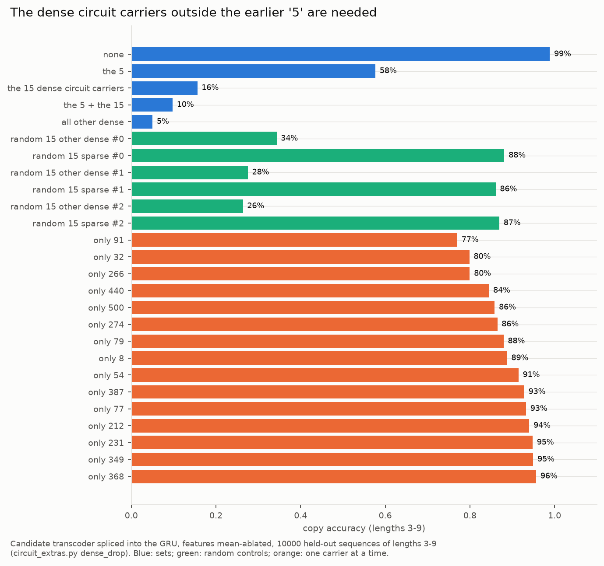

**Each carrier serves its own tokens** (kind 3). Removing one hurts mostly outputs of the tokens in its raising set:

| feature | its raising set | outputs in that set | other outputs |
|---|---|---|---|
| 77 | d, c, f, 0 | 69% | 95% |
| 387 | u, d, w, 2 | 71% | 95% |
| 368 | y, s, 1 | 81% | 96% |
| 212 | 0, g, r, i | 83% | 94% |
| 231 | j, 1, p, m | 83% | 95% |
| 349 | g, i, r, o | 91% | 94% |

**Merged variables (a transcoder issue).** These features fire for every token (the timing / phase part) and run 2–7×
higher for their own token set (the part the model uses). The transcoder merged a phase feature and a token-set
feature into one. The same happens at slots 0–1: no feature carries "a token arrived" there; it is spread over the
token features (37–49% of the shared write; `slot_absorption.py`). At slots 2–3 and `<DEL>`, dedicated positional
features carry it (43–95%). The fix is better transcoder training, not relabelling.

*Code:* `circuit_extras.py` (`dense_drop`, `token_cond`), `slot_absorption.py`.

---

## 5. How a token is stored: rewrite, rotation, keepers and flippers

**Leaky rewrite.** The token's trace in h (original minus swapped run) splits exactly into kept, written and gate
parts. Only 30–60% survives each input step; the candidate rewrites the rest. 96–99% of the candidate's change comes
from reading the stored trace through the reset gate. Gate changes add 0–5%. (`gate_mechanism.py`)

**The code turns about 180°.** Cosine with the written code falls to −0.70 … −0.85 at the output step. Visibility to the
output layer goes from −30 … −46 when written to +50 … +55 at the output step, then drops after the pop.

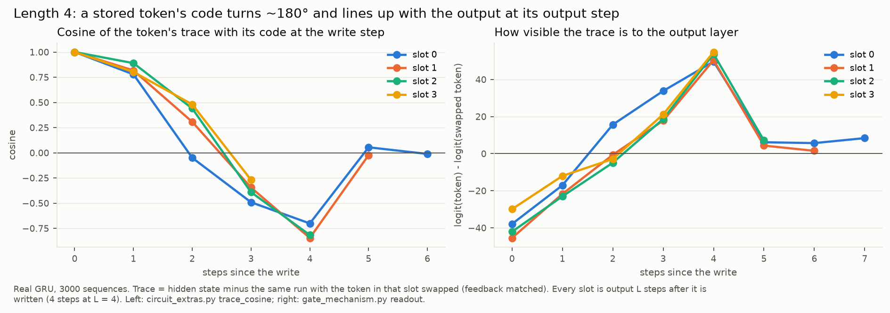

**The candidate writes a turned copy each step.** Projecting each step's pieces on the stored code (e1) and the
direction towards the read-out (e2): the carried part stays on e1; the written part has e1 > 0 and a large e2 (turned
35–85°). Nothing actively undoes the old code; it fades through the update gate. Half of the turning needs 117–239
feature→feature edges, so the turn is spread over the whole dense population. (`rotation_edges.py`)

**Two groups of features.** Each carrier writes the token at a characteristic angle (0° = as written, 180° = read-out):

- **keepers** (487, 283, 145, 274, 488, 474): write at +13° … +36° at every step;
- **flippers** (426, 8, 348, 387, 440, 328, 212, 214, 368, 388, 336, 315, 500, …, and the copy-phase read-out 77, 34,
  163, 177): write at +150° … +163°.

Most flippers already respond at the write step (about −20°) and reverse 2 steps later. The trace turns smoothly
because it is a blend that shifts from keepers to flippers.

**Which dense features are keepers and which are flippers.** A feature is a keeper if its mean write angle is within
90° of the written code, a flipper otherwise (`rotation_phases_L4.json`). The 5 dense features no firing predicate
explains (`interpretability_findings.md` §4) are both:

| feature | group | write angle |
|---|---|---|
| 162 | keeper | 22° |
| 284 | keeper | 51° |
| 487 | keeper | 31° |
| 214 | flipper | 157° |
| 388 | flipper | 153° |

All dense candidate features at L = 4 (active in ≥ 90% of sequences), by whether they matter (best of mean, zero and
time-shift ablation on their own sequences or worst output token, L = 4 / 7; §3). "Other" = writes too little in the
token's 2-D frame to have an angle:

| dense features | n | keepers | flippers | other |
|---|---|---|---|---|
| all | 68 | 19 | 29 | 20 |
| that matter (≥ 20%) | 44 | 19 | 24 | 1 (`<DEL>` 123: timing, not a token) |
| inert (< 1%) | 17 | 0 | 2 | 15 |

Every dense keeper matters, and most dense flippers do; the dense features outside both groups barely write the token
and are almost all inert. Read-out is done by flippers (the 12 features with the most flow at the output step are all
flippers); holding the token is done by both. Note: the keeper list in the file (65 features) also contains the sparse
"input X" write features, which write at about 0°; among dense features there are 19 keepers.

**Keepers vs the features that write the token.**

| | sparse "input X" write features (e.g. 120 "input g") | keepers (e.g. 145, 487, 283) |
|---|---|---|
| active in | only sequences containing their token (≈ 5–15%) | almost every sequence (dense) |
| active when | only at the step the token arrives | at the arrival step and the following steps |
| respond to | the current input token | a running tally of recent inputs (145: current and previous input about equally, fading over ~3 steps): the input at first, then what is stored in h |
| carry the token | on / off ("the input is g") | by magnitude: a signed scale over many tokens |
| share of the output's dependence on the token (§3) | 47% at the write step, 4–7% after | part of the dense share: 36% at the write step, about half the change at each relay step |
| write angle | about 0° | about +13° … +39°, fading by the output step |

A write feature puts the token in once; a keeper holds it for the next few steps. Keepers are needed because:
- **memory leaks:** only 30–60% of a token's trace survives a step (above), so something must rewrite it every step;
- **the write features cannot:** they read the current input, which one step later is another token; rewriting has
  to come from features that read h, and for the first steps (before the flip) those are the keepers;
- **the flippers build on them:** the flip is the flippers reading the keepers' copy with the opposite sign; removing
  10 keepers one step after the write weakens it (below, test A);
- **they matter for behaviour:** 145, 487, 283 and 488 each cost 20–26% at L = 7 when removed alone, and every dense
  keeper is in the "matters" group.

Caveat: that keepers read h rather than the input after the write rests on their magnitude labels and the flow shares;
a keeper's activation has not been split into input-driven and memory-driven parts.

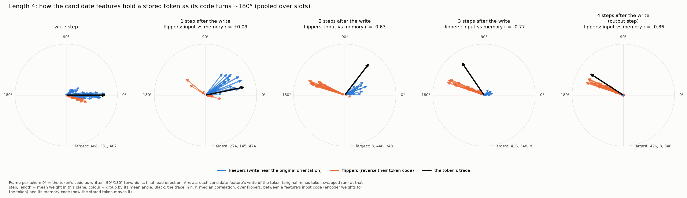

**When the flip happens.** Write angle (and in-plane weight) by steps since the token was read in, L = 4
(`rotation_phases_L4.json`):

| features | 0 (just read) | 1 | 2 | 3 | 4 (output step) |
|---|---|---|---|---|---|
| memory flippers (8, 348, 387, 426, 328, 212, 388) | −13 … −23° (0.01–0.03) | −18 … +8° (≈ 0.01) | **151 … 163°** (0.02–0.04) | 153 … 161° (0.04–0.08) | 152 … 161° (0.07–0.15) |
| 440 | −14° | **147°** (one step earlier) | 161° | 161° | 162° |
| copy-phase flippers (34, 77, 177, 163) | off | off | off | 151 … 156° | 154 … 159° |
| keepers (487, 283, 145) | 30 … 39° | 29 … 39° | 22 … 35° | 11 … 28° | −7 … +49°, fading |

So a flipper active at a given step writes *every* stored token at once, each at its own stage: the token read in
now and the one before it weakly and unflipped, all older ones flipped, more strongly as their output step nears.

**Why the flip comes 2 steps after the write, not 1.** Note first that flippers do *not* write the token flipped at
the write step: there they respond to the input, and write at about −20°, close to the token as written. "Flipper"
describes what they write from 2 steps on. A flipper's response to a stored token is the sum of what it reads from
h. The numbers are contributions to the sign test (below, "Flippers store the token as the opposite…"; + = responds to
the stored token the way it responds to it as an input, not flipped; − = the opposite way, flipped):

| what the flipper reads from h | 1 step after the write | 2 steps after |
|---|---|---|
| the keepers' copy (written at about +30°, read with the opposite sign) | −0.40 | −0.49 |
| the flippers' own write from the write step (input-driven, at about −20°, read back with the same sign) | +0.47 | −0.02 |
| net (sign test) | +0.09: not flipped yet | −0.63: flipped |

1. At the write step the flippers respond to the input through their input weights and write the token in its
   input orientation, next to the keepers' write.
2. One step later they read both back. The keepers' copy is read negatively (the flip); their own earlier write is
   read positively, as a feature reading back what it just wrote responds the way it did when writing it. The two
   roughly cancel, so the code is not flipped yet.
3. Two steps later their own input-driven write has faded (+0.47 → −0.02), the negative read of the keepers
   dominates, and the code is flipped.

A GRU reads its memory once per step, so a flipper can read what the keepers wrote at step s only from step s + 1: the
flip cannot appear at the write step, and without the masking it would appear one step later. Test B below confirms
the masking: removing the flippers at the write step (so their input-driven write never happens) makes them reverse
one step early. Not known: *why* the model works this way (e.g. whether something needs the token in its input
orientation for a step), and whether the lag stays at 2 steps at other lengths (measured at L = 4 only).

**"Flipper" names the direction a feature writes in, not the flipping.** The flip happens once, in the memory flippers,
2 steps after the read. After that the code still has to be rewritten every step (only 30–60% survives a step, above),
and anything rewriting a flipped token writes it flipped. So every feature holding tokens late shows up as a flipper.

**Two kinds of flippers.** Both are dense across sequences (active in 99–100% of them); they differ in when they are on
and what they track (magnitude labels, §4):

| kind | features | on at (share of sequences, per step) | tracks |
|---|---|---|---|
| memory flippers | 8, 348, 387, 426, 440, 328 (212, 388 on about half the steps) | from the 2nd input to the end (0.65–1.00 per step) | a signed token scale over what is held, weighted by slot (e.g. 426: orig 0 > 1 > …); the queue head in the copy phase |
| copy-phase flippers | 34, 77, 177, 163 | output steps only (0.80–1.00), off at `<DEL>` | a signed token scale over the token being output (weight ≈ 1), the next one (≈ 0.5), the one after (small) |

The copy-phase flippers switch on when every stored token is already ≥ 2 steps old, so they never flip anything. They
rewrite the head of the queue, which moves on after each pop. They are the main read-out features at the output step
(§3) and carry the most pop flow averaged over tokens (about a third of the cancellation, §6). Ablating one (kind 2):
mean ablation (token content removed, average level kept) costs 0–26% on its worst output token; zero ablation costs
67–85%; neither causes repeats. So their token content is shared with the others, their copy-phase level matters (why
is untested), and they do not do the matching.

The keepers are not read-out features, but several are among the most important features overall (145, 487, 283, 488:
20–26% each at L = 7): they hold the token until the memory flippers flip it.

**One token, start to end:** a sparse "input X" feature writes it at 0° (§3) → keepers hold it near that orientation
→ memory flippers flip it after 2 steps and keep rewriting it → in the copy phase the copy-phase flippers rewrite the
queue head and read it out → X's pop feature erases it once it is fed back (§6).

**Flippers store the token as the opposite of how they read it as input.** Correlation between a flipper's input code
(encoder weights for the token) and its memory code (how the stored token moves it), by steps since the write:

| | +1 | +2 | +3 | +4 (output) |
|---|---|---|---|---|
| flippers (median) | +0.09 | −0.63 | −0.77 | −0.86 (100% negative) |
| keepers (median) | +0.03 | +0.03 | +0.02 | −0.14 |

**What causes the reversal.** The flippers' correlation splits exactly by what in h they read: keepers' write −0.40 /
−0.49 (at +1 / +2), flippers' own input-driven write +0.47 / −0.02, gates ≈ 0. So flippers read the keepers with the
opposite sign; at the write step their own input-driven write hides this; one step later the input has moved on and
the reversal shows. Causal tests (kind 2; `rotation_edges.py --reversal_tests`):

| intervention | effect on the flippers' correlation | outputs |
|---|---|---|
| B: remove the flippers at the write step (no input drive) | reverses one step early: +1 goes +0.27 → −0.06, +0.41 → 0.00, +0.02 → −0.46 | unchanged |
| A: remove 10 keepers at +1 | reversal weaker at +2: −0.84 → −0.62, −0.83 → −0.55, −0.72 → −0.36 (slot 3: −0.13 → +0.18) | 90–99% |
| random controls | no change | unchanged |

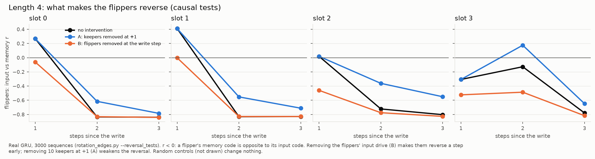

**The carry keeps a second copy** (kinds 1 and 2). Steering at a single later relay step often fails (33–78%). Dropping the carried
copy at that step (z = 1) lets steering work (63–93%), and the candidate's rewrite alone keeps that output at 78–100%.

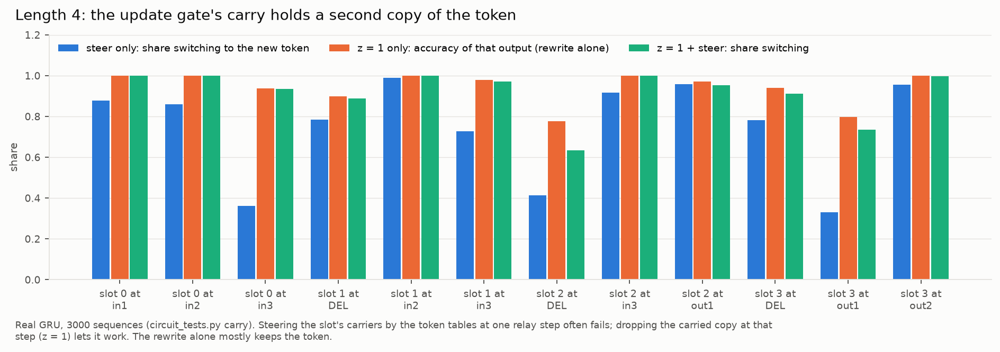

**The token is stored per slot.** h before `<DEL>` is predicted with R² 0.99 from slot-specific token one-hots, against
0.39 from a bag of tokens. (`slot_absorption.py`)

---

## 6. The pop: cancellation in the candidate

At a pop step the update gate (≈ 0.70) replaces most of memory either way; the head survives only if the candidate
writes it again.

| pop step | kept from memory | candidate write, memory only | write, matched token fed back | write, other token fed back |
|---|---|---|---|---|
| out1 | +2.4 | +29.5 | −0.5 | +30.5 |
| out2 | +1.7 | +30.5 | −1.0 | +32.8 |
| out3 | +2.2 | +31.2 | +0.2 | +33.2 |

The matched-vs-mismatched difference (−32.5) is −32.4 from what the candidate writes (−28.8 through the input
weights, −3.7 through the reset gate) and −0.1 from the update gate. The fed-back token's input term and the stored
token's memory term are added inside the candidate's tanh and cancel. This is the flippers' reversed code at work.

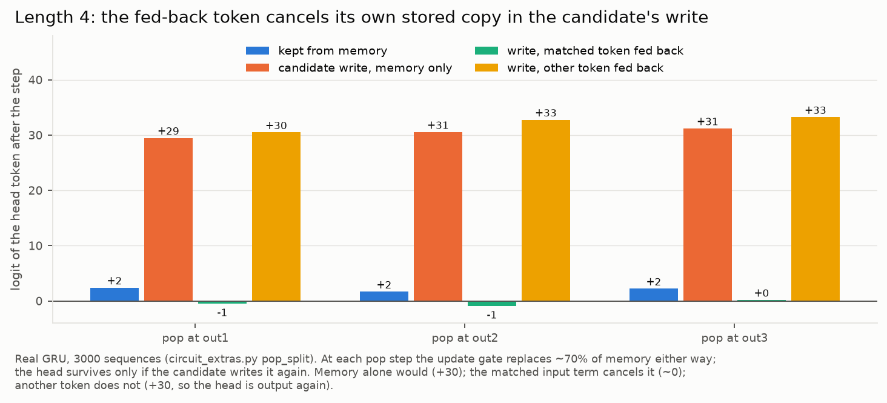

**Cancellation follows the token, not the slot.** Feeding back the token due now or next turns *its* write negative
(−14, −26) while the head stays and is output again.

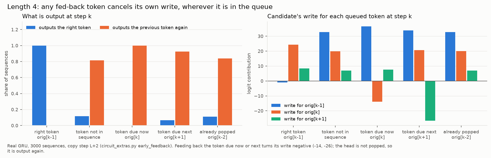

**No token-general pop features, but token-specific ones** (kind 2). The features with the largest pop flow averaged
over all tokens (177, 77, 163, 34, 347, …) are the read-out features. Removing 10 of them breaks outputs (31–48% with
resampling) but causes no repeats (≤ 2%). They make up about a third of the cancellation; the rest is spread out. The
per-feature clamp tests (§3) found what that ranking misses: for most tokens a single "fed-back X" feature carries the
pop (316 "fed-back u" off → u is output again 62–71% of the time; on before u's turn → u is erased). The per-token map
of all 210 such features is in §3 ("Measuring a feature where it matters").

**What a pop feature does.** It is how the transcoder represents the input-weight part of the cancellation for one token:
it fires when X is fed back (its encoder reads the input), and its decoder writes a direction that lowers X (direct
effect on X's logit −20 … −26 per step for 304, 316 and 28). It is X's eraser: without it X stays and is output again;
switched on early it erases X before its turn.

The match may need nothing more. An eraser removes only its own token's code; if the fed-back token Y is not the stored
head, Y's eraser has nothing to cancel there, the head stays and is output again (the 82–93% repeats of §1, and early
feedback cancelling its own token above). This is inferred, not tested: whether a pop feature fires less when its token
is not stored is untested (§10).

*Kind 1 for the pop split, match test and early feedback; kind 2 for the pop-feature ablations. Code:* `circuit_extras.py` (`pop_split`, `early_feedback`), `circuit_tests.py` (`match`, `pop`).

---

## 7. `<DEL>`

Candidate feature **123** ("`<DEL>` delimiter step") fires at `<DEL>` with nearly the same value in every sequence.

- Zeroing it at `<DEL>` (kind 2): output 0 still 100%, outputs 1–3 58% / 0% / 0%. Together with reset 31 zeroed: 14% / 0% / 0%.
- It drives the copy-phase gate features (§8): update 177 (+13.1 of its preactivation), reset 434, 322, 477, update 901,
  through its write decaying in memory ("time since `<DEL>`").
- Mean ablation shows nothing (its mean at `<DEL>` is its value), so the right removal is zero.

---

## 8. Update-gate vs reset-gate features

The two gates enter the GRU step differently: **update** `h = (1 - z) h + z n` (how much memory changes), **reset**
`n = tanh(W_in x + W_hn (r ⊙ h) + b)` (what the candidate reads).

| | update-gate features | reset-gate features |
|---|---|---|
| what they control | how much of memory survives and how much of the new write gets in (one knob for both) | what the candidate sees of memory, i.e. the *content* of the rewrite |
| main features | 650 (steps 1–3), 580 (first step), 717 (t ≥ 3 → `<DEL>`, off in copy), 297 (`<DEL>`), 177 (first copy step), 901 (end of copy) | 31 (`<DEL>`), 434 (copy phase), 312 (input position ≥ 3), 76 (early), 147 (position 2), 322 / 477 (later copy steps) |
| share of their gate's action | 10–35% of erasing; the bias does 57–90%, including the pop's erase | the bias carries 60–110% of the reading; features add phase-specific opening (76 +0.22 at the flippers' reversal step; 434 +0.21–0.27 at the pop; 31 at `<DEL>`) |
| what drives them | built from candidate features: 717 and 312 from the relay features' positional part (336, 440, 315, 500, 91); 177, 901 from `<DEL>` 123; 650 from any token feature one step back | 434, 322, 477 from `<DEL>` 123 decaying in memory; 312 from the relay features; 31 from the `<DEL>` input |
| mistimed (L = 4; kind 2) | timing errors: 717 on in the copy phase → outputs 2–3 at 0%; 650 off early → 69–76% | corrupted contents: 434 on during input → output 3 at 17%, no repeats |
| removed | (all-steps mean of top features breaks late outputs) | L = 4: little (all 8 off → 83%); L = 7: 31 alone → 60%, 312 → 71%, 434 → 72%, all 8 → 26% |
| token content / matching | none (≤ 2 logits) | none (≤ 6%; −3.7 of −32 at the pop) |

So: **update features clock how fast memory turns over** (get them wrong → delays, repeats, leaks); **reset features
clock what the rewrite is computed from** (get them wrong → corrupted contents), and are needed mainly under heavier
memory load.

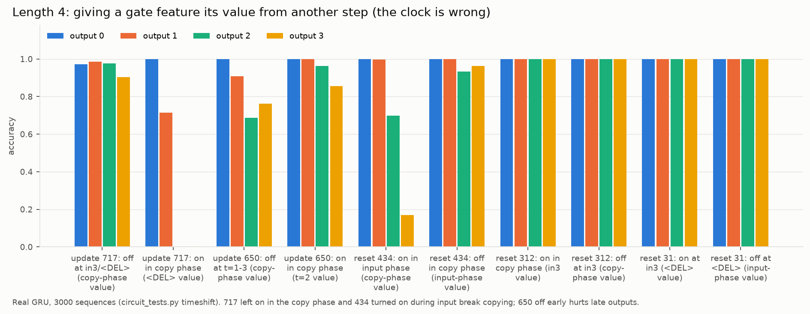
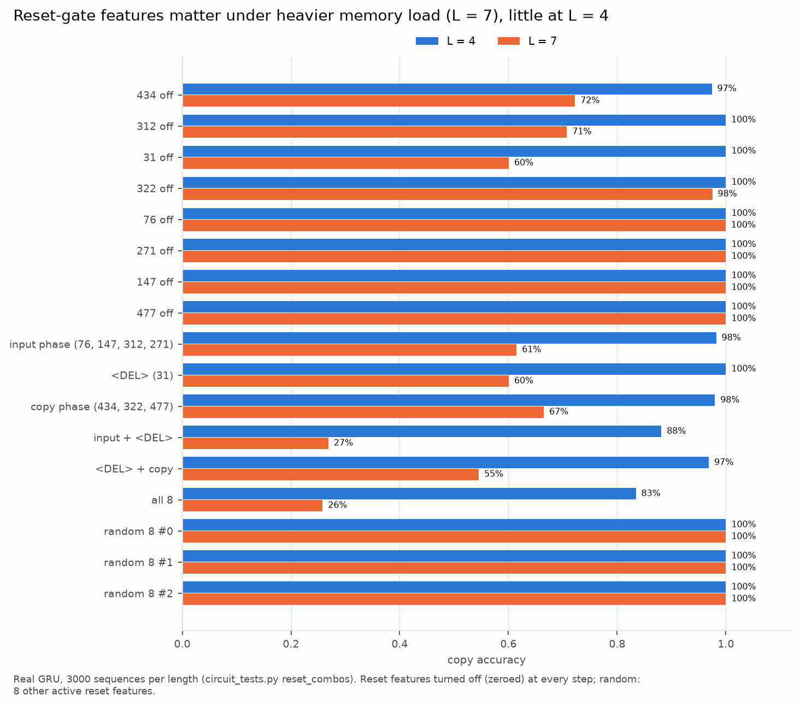

*Drivers / reads / writes are exact decompositions; time-shifts and removals are kind 2. Code:* `gate_features.py` (drivers, reads, writes), `circuit_tests.py` (`timeshift`, `reset_combos`),
`gate_mechanism.py` (kept / erased shares).

**Features vs GRU units for the gates.** 1–2 gate features cover 80% of each gate term (beyond the bias), against
49–56 units. Removing the top features does targeted damage where removing the same number of units does nothing;
at an equal size of push the damage is similar, and against random directions of equal size the feature directions are
more damaging in 2 of 4 gate × length cases. (`gate_mechanism.py`)

---

## 9. Mistakes and pitfalls we hit

- **Partner credit** in single graphs (off-diagonal +57 from token 0): fixed with contrast, then the DeepLIFT-rescale
  flow (§2).
- **Reset-gate edits were silently ignored** in an early version of `circuit_tests.run` (the candidate was computed
  before the hook changed r). Fixed; all reset results here are from the fixed version.
- **Mean or same-step resample ablation cannot remove a timing feature** (it already has that value at that step). Use
  zero or a time-shift instead.
- **"Dense"** means active across many sequences; firing on many steps within a sequence is expected.
- **Averaging a feature's effect over all sequences hides token-specific features** (pop and write features looked
  unimportant; §3, "Measuring a feature where it matters"). Measure on the sequences or output tokens it takes part in.
- **A correct label does not mean a feature is used**: many features share a label with a used one but write almost
  nothing. Test effects, and test at the lengths a feature's label refers to.

## 10. Open questions

- How exactly each read-out / flipper feature combines the stored and the fed-back token (opposite signs per feature
  is the hypothesis; shown in aggregate, not per feature).
- Whether the pop permanently erases a token fed back early (teacher forcing stalls the queue, so this was not testable).
- Update-gate time-shifts at L = 7 (reset features mattered much more there).
- Lengths beyond 4 for the full feature circuit; L = 3 was checked for graphs and swaps only.
- A better-trained candidate transcoder that separates timing from token sets, and does not learn low-norm duplicates
  (44% of candidate features do nothing measurable, §3).
- Whether a pop feature fires less when its token is not the stored head (if not, the match comes from cancellation
  alone).
- Why most tokens have two pop features, one for the first copy steps and one for later ones (a token is always
  popped the same number of steps after its write, so it is not the code's age).
- Why zeroing a copy-phase flipper costs far more than mean-ablating it (a baseline the read-out needs, or an effect
  through the gates?).
- Whether the flip stays at 2 steps after the read at longer lengths (measured at L = 4 only).
