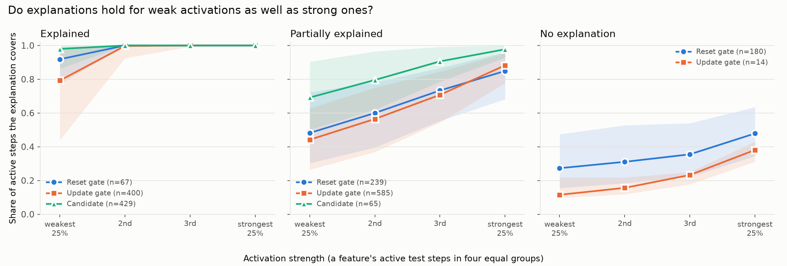
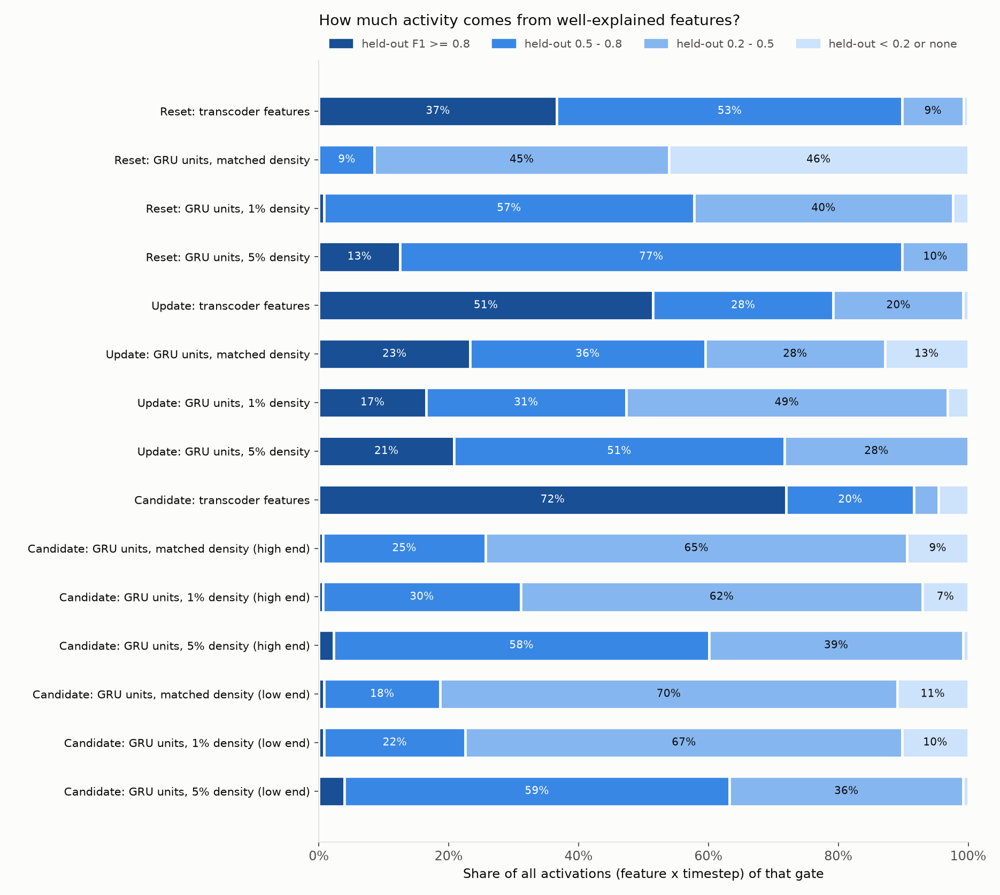
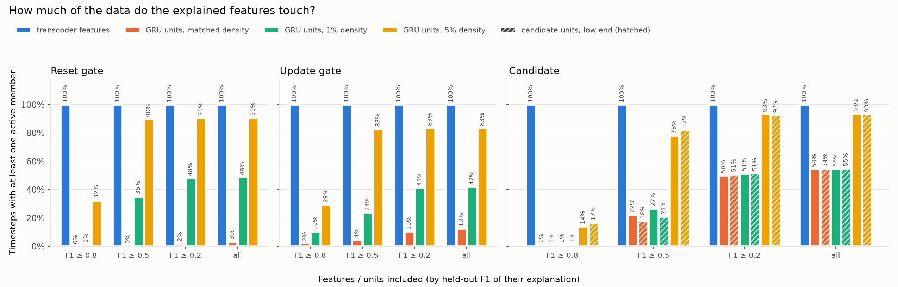
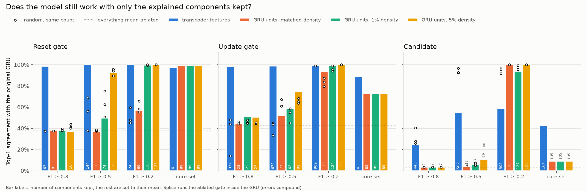
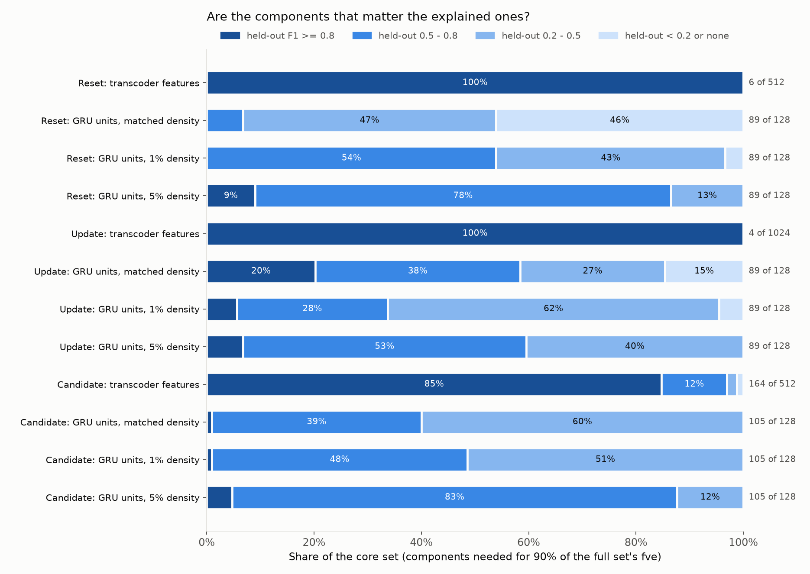
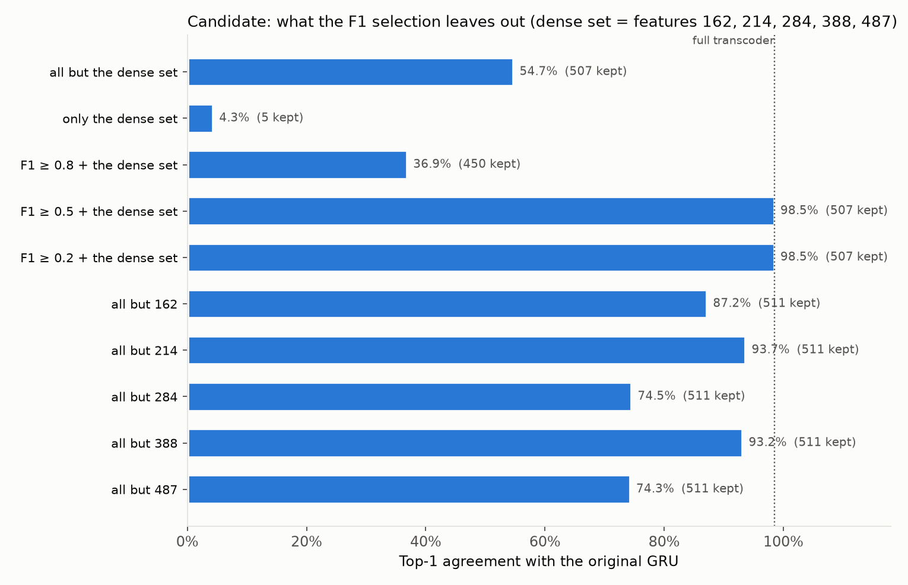
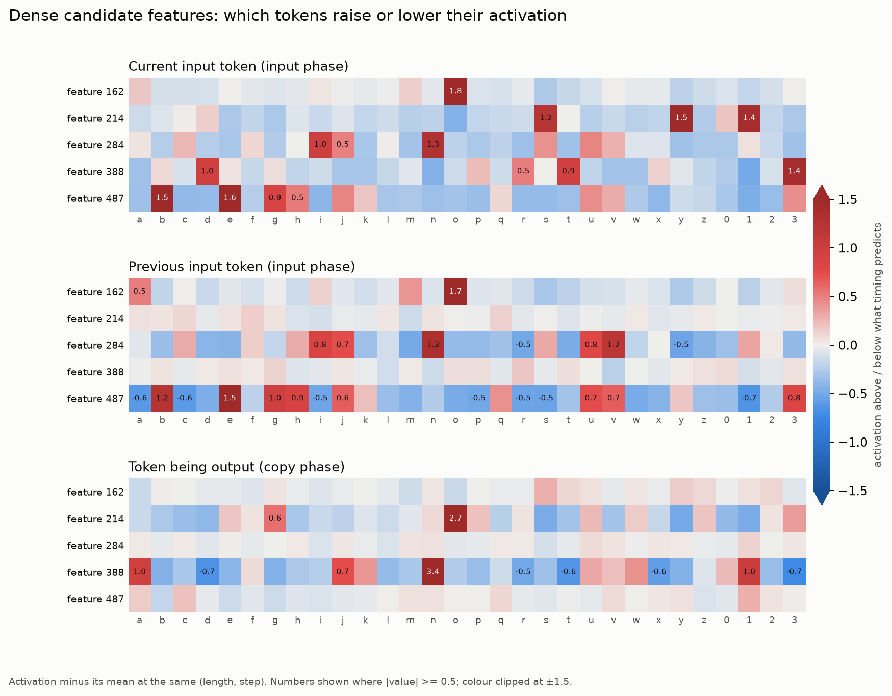
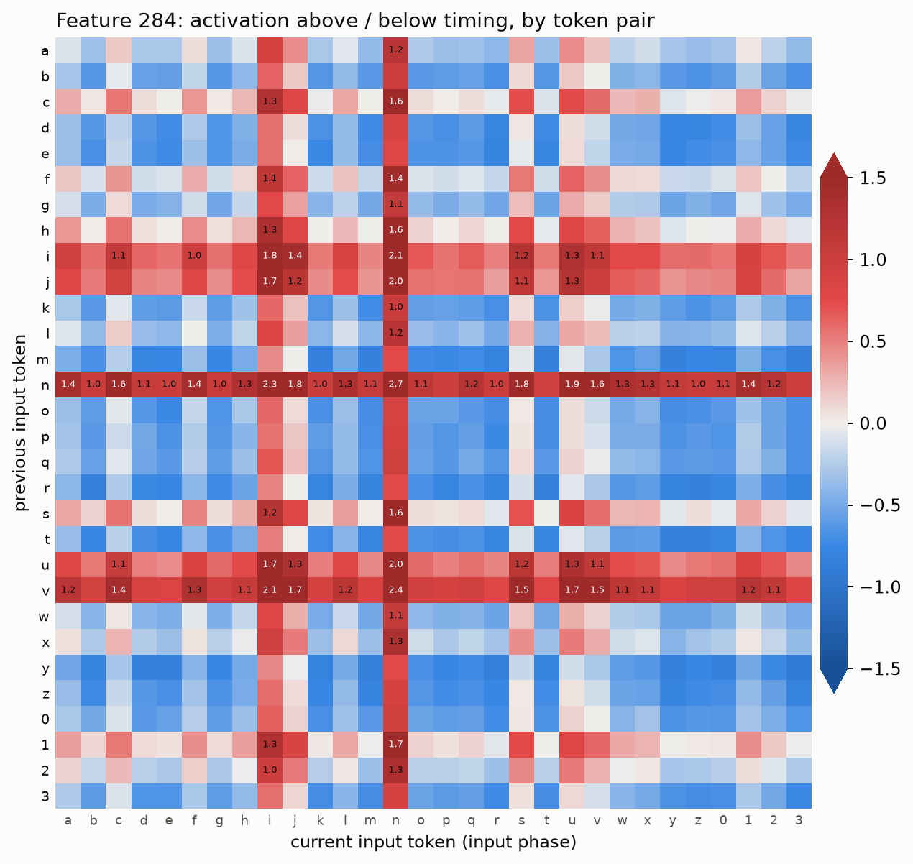
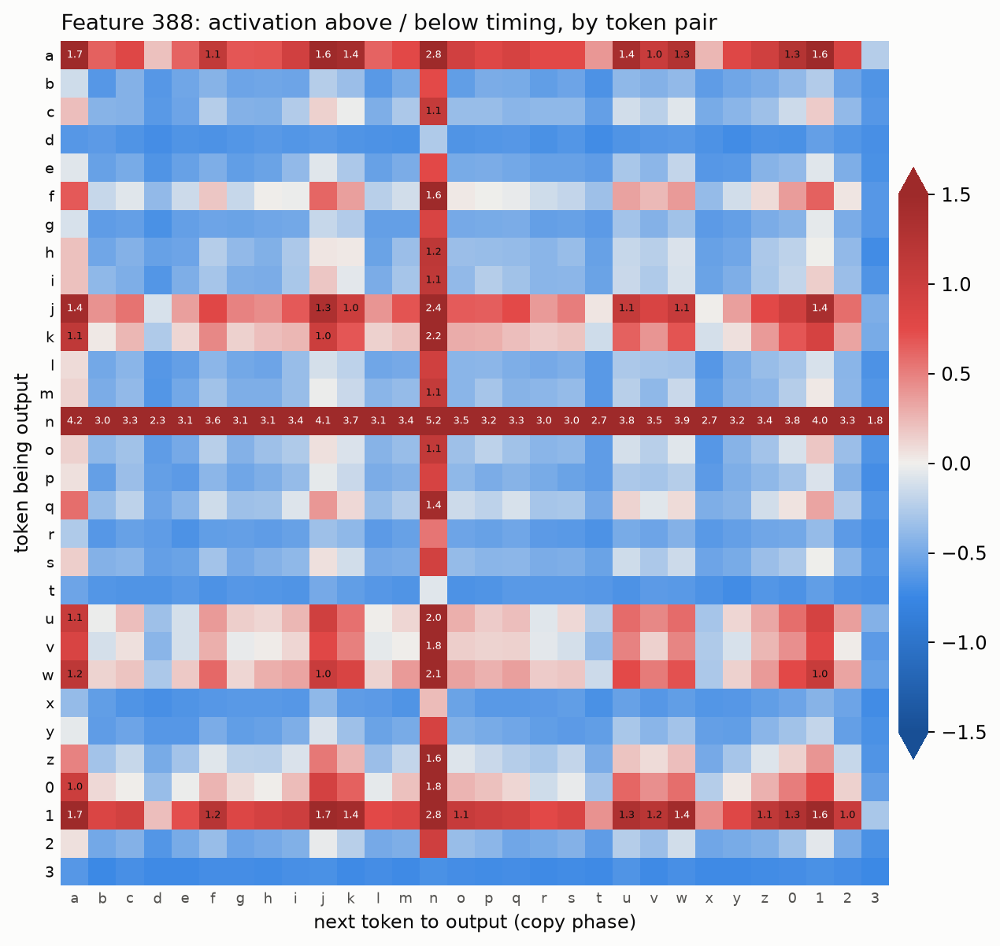

# Do transcoders make the copy-task GRU more interpretable?

Model: `copy_128_high` (GRU, hidden size 128) on the copy task, sequence lengths
3-9. Transcoders replace one gate each: reset (512 features), update (1024) and
candidate (512), JumpReLU. Baseline: the GRU's own gate units, thresholded so
each unit "fires" on a fixed share of steps.

Code: `circuit/copy_task/autointerp.py` and `circuit/copy_task/autointerp_workflows/` (interpretation),
`circuit/copy_task/scorecards.py`, `circuit/copy_task/neuron_baseline.py`, `circuit/copy_task/explained_fidelity.py`
(ablations), `circuit/copy_task/feature_probe.py` (dense-feature probe),
`circuit/copy_task/autointerp_plots.py` (figures). Raw outputs live in `features/` (index: `features/README.md`); figures:
`docs/figures/README.md`.

## Summary

- At equal firing rate, transcoder features are far more often precisely
  explained than GRU units (e.g. candidate at ~1%: 97% vs 1% with F1 >= 0.8).
- Reset and update: keeping only the well-explained features reproduces the
  model (98-99% top-1 agreement); random subsets of the same size and the
  explained GRU units do not. The few features that carry most of each gate
  (6 reset, 4 update) are all well explained (timing / position features).
- Candidate: the explained features carry most of the gate, but 5 dense
  features (162, 214, 284, 388, 487) are essential under the recurrence and
  no firing predicate explains them. Their information is in the activation
  magnitude: each is a graded code over two token slots (the last two inputs,
  or the current and next output), e.g. 284 ~ "last two inputs in
  {n, i, j, u, v}", 388 ~ a signed "outputting n vs 3/d/t" axis.
- "Timesteps covered" by explained features is not a useful measure: a few
  dense features saturate it.

## 1. Interpretation protocol

One agent per feature (or unit) proposes an exact predicate over the sequence
(phase, position, tokens, token history), scores it on a dev split (even
sequence ids) and records it; the reported score is precision / recall / **F1
on the held-out split** (odd ids). A skeptic agent tries to refute every
"explained" verdict. Features firing in fewer than 20 sequences are recorded
as too sparse without an agent.

| | Transcoder features | GRU units, matched density | 1% density | 5% density |
|---|---|---|---|---|
| Data | 1M sequences | 200k subsample | 200k | 200k |
| Firing rate | learned | reset 0.03%, update 0.26%, candidate 0.98% | 1% | 5% |

## 2. Per-item explanation quality (held-out F1)

| Gate | Source | n | F1 >= 0.8 | 0.5-0.8 | 0.2-0.5 | < 0.2 / none | median F1 |
|---|---|---|---|---|---|---|---|
| Candidate | features | 512 | **87%** | 11% | 1% | 1% | 0.95 |
| | units matched / 1% / 5% | 256 | 1% / 1% / 3% | 21-59% | 38-68% | 1-10% | 0.42 / 0.42 / 0.54 |
| Reset | features | 512 | 13% | 15% | 19% | 53% | 0.18 |
| | units matched / 1% / 5% | 128 | 0% / 1% / 12% | 9-77% | 10-45% | 0-46% | 0.21 / 0.52 / 0.62 |
| Update | features | 1024 | 37% | 29% | 23% | 11% | 0.65 |
| | units matched / 1% / 5% | 128 | 22% / 18% / 21% | 30-51% | 28-48% | 0-12% | 0.56 / 0.49 / 0.57 |

Raw per-item rates are confounded by firing rate: 359 of 512 reset features
(and ~34% of update features) fire on < 0.1% of steps and score ~0, while
units at 5% fire on broad regions that are easy to describe loosely (the
skeptic overturned 35 of 59 "explained" verdicts at 5%, vs 5 of 18 at 1%).
**At equal firing rate** features are far more often precisely explained:

| Gate | Firing rate | Features F1 >= 0.8 / >= 0.5 | Units F1 >= 0.8 / >= 0.5 |
|---|---|---|---|
| Candidate | ~1% | **97% / 100%** (n=244) | 1% / 27% |
| Candidate | ~5% | **54% / 100%** (n=13) | 3% / 62% |
| Reset | ~1-3% | **100% / 100%** (n=38) | 1% / 58% |
| Reset | ~5% | **33% / 96%** (n=54) | 12% / 89% |
| Update | ~1% | **63% / 85%** (n=147) | 18% / 48% |
| Update | ~5% | 14% / 57% (n=44) | **21% / 72%** |

Fitted scorecards (sparse logistic models over one-hot cues) raise the median
F1 of the not-fully-explained features from 0.37 (agent predicate) to 0.56
(readable top-40 / two-slot form) and 0.71 (full scorecard).

## 3. Coverage is the wrong headline metric

"Share of activations" counts every (feature, timestep) firing once; "steps
covered" is the union, each timestep counted once. Transcoder features with
F1 >= 0.8 cover 100% of timesteps in every gate, but that is driven by a few
dense, simple features (e.g. reset 434 "every step after `<DEL>`", fires on
~40% of steps; several candidate features fire on ~90%). Coverage mostly
measures density; at 5% density units with F1 >= 0.5 already cover 78-90% of
timesteps. Hence the functional test below.

## 4. Does the model still work with only the explained part?

`circuit/copy_task/explained_fidelity.py`, 20,000 held-out sequences (258,300 steps).
For one gate at a time, keep a subset of components and set the rest to their
mean. **fve**: share of the true gate value's variance explained, one step at a
time on the stored inputs. **Top-1**: agreement of the output token with the
original GRU when the ablated gate runs inside the recurrence (errors
compound). The original model is 100% accurate on these sequences. Random
controls keep the same number of components, drawn from those that fire.
The **core set** is the fewest components, ranked by single-ablation importance,
that recover 90% of the full set's fve; it is chosen without looking at the
explanations.

Top-1 agreement (number kept in brackets):

| Gate | Kept | Features | Random features | Units matched | Units 1% | Units 5% |
|---|---|---|---|---|---|---|
| Reset | everything mean-ablated | 37.5% | | 37.6% | | |
| | F1 >= 0.8 | **98.5%** (67) | 37% | 37.6% (0) | 37.5% (1) | 37.2% (16) |
| | F1 >= 0.5 | **99.8%** (144) | 38-69% | 36.9% (11) | 49.7% (74) | 92.2% (115) |
| | core set | 97.5% (**6**) | | 99.0% (89) | | |
| Update | everything mean-ablated | 43.1% | | 43.1% | | |
| | F1 >= 0.8 | **98.2%** (374) | 14-48% | 44.6% (28) | 51.0% (23) | 50.6% (27) |
| | F1 >= 0.5 | **98.9%** (672) | 33-45% | 52.0% (77) | 58.3% (62) | 74.4% (92) |
| | core set | 88.8% (**4**) | | 72.7% (89) | | |
| Candidate | everything mean-ablated | 3.4% | | 3.4% | | |
| | all (full transcoder) | 98.5% (512) | | | | |
| | F1 >= 0.8 | 24.3% (445) | 26-40% | 3.4% (2) | 3.4% (2) | 3.5% (7) |
| | F1 >= 0.5 | 54.7% (502) | **92-97%** | 4.1% (47) | 5.8% (57) | 10.9% (99) |
| | core set | 42.6% (164) | | 9.1% (105) | | |

For units, explained selections show no consistent advantage over random ones
of the same size: sometimes better (update, matched, F1 >= 0.2: 93.7% vs
80-87%), often worse (reset, 1%, F1 >= 0.5: 49.7% vs 51-75%); see figure. Unit core sets are the same at every
density: thresholding changes a unit's explanation, not its value.

### Reset and update: yes

- Keeping only the well-explained features reproduces the model (98-99% top-1);
  random subsets of the same size do no better than ablating everything.
- The core sets are tiny and entirely well explained: 6 reset features and 4
  update features, all F1 >= 0.97. They are timing/position features:
  reset 434 "copy phase", 312 "input position >= 3", 31 "`<DEL>` step",
  322 "copy phase from the 3rd/4th output", 76 "steps 1-4", 271 "t >= 6 up to
  `<DEL>`"; update 717 "position ramp t >= 3 through `<DEL>`", 212 "position
  >= 5 before copying", 650 "steps 1-3", 580 "first step".
- For units, keeping the explained ones is no better than keeping random ones,
  and 90% fve needs 89 of 128 units with median F1 0.21-0.61.

Caveat: the variance of these gates is dominated by timing, which is also the
easiest thing to explain, so the core-set result partly says "the gates mostly
encode phase". The F1 >= 0.8 result is stronger: those 374 update / 67 reset
features include token-specific ones and recover 98% behaviour, not just fve.

### Candidate: interpretable features, plus 5 essential dense ones that predicates miss

Keeping F1 >= 0.5 drops exactly 10 features: 5 dead or near-dead, and 5 dense
ones that no firing predicate explains (section 6 shows they are graded
two-slot token codes). A random drop of 10 avoids all 5 dense ones ~90% of
the time, so random looks better. Testing them directly:

| Feature | Fires on | Agent verdict / label | Top-1 without it |
|---|---|---|---|
| 284 | ~94% of steps | dense uninterpretable: "dense baseline (boosted by n/i/v in original phase)" | 74.5% |
| 487 | ~94% | dense uninterpretable: "near-always-on (mild boost after early e/b)" | 74.3% |
| 162 | ~50% | partial, F1 0.35: "decaying o trace" | 87.2% |
| 214 | ~50% | dense uninterpretable, F1 0.33: "o seen / o being output" | 93.7% |
| 388 | ~52% | dense uninterpretable, F1 0.41: "outputting n (and a/1/j/w/...)" | 93.2% |

- F1 >= 0.5 features plus these 5 reproduce the gate exactly (98.5%); without
  the 5, 54.7%; the 5 alone, 4%.
- They hold only 3% of single-step importance (ranks 17-97): removing them
  barely changes one step's candidate value (fve 0.95) but the error builds up
  across steps. fve-based selection (the core set) misses this, so core sets
  should be chosen by behaviour, not fve.
- At F1 >= 0.8 (445 kept) features and random sets tie (24% vs 26-40%): the
  candidate gate is fragile under recurrence, and the 62 features with F1
  0.5-0.8 matter too (F1 >= 0.8 + the dense 5: 36.9%).
- Units fare worse: no subset short of (nearly) all 128 gets above 25%.

## 5. Caveats

- KL is unusable for the candidate gate: the full transcoder averages KL 6.4
  despite 98.5% top-1, because its output is not bounded to [-1, 1] and a few
  sequences blow up. Several ablated runs diverge (NaN). Use top-1 / accuracy.
- Mean ablation puts gates off-distribution; it is harsher on dense components.
- Units were interpreted on a 200k subsample, features on 1M; 128 units per
  gate vs 512-1024 features.
- Candidate units count as explained if either their high or low end is
  (favours units).

## 6. What the 5 dense candidate features encode

`circuit/copy_task/feature_probe.py` (output `features/dense_probe/probe.json`; figures via
`python -m circuit.copy_task.autointerp_plots probe`). Profile, regression, decoder,
conditional-ablation and divergence sections on 20,000 held-out sequences;
token tables on 60,000.

**They are separate signals.** 162, 214 and 388 fire on ~50% of steps, 284 and
487 on ~95%, in every phase. Pairwise activation correlation |r| <= 0.11 and
decoder cosine |cos| <= 0.17.

**Their information is in the activation magnitude, not in when they fire**,
which is why firing predicates (F1) cannot explain them. Held-out R^2 of the
magnitude from one-hot cues: timing (L, t) alone 0.02-0.12; best single token
cue added to timing: tokens seen so far 0.47-0.49 (284, 487), the token being
output 0.28-0.29 (214, 388); all cues 0.42-0.59.

**What the model needs from them** (replace a feature by its mean conditional
on a cue, run the GRU; top-1 agreement; plain transcoder 98.5%):

| Feature | global mean | given (L, t) | given (L, t, input, previous input) | given (L, t, target, next output) |
|---|---|---|---|---|
| 284 | 74.5% | 72.6% | **89.2%** | 74.4% |
| 487 | 74.3% | 72.7% | **89.9%** | 74.1% |
| 162 | 87.2% | 86.3% | **95.8%** | 87.2% |
| 214 | 93.7% | 93.5% | 96.2% | **97.8%** |
| 388 | 93.2% | 92.8% | 96.2% | **96.8%** |
| all 5 | 54.7% | 52.8% | **78.7%** | 62.4% |

Timing carries nothing the model needs; the last two input tokens (284, 487,
162) or the current and next output tokens (214, 388) carry most of it.
With all 5 globally mean-ablated the hidden state is off by 15-27% through the
input phase and the error then grows through the copy phase (and runs away
for L = 8-9, since the candidate transcoder's output is unbounded).

**Token tables.** Activation minus its mean at the same (L, t), by token:

*Reading the token figures.* "What timing predicts" is the feature's average
activation at that exact point in a sequence: the same length L and step t,
averaged over all sequences regardless of their tokens. Each plotted value is
the actual activation minus that average, averaged over the steps where the
token (or token pair) occurs. Example: 284 averages ~1.2 in the input phase
and ~0.8 in the copy phase. Say it averages 1.1 at step 2 of length-5
sequences; on a sequence whose input at that step is `n`, 284 is 2.4, a
residual of +1.3. The `n` cell averages such residuals over every step where
`n` is the input, so "+1.3" means: when the input is `n`, 284 runs 1.3 above
its usual level for that point in the sequence. Red = the token pushes the
feature above its usual level, blue = below; colours are clipped at +/-1.5
and cells with fewer than 20 steps are left blank.

Why residuals rather than raw activation:
- They isolate what tokens add. Raw activation mixes position in the
  sequence with token content; subtracting the per-(L, t) mean removes the
  first.
- They keep cells comparable. A token's cell pools steps from different
  lengths, steps and phases; without the subtraction a cell could look high
  only because its steps fall where the feature is generally higher.
- They match what the model uses. Replacing a feature by its per-(L, t) mean
  restored almost nothing (72-94% top-1, no better than the global mean), so
  timing is the part the model does not need from these features and the
  residual is the part it does.

Tokens are drawn independently of position, so the subtraction mostly removes
phase-level offsets; raw averages would likely show the same token patterns,
shifted.

| Feature | Raised by | Lowered by | Reading |
|---|---|---|---|
| 162 | input `o` (+1.8), previous input `o` (+1.7), weaker `a`, `m` | inputs `s`, `y`, `1`, `t` | "an `o` was just input" (current or previous step) |
| 284 | current input `n` (+1.3), `i` (+1.0), `j`; previous input `n` (+1.3), `v` (+1.2), `i`, `u`, `j` | `r`, `t`, `y`, `m`, `3` | membership of the last two inputs in {n, i, j, u, v} |
| 487 | current input `e` (+1.6), `b` (+1.5), `g`; previous `e`, `b`, `g`, `h`, `3` | `1`, `i`, `x`, `c`, `a`, `s` | membership of the last two inputs in {e, b, g, h} |
| 214 | output target `o` (+2.7), `g`; *input-phase* inputs `y` (+1.5), `1` (+1.4), `s` (+1.2) | output targets `y`, `s`, `1`, `d`, `0` | a signed `o` vs {y, 1, s} axis: high for input y/1/s, high for output o, low for output y/s/1 |
| 388 | output target `n` (+3.4), `1`, `a`, `j`; next output `n`; input-phase `3`, `d`, `t` | output targets `3`, `d`, `t`, `x`, `r` | a signed `n` (and a/1/j/k/w) vs {3, d, t, x} axis over the current and next output |

The pairwise tables are close to additive. Fitting "row effect + column
effect" to each feature's 30 x 30 pair table:

| Feature | Pair table | Additive fit (R^2) |
|---|---|---|
| 162 | previous x current input | 0.97 |
| 284 | previous x current input | 0.997 |
| 487 | previous x current input | 0.998 |
| 214 | current x next output | 0.96 |
| 388 | current x next output | 0.97 |

So each feature is a weighted sum over two token slots with little
interaction. Caveat: these R^2 values measure how well the additive model
fits the table's averaged cells, not individual timesteps; per step, all cues
together only explain R^2 0.42-0.59 of the activation (above). The token
effects are additive, but they are only part of what drives each feature. For example, 284 is high whenever either of the last two inputs
is `n`, `v`, `i`, `u` or `j`, and highest when both are (previous `n`, current
`n`: +2.7):

(Also `figures/dense_feature_{162,214,487}_pairs.png`.)

*Analysis.* The 5 features split into two groups that match the two halves
of the copy task:

- **Writing (162, 284, 487).** Their strength tracks which token sets were
  among the last two inputs, and conditioning on the current and previous
  input restores most of their behavioural role (89-96% top-1). Each covers a
  different token set (162: `o`, and weaker `a`, `m`; 284: {n, i, j, u, v};
  487: {e, b, g, h}), with near-orthogonal decoder directions. A reasonable
  reading is that together they write a coarse, graded code of recent input
  tokens into the candidate, alongside the sparse token features. That would
  explain why removing them hurts more as the copy goes on: the stored
  sequence is corrupted, and the error only shows when it is read out. With
  284 or 487 replaced by its mean, top-1 agreement falls from 96-97% at the
  first output to 21-24% at the ninth (162: 97% to 50%). Later output indices
  exist only in longer sequences, so this mixes position with length.
- **Reading out (214, 388).** Their strength tracks the token being output
  and the next one; conditioning on those restores them (97-98%). Both are
  signed axes: 214 is high when outputting `o` and low when outputting y, s
  or 1, and 388 is high for `n` (and a, 1, j, k, w) and low for 3, d, t, x.
  They also respond to the opposite token set during the input phase
  (214 to inputs y, 1, s; 388 to inputs 3, d, t), so the same direction may
  be used for both storing and retrieving these tokens.

This reading is a hypothesis from these tables and ablations; we have not
traced how the hidden state carries these codes from writing to read-out.

So the dense features are not uninterpretable: each is a graded,
two-slot token code (which token sets were just input, or which token is
being / about to be output). They are the kind of feature the scorecard
"slot2" format describes, scored on magnitude rather than firing. About
10-20 points of behaviour stay unrecovered even given the best cue, so they
also carry something longer-range (e.g. earlier history) not in these tables.

## Next

- Score magnitude-based explanations (e.g. the two-slot token tables above)
  on held-out data, for all dense features, not only these 5.
- Retrain the candidate transcoder with stronger sparsity or a density
  penalty and see whether these codes split into sparse token features.
