# Circuits of the two-step-task GRU: model-based credit and switching after a reversal

Circuit analysis of the RL agent (GRU, 48 units) with its three transcoders (reset 128, update 256, candidate 256
features), in the style of the copy-task analysis (`docs/interp_circuits.md`). Feature labels are the firing
explanations of `docs/rl_interpretability_findings.md`. Results: `rl_features/rl_circuits/` (index
`rl_features/rl_circuits/README.md`); code: `circuit/rl_task/` (each script's docstring has its command); figures:
`docs/figures/rl/` (index `docs/figures/rl/README.md`).

**Task timing that matters here.** The state reached is shown at D2 together with the choice; the reward is shown
only at the next trial's D1, when the state is no longer in the input. To credit a reward to a state, the network
must hold the state from D2 and combine it with the reward at D1. "Core trial" c is the trial a test edits; the
target is the next trial's choice (logit a1 − a2 at (c+1).GO) unless stated.

## Summary

1. **The agent is model-based.** After a rare transition a reward pushes it away from the action it took
   (P(stay) after common rewarded / common unrewarded / rare rewarded / rare unrewarded: 1.00 / 0.72 / 0.64 / 1.00).
   It agrees with an ideal observer's choice on 97% of trials.
2. **A reward is credited to the state, not the action.** Rerunning a trial in all 8 choice × state × reward
   combinations: credit to the state (reward × state) +11.5 logits, credit to the action (reward × action) +0.6.
3. **The action barely enters memory.** At D2 a state swap moves h by 2.8 (Euclidean distance), an action swap by
   0.65; the transition-specific D2 features write mostly the state. What is left of the action is overwritten at
   the next D1.
4. **The credit circuit has three steps:** D2 features write the state; at the next D1 conjunction detectors
   ("rewarded S1", "unrewarded S2", ...) read the reward together with that memory; at GO a few update-gate and
   candidate features read both and write the choice. The update gate carries real flow here (unlike the copy task):
   at GO, update features carry 2.2 logits of the ~6-logit next-choice change (0.38 of it), more than the
   candidate features (1.7 logits, 0.29).
5. **Switching after a reversal reuses the same circuit.** The agent switches a median 3 trials after a reversal,
   against 2 for the ideal observer (who does not know when the reversal happened): on the same trial in about
   half of reversals, one trial later in a third, rarely earlier (0.7 trials later on average). The lag is all in
   switching away from S2 (about 1.5 trials late); away from S1 the agent is as fast as the observer (§7). The switch is the sum of the last few outcomes' evidence, decaying fast (the last
   two outcomes give 11.5 of 12.9 logits), carried from trial to trial through the hidden state.
6. **The circuits are causally right.** About 10 features per step (3–5 for the reward) are sufficient and
   necessary for each change, even with the rest of the model held; random features do nothing. Steering the
   D1 detectors by their labels works for the reward (0.90 of the real reward swap) but not for the state:
   downstream reads them as reward valence and re-reads the state from memory at GO.
7. **The value is the return-to-go read off a trial counter.** V matches the discounted return (γ = 0.97); h holds
   a trial counter (decoded with R² 0.998), late-onset features read it at staggered thresholds, and candidate 130
   carries most of the time effect into V. V ignores the belief (no dip after a reversal) except for one TD-like
   step when the state reached is shown; beyond time it is not the expected return (a reward that signals a
   reversal raises V although the expected return falls). The value and choice circuits barely touch: orthogonal readouts, about 13%
   of shared flow, unchanged behaviour over the episode.
8. **Closer to a Bayesian observer than to model-based RL, with a recency term.** A Bayesian model fits the
   agent's choices better than two-value MB-RL; the belief is decoded from h (R² 0.985). The bands of its phase
   portrait are the previous trial (0.71 of their spread). In the attribution graph a few features carry each band
   (patching 3–5 per step carries all of it): the previous outcome changes which detectors read the next outcome and
   how the next state is written, so the update depends on history beyond the belief. An outcome's effect lasts
   according to whether the next outcome agrees with it, not which state it visits: one belief, not two values.
   But evidence from the two states is carried differently: S1 evidence is wiped off the choice read-out after
   each choice and re-created by features, S2 evidence is kept in memory on the read-out; and a confident agent
   reads S2 outcomes weakly. So an S1 outcome counts about 2–3× an S2 outcome, and the agent switches late only
   when leaving S2.
   The ideal observer's belief can be read from the memory almost perfectly, but the agent never acts on that
   read-out: it acts on a separate "which action" memory (its action preference), which is what lags. After a long
   run of one choice, the detectors that read a missed reward as "switch" respond less and a "stay anyway" detector
   more, so the action preference often switches a trial late (0.7 trials on average). A short "was I just rewarded" memory carries about
   40% of the bands but barely affects behaviour.

## 1. Behaviour (closed-loop agent)

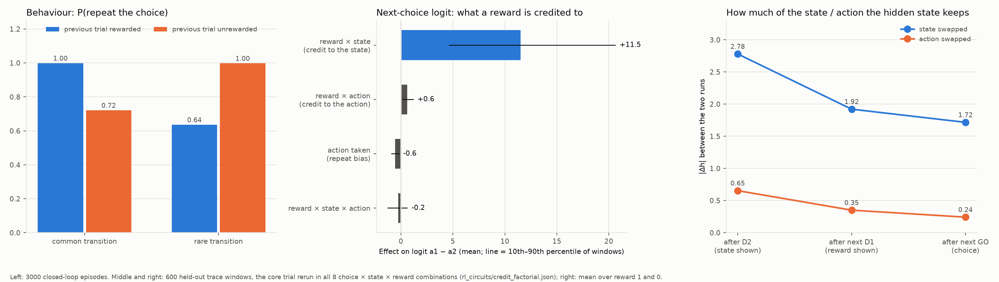

3000 episodes of the real agent (`reversal_flow.py`), actions sampled from its policy as in training.

- **Stay table** (left panel): a reward after a common transition makes the agent repeat (1.00); after a rare one it
  makes the agent switch (0.64 stay, against 1.00 after a rare unrewarded trial). Pure model-free learning would
  give a reward main effect; this is the reward × transition interaction of model-based control.
- **Agreement with the ideal observer** (belief over which state is good, hazard 0.025, greedy choice): 97% of trials.
- **The value head ignores single outcomes.** Swapping a trial's state, action or reward moves the next value by
  at most 0.15 (scale about 7.8); the agent almost always chooses well, so expected reward hardly changes
  (`contrast_flow_value.json`).

## 2. Credit to the state, not the action

**The factorial** (`credit_factorial.py`; middle panel). 600 held-out windows, the core trial rerun with each of
the 8 choice × state × reward combinations (all occur in the task), history and later inputs as recorded:

| effect on the next choice logit (a1 − a2) | mean | 10th–90th percentile |
|---|---|---|
| reward effect after a1→S1 / a1→S2 / a2→S1 / a2→S2 | +5.9 / −5.4 / +5.5 / −6.2 | |
| credit to the state: reward effect after S1 minus after S2 (averaged over actions) | +11.5 | 4.7 – 20.6 |
| credit to the action: reward effect after a1 minus after a2 (averaged over states) | +0.6 | 0.2 – 1.2 |
| repeat bias: a1 minus a2 taken (averaged over states and rewards) | −0.6 | −0.9 – −0.2 |
| reward × state × action | −0.2 | −1.3 – 0.6 |

Whichever action was taken, a reward counts for the state it reached.

**Why: the action barely reaches memory** (right panel; `held_in_h`). h after each step is an exact sum of writes
(carried state, each candidate feature's write, bias and error), so the effect of a swap on h splits exactly.
|Δh| is the Euclidean (L2) length of the 48-unit difference in h between the two versions of the trial (S1 vs S2
reached, averaged over the two actions; or a1 vs a2 taken, averaged over the two states), averaged over windows and
the two rewards. For scale, two hidden states can be at most about 13.9 apart (each unit lies in −1 to 1). A write's
share is its projection on the total difference over the difference's squared length:

| | after D2 | after the next D1 | after the next GO |
|---|---|---|---|
| \|Δh\|, state swapped | 2.78 | 1.92 | 1.72 |
| \|Δh\|, action swapped | 0.65 | 0.35 | 0.24 |

- At D2 the candidate features are transition-specific: 219 a1→S1, 210 a2→S1, 147 a1→S2, 167 a2→S2. The state
  difference (h after D2 with S1 reached minus with S2 reached, averaged over the two actions) is written almost
  entirely by the two S2 features (147: 0.50 of it, 167: 0.48); the S1 features contribute little to it. So in what
  h holds, "reached S2" is an active signal and "reached S1" mostly its absence. (This is the write into h; in the
  attribution graph 219 still carries large flow because later features read it.)
- The action difference (h after D2 with a1 taken minus with a2 taken, averaged over the two states) is a small
  leftover of large opposing writes. Swapping the action switches which transition-specific features fire, and
  each switch moves h a lot, but most of what they write is the same state signal, which cancels. Shares of the
  0.65 difference: candidates 167 (+0.88) and 210 (+0.87) on one side; 204 (−0.63), 147 (−0.28), 243 (−0.23) and
  10 (−0.14) on the other (grouped by sign, not by action: 204 is an a2 feature).
- At the next D1 most of what is left is overwritten (0.65 → 0.35); of the remainder, the carried state supplies
  0.41–0.64 (unrewarded / rewarded), and it moves the next choice by at most 0.6 logits.

So the transcoder represents the full transition at D2, but the model writes the state and discards the action.

## 3. The credit circuit

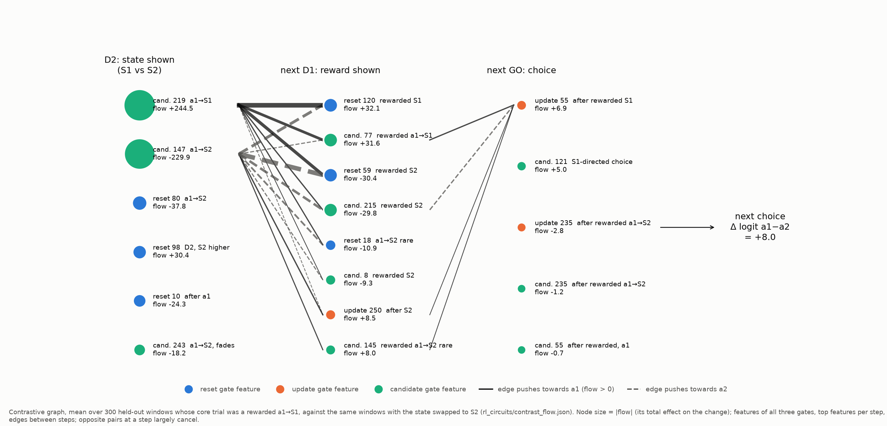

**Method.** Exact contrastive flow (`contrast_flow.py`), the RL version of the copy task's (`interp_circuits.md`
§2), with one change: the gates are not frozen. Freezing them left 3–7 logits of the change in a "gate" term. Instead
every product in the GRU step is split at the two runs' midpoint (exact for a product of two factors), so the
features of all three transcoders are nodes, and each JumpReLU is replaced by its secant slope (DeepLIFT rescale).
The decomposition sums to the real GRU's change to within 3e-4 logits. Transcoder errors carry under 0.4 in the
state and reward contrasts; in the action contrast the reset error at D2 carries up to 20, cancelling the input's
flow (net change under 2).

**What the graphs show** (state contrast, e.g. a rewarded a1→S1 trial vs the same trial ending in S2, +8.0 logits;
the reward and factorial graphs agree):

| step | what happens | main features (flow) |
|---|---|---|
| D2 | the state is written | candidate 219 a1→S1 (+245) and 147 a1→S2 (−230); reset 80 a1→S2, 98, 10 |
| next D1 | the reward meets the remembered state | reset 120 "rewarded S1" (+32), candidate 77 "rewarded a1→S1" (+32), reset 59 and candidate 215 "rewarded S2" (−30 each); after no reward: candidate 208 "unrewarded, not S1", 18 "unrewarded a1→S1" |
| next GO | the choice is written | update 55 "after rewarded S1" (+6.9), candidate 121 "S1-directed choice" (+5.0); after S2: update 206, candidate 146; update 5 after unrewarded S1 |

- **Opposite pairs cancel.** At D2 and D1 the features for the two cells (the two versions of the trial being
  compared, e.g. a1→S1 vs a1→S2) swap on and off, each with a large flow
  and opposite signs (+245 / −230). Their net, and the per-step totals, are what carry the change; single-node
  flows overstate. (A reset feature's effect is measured on the two runs' mean memory, which is no real state.)
- **Credit-to-state graph** (reward side, `credit_factorial.json`): the interaction's 11.5 logits pass through the D1
  detectors 208 (+22.6), 77 (+11.4), 18 (−10.2), 215 (−8.2) and the GO features update 55, 206, candidate 121.
  The credit-to-action graph carries 0.6, spread thinly.
- **The update gate writes the choice.** At GO, update features 55 and 206 set how much of the choice-coded
  candidate (121, 146) is written into h.

**How much flow each gate carries** (`gate_flow_shares.py`; 800 held-out windows, 100 per core-trial pattern). *Why:*
in the copy task the gates' changes carried only 7–12% of the output change, so freezing them lost little; here we
want to know how much each gate's features carry, step by step. A feature's flow is how much of the change in the
next choice passes through it, so summing over a gate's features gives that gate's share. Two numbers per gate:
the signed sum (oriented so the change is positive; how much of the net change goes through the gate) and the share
of the absolute flow at that step (how much traffic the gate carries, cancelling pairs included).

| step | contrast | reset | update | candidate | net change |
|---|---|---|---|---|---|
| D2 | state | −9.8 (abs share 0.20) | −0.6 (0.01) | +6.6 (0.79) | 5.9 |
| next D1 | state | −3.0 (0.34) | +2.7 (0.07) | +3.3 (0.59) | 5.9 |
| next D1 | reward | −1.0 (0.09) | +0.4 (0.02) | +5.6 (0.89) | 6.0 |
| next GO | state | +0.3 (0.06) | **+2.2 (0.52)** | +1.7 (0.42) | 5.9 |
| next GO | reward | +0.3 (0.07) | **+2.3 (0.56)** | +1.8 (0.37) | 6.0 |

- **At D2 and D1 the candidate carries most of the traffic** (59–89% of absolute flow), with reset second at D2 and
  for the state at D1 (20–34%); the update gate carries little there (1–7%).
- **At GO the update gate carries the most:** about 2.2 of a 5.9–6.0 logit change (signed flow over net change:
  0.38), against 1.7–1.8 for the candidate (0.29); the rest (about 0.33) arrives through the carried memory. This is the step that writes the choice.
- **Reading the numbers.** Reset features act on h only through the candidate (they gate what it reads), so their
  flow is nested inside the candidate's, not added to it; update and candidate features write h side by side, so
  those two compare like for like. Per-step signed sums need not add up to the net change (cancelling pairs, nested
  reset flow); the action contrast (net 0.6) splits the same way at GO (update 0.44, candidate 0.47 of the traffic).
- **The a1 side carries more flow** than the a2 side: the a1 features (219, 77, 208, 18) are the large ones; a2
  trials use smaller, more numerous features.

## 4. Switching after a reversal

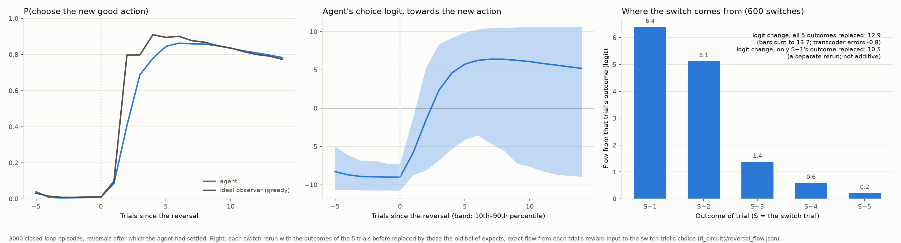

`reversal_flow.py`: reversals after which the agent had settled (old good action on ≥ 4 of the 5 trials before),
3000 episodes.

**Behaviour.**

| trials since the reversal | 1 | 2 | 3 | 4 | 5 |
|---|---|---|---|---|---|
| P(new good action), agent | 0.08 | 0.41 | 0.69 | 0.78 | 0.85 |
| P(new good action), ideal observer | 0.10 | 0.80 | 0.80 | 0.91 | 0.90 |
| agent's choice logit towards the new action (−9.0 when settled) | −5.9 | −1.6 | +2.3 | +4.6 | +5.8 |

The agent switches a median 2–3 trials after the reversal (the switch trial is the first trial on which it chooses
the new action and chooses it again on the next trial, so one-off tries do not count). The mean logit rises by 3–4
per trial after the reversal.

**Compared with the ideal observer** (`switch_lag.py`; 4,970 settled reversals in 3,000 episodes). *Why:* a lag after
the reversal is expected, since no one can know the reversal has happened until outcomes show it; the fair question
is how much later the agent switches than an agent that uses the same evidence perfectly. The ideal observer does
not know when the reversal happened: it is the Bayesian belief from the agent's own outcomes, knowing only the
task's rules (reversal chance 0.025 per trial, rewards 0.9 / 0.1). Same switch definition for both; the agent's
preferred action (sign of its logit) is used, so sampling noise is left out:

| | median trials to switch | mean |
|---|---|---|
| ideal observer | 2 | 2.5 |
| agent (preferred action) | 3 | 3.2 |
| agent (actual, sampled choices) | 3 | 3.2 |

Per reversal, agent minus observer: same trial 46%, one trial later 37%, two or more later 13%, earlier 5%; mean 0.7
trials. So the agent is often exactly as fast as the evidence allows and otherwise mostly one trial late. Split
by direction, the lag is all in switching away from S2: about 1.5 trials late, later in 94% of those reversals;
switching away from S1 it is as fast as the observer (−0.15 trials, later in 2%). Why: §7, "How evidence from S1
and from S2 outcomes is carried". At its
switch the observer's belief in the new good state is already 0.91 (median).

**The switch's graph.** 600 switches; the counterfactual replaces the rewards of the 5 trials before the switch
trial S by those the old belief expects (1 in the old good state, 0 in the old bad one). Target: the choice logit at
S.GO towards the new action. Each trial's reward is an input at the next trial's D1, and the graph gives the flow
from each of those inputs. Replacing all five removes 12.9 logits; the five inputs carry 13.7 and the transcoder
errors −0.8:

| outcome of trial | S−1 | S−2 | S−3 | S−4 | S−5 |
|---|---|---|---|---|---|
| flow into the switch (logits) | 6.4 | 5.1 | 1.4 | 0.6 | 0.2 |

- **Not every reward actually changes.** A reward only changes if it differed from what the old belief expected:
  trial S−1's always does, S−2's in 86% of switches, S−3's 52%, S−4's 28%, S−5's 19% (2.85 of the 5 on average;
  the older trials often fall before the reversal). Per changed reward, the flow is roughly 6.4, 5.9, 2.6, 2.1 and
  1.1 logits for S−1 to S−5 (approximate: change rates from the circuit-check run).
- **Evidence decays fast:** the last two outcomes give 11.5 of the 12.9 (partly because older rewards change less
  often; per changed reward the decay is gentler, as above). Replacing only the last one (a separate
  rerun) removes 10.5 on its own, more than its 6.4 share above: its effect depends on the other outcomes. With
  the four earlier outcomes still real, the last one decides the switch; with them replaced too, the logit is
  already deep on the old side, where one more outcome moves it less (the logit saturates). The 6.4 is its share of
  the joint effect, not its effect alone.
- **Same circuit every trial.** Each outcome enters through the D1 detectors of §3 (208, 77, 18, 66) and the GO
  features (update 55, 206; candidate 121, 146). There is no separate "switch" circuit.
- **Relay through h.** Evidence is carried from trial to trial in the hidden state: flow passes each step on the
  way (S−1: D1 6.2, GO 1.9, D2 4.2; S: D1 11.8, GO 9.0), and the largest cross-trial edges link the D2 state
  features and the D1 detectors of consecutive trials (e.g. candidate 167 at S−1.D2 → 208 at S.D1; 208 at S−1.D1
  → 208 at S.D1).

## 5. Causal checks (real GRU)

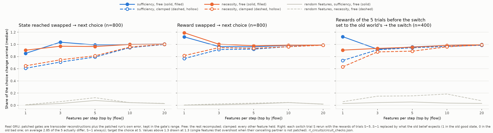

**Minimal circuits** (`circuit_checks.py`). The circuit is each window's top-k features per step by |flow|, from
the changed step to the target. Patching sets them to their values in the other run, as in the copy task
(`interp_circuits.md` §3): sufficiency (run the edited input, circuit set to the original's values) and necessity
(run the original, circuit set to the edited run's values), free (rest recomputed) or clamped (every other feature
held). Score: median share of the choice change carried.

| contrast | k per step | sufficiency free / clamped | necessity free / clamped | random features: sufficiency / necessity |
|---|---|---|---|---|
| state swap (800 windows) | 10 | 1.00 / 0.95 | 1.00 / 0.96 | 0.04 / 0.04 |
| reward swap (800) | 3 | 0.96 / 0.92 | 1.00 / 0.95 | 0.01 / 0.02 |
| reversal switch (400) | 10 | 0.98 / 0.97 | 0.98 / 0.96 | 0.04 / 0.18 |

With k = 10 the choice ends on the predicted side in 90–100% of cases. A single feature per step can overshoot
(reward, k = 1: 1.12–1.19), because its cancelling partner is not patched.

**Steering by label** (`credit_steering.py`). A cell is one combination of the core trial's state reached and
reward (rewarded S1, unrewarded S1, rewarded S2, unrewarded S2). The detectors of each cell are the features at the
next D1 at least 3× more active in that cell than in any other (chosen on half the windows, tested on the other
half). With the input unchanged, the recorded cell's detectors are switched off and another cell's on (at their
mean there). Shift of the next choice, in units of a real state swap's effect (medians; candidate features at the
next D1; random control 0.04–0.05):

| | state swap (other state) | reward swap (other reward) | double swap (other state and reward) |
|---|---|---|---|
| real input swapped | 1.00 | 1.03 | 0.01 |
| this cell's detectors off | 0.39 | 0.39 | 0.39 |
| other cell's detectors on | 0.14 | 0.55 | 0.39 |
| both | 0.41 | 1.08 | 0.68 |

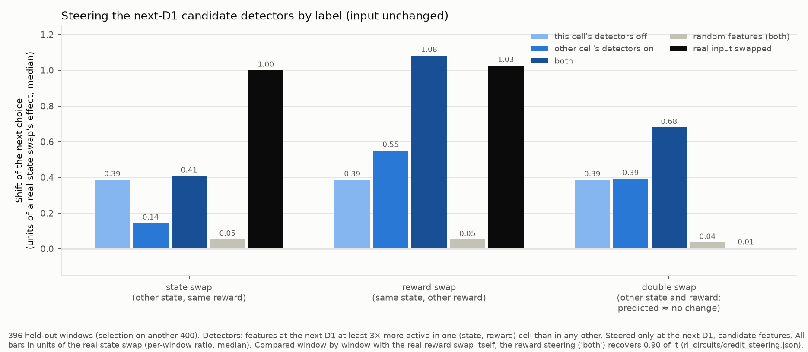

- **The reward swap works by label:** 0.90 of the real reward swap's effect, the choice following in 92% of cases
  (random features: 0.06, 25%). The 0.90 compares the two window by window (median of steered shift over the real
  reward swap's shift in the same window). The table's 1.08 and 1.03 are both in units of the state swap and are
  medians over different windows, so their ratio is not the per-window answer.
- **The state swap does not, at D1 alone** (0.41), and the double swap, which a model-based agent should credit to
  the same action, is steered as if the reward had flipped (0.68). Downstream reads the D1 detectors mainly as reward
  valence; which state is re-read from the memory carried from D2, at GO. Steering the state detectors at D2, D1 and
  GO together reaches 0.89 of the real state swap (choice follows in 84%), but its random control is high there
  (0.52): random candidate changes at three steps move a confident choice towards zero.
- So the labels of the D1 detectors ("rewarded S1") are right about when they fire, but the model uses them as
  "rewarded / not" and takes the state from elsewhere.

## 6. The value circuit

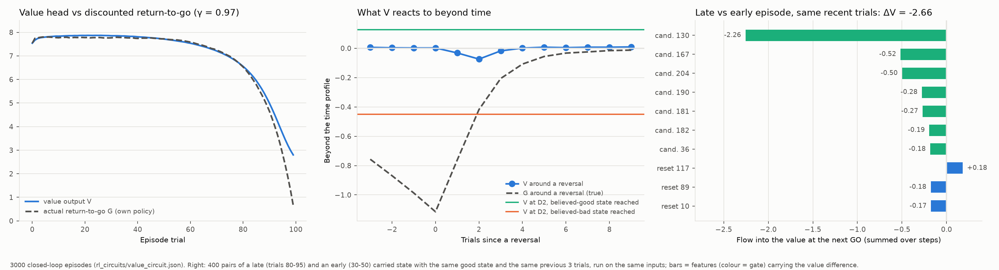

`value_circuit.py`, 3000 closed-loop episodes. The critic was trained on full-episode discounted returns (A2C,
γ = 0.97 per step, terminal at trial 100); the network gets no trial-number input.

**What the value is for.** The return-to-go at step t is the discounted reward still to come in the episode,
G_t = r_t + γ r_{t+1} + γ² r_{t+2} + … to the last step (training used these full-episode returns, no
bootstrapping). The critic's output V_t = V(h_t) is a read-out of the hidden state h_t, trained on (G_t − V_t)²,
so it learns E[G_t | h_t]: the expected return given what the agent's memory holds. This is the usual value
function, with the agent's memory as its state (the task's good state is hidden from it). Nothing forces V to use
time rather than belief; that it mostly uses time is a finding (below). At test
nothing reads V: actions come from the policy logits alone. Its use was in training, as the baseline of the policy
gradient, −log π(a_t) (G_t − V_t): an action is reinforced only if the return beat V's expectation, which cuts the
gradient's variance without biasing it (the training also clips G_t − V_t to ±5, a small departure). G_t falls near the end of the episode. A V that did not know the time would
be too high there, so the advantage G_t − V_t would be negative for every late action and the policy wrongly
discouraged; counting trials lets V remove that time-driven part, so the advantage reflects only whether the choice
was good. The policy and the
value share the GRU, so the critic also shaped the hidden state (the counter below).

**What V computes: the return-to-go, almost from time alone.**
- V matches the actual discounted return-to-go G under the agent's own policy (mean by step: error 0.36; scale
  about 7.8), flat until about trial 60 and falling over the last 40 trials. Only at the very end is it too high
  (trial 99: 2.8 against 0.67).
- Beyond its time profile (sd 1.26), V varies little (sd 0.18). The ideal observer's confidence, the expected next
  reward under the belief and the previous reward explain 2% of that remainder together.
- After a reversal the true return dips (−1.1 beyond time: the agent keeps choosing the old action for 2–3
  trials); V barely moves (−0.07).
- **One TD-like step:** at D2, when the state reached is shown, V rises if it is the believed-good state (+0.13
  beyond time) and falls if not (−0.45); the TD error r + γV′ − V over that step is +0.16 / −0.39. Elsewhere the
  mean TD error is about 0, except at the last step (−0.72, where V is too high).
- So V is consistent with the Bellman equation on average, and it does not hold a belief-weighted value: the
  belief lives in the choice circuit, and V reads time plus the state just reached.
- **Inferred value, partly.** *Why we ran this:* Wang et al. (2018, Simulation 3) showed their agent's value reflects
  inferred value, as dopamine does (Bromberg-Martin et al., 2010): after learning about a reversal from one cue, the
  response to the other cue is already updated. Their task was different (5-trial episodes, deterministic rewards,
  a 50% chance of reversal per episode), and the measure was the value change when a cue appears. Our analogue is
  the value change when the state reached is revealed. Arriving at a state that is still believed bad: −0.48
  (beyond the time profile); arriving at the same kind of state after an outcome in the other state has flipped the
  belief so that it is now believed good, without visiting it: −0.20; arriving at a believed-good state in general:
  +0.13. So the value moves about 45% of the way to the "good" response on inferred evidence alone: a partial
  inferred-value effect.
- **How it happens** (`inferred_value_flow.py`). *Why we ran this:* to see whether a separate value computation
  handles the inferred state. The contrast: trial t's outcome in one state flips the belief so the other state Y is
  now believed good, and trial t+1 reaches Y; the comparison run has trial t's reward swapped, so Y stays believed
  bad (400 events; the exact attribution graph to the value change at Y's reveal, error 6e-6).
  - The value of Y itself hardly differs: right after Y is revealed the two runs are within 0.02. What differs is the
    value just before: after the bad news about the first state, the value at the next GO is 0.18 lower. So the
    reveal response is larger because the expectation before it was lower, not because Y is valued more (in dopamine
    terms, a larger prediction error at the cue because the prediction before it was lower).
  - The difference (0.15) flows mainly through the features that read trial t's outcome at the next D1 (candidate 18,
    "unrewarded a1→S1", −0.44; also candidates 66, 112, 118, 77, 181, 208) and the choice writers at the next GO
    (update 55, +0.52; candidate 121, −0.33; update 5; reset 106), whose writes also land on the value read-out.
    At the reveal itself only a little (candidate 31, +0.13).
  - Patching the top 10 features per step carries 92% of it (top 5: 71%; top 3: 61%); random features about 0.
  - So the value's inferred-value effect comes from the same outcome-detector → choice-writer circuit that sets the
    action preference, not from a separate valuation of the inferred state; that circuit lags, which fits the effect
    being partial.

**The clock: a trial counter in h.**
- The trial number is decoded linearly from h at D1 with R² 0.998 (mean error 1.0 trial, held-out episodes). Along
  that direction h advances 0.99 per trial (sd 0.42), independent of the outcome (R² 0.001 from reward and rare
  transition): the network counts trials.
- V at D1 is a function of the counter (R² 0.975, the same as the trial profile).
- 47 candidate features switch on between trials 50 and 84; their preactivations follow the counter (median
  correlation 0.49, up to 0.90). They read the counter at staggered thresholds, often together with a trial outcome
  ("late-episode D1 after a rewarded visit to S1").

**The value's time circuit** (late vs early carried state, same good state and the same previous 3 trials, same
inputs; 400 pairs; ΔV = −2.66, exact to 1e-5):
- Almost all of it passes through features (−2.49), little through the carried state read directly (−0.17).
- One feature carries most: candidate 130 ("GO step, later in the episode", −2.26). Then candidates 167 and 204 at
  D2, and late-episode D1 detectors 190, 181, 182, 36.
- Patching the top-k value features per step from the early run into the late one carries 0.67 (k = 1) to 0.81
  (k = 20) of the value difference.

**Is the value right beyond time?** (`value_check.py`; 3,000 closed-loop episodes.) *Why:* V barely moves when an
outcome changes (0.15 at most above), but that alone does not say it is wrong; an outcome might change the expected
return only a little. If V were exactly the expected return given the agent's memory, then for any group of steps
picked by what the agent has seen, V's average would equal the actual return's average. So we compare the two,
both beyond their time profile, at the next D1 after a trial, rewarded minus unrewarded:

| trial reached the state the ideal observer believed | V (value head) | G (actual return) |
|---|---|---|
| good | +0.10 | +0.21 |
| bad | +0.08 | **−0.27** |

- **After the believed-good state, V moves the right way but half as much.**
- **After the believed-bad state, V moves the wrong way.** A reward there is evidence that the good state has
  reversed, so the agent is about to choose wrongly for a trial or two and its expected return falls (−0.27). V
  rises anyway (+0.08): it treats a reward as good news whatever it implies.
- **Around reversals** (figure, middle panel) the actual return dips by 0.76 one trial after the reversal and 0.42
  two trials after (beyond time); V dips by 0.03 and 0.07.
- So beyond the clock, V is not the expected return: it carries a small "reward is good" term and the TD-like jump
  when the state is shown, and misses what an outcome implies about the future. This fits its job ("What the value is for" above): as a
  baseline it only needs to remove the time trend, and errors in the baseline add variance but no bias.

**Does it touch the choice circuit?**
- The two heads read nearly perpendicular directions of the hidden state: the cosine between the choice read-out
  (output weights for a1 minus a2) and the value read-out is 0.02. This is about where the heads read, not what the
  features write: a feature's write could still move both, which the next points check.
- The credit contrasts of §3 (the state reached, the action or the reward of one trial swapped) move the value by
  at most 0.15, and the time contrast moves the choice by −0.55 (sd 1.3;
  the choice logit is about ±8.6). In the choice's flow candidate 130 is large (−4.1) but cancelled by others.
- Patching the value features changes the choice by about 1 logit (11–16% of its size).
- Feature overlap between the two graphs: the 15 features with the most flow in the value-time graph (late vs
  early episode, target the value) and the 15 with the most in the credit graphs (state and reward swaps, target the
  choice) share only 2, candidate 167 and reset 10. Those 2 carry 13% of the value-time list's flow (their |flow|
  over the summed |flow| of its 15 features). A rough measure: it depends on the top-15 cut, and a shared feature
  can carry different things in each graph (167 writes the state for the choice and fades with episode time).
- Behaviour does not change over the episode, although the clock does (V falls from 7.8 to 2.8 and the late-onset
  features switch on, some with large flow into the choice that others cancel): agreement with the observer 0.97 / 0.97 / 0.95 (trials 10–49 /
  50–79 / 80–99), mean |choice logit| 8.6 / 8.7 / 8.5, the same stay table.
- So the clock serves the value, which mattered for training (the baseline); at test it neither drives nor is
  driven by the choice in any large way.

## 7. Bayesian observer or model-based RL? The bands of the phase portrait

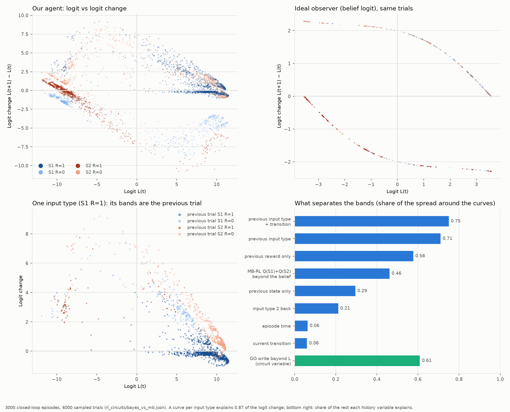

Ji-An, Benna & Mattar (2025, *Nature* 644: 993) plot each trial's policy logit L(t) = log P(a1) / P(a2) at GO
against the logit change L(t+1) − L(t), coloured by the trial's state and reward. A one-dimensional Bayesian agent
gives one curve per input type; their meta-RL agent on the same task (an LSTM with 48 units, rewards 0.8 / 0.2) gave
Bayesian-like curves split into parallel bands, which they called a history effect. `bayes_vs_mb.py`, 3000
closed-loop episodes of our agent (rewards 0.9 / 0.1).

**Closer to a Bayesian observer than to model-based RL, but not exact.**
- Fitted to the agent's choices (half the episodes; log-likelihood per trial on the other half; the agent's own
  policy gives the ceiling, −0.026): a Bayesian observer −0.057, model-based RL with two state values −0.065.
- The fitted Bayesian forgets faster and weighs evidence less than the ideal: hazard 0.067 (true 0.025), evidence
  1.24 / 1.00 logits per rewarded / unrewarded outcome (ideal 2.2 each).
- The ideal observer's belief logit is decoded from h after D1 with R² 0.985 (held out).
- The Bayesian symmetry (a rewarded S1 and an unrewarded S2 are the same evidence) holds for that pair between
  L = −5 and 5 (logit changes within 0.4), only roughly for the mirror pair, an unrewarded S1 and a rewarded S2
  (0.7–1.7 apart; the rewarded S2 counts more), and not at the extremes (up to 3 logits apart).
- The circuit agrees: a reward is credited to the state, and the four outcomes act along one choice axis (§2–3).

**The bands are the previous trial.** A curve per input type (piecewise linear in L) explains 0.87 of the logit
change. Of the spread left around the curves:

| added to the curves | share of the spread explained |
|---|---|
| previous input type and transition | 0.75 |
| previous input type | 0.71 |
| previous reward only / previous state only | 0.58 / 0.29 |
| MB-RL's second dimension, Q(S1) + Q(S2) beyond the belief | 0.46 |
| input type two trials back | 0.21 |
| episode time / current transition | 0.06 / 0.06 |

So at the same logit, the next change depends on what happened on the trial before. For example, after a rewarded
S1 at L ≈ 9, the logit stays put if the trial before was also a rewarded S1, but still climbs by 1–3 if the trial
before was a setback. A one-dimensional Bayesian agent cannot do this: its logit is its whole state.

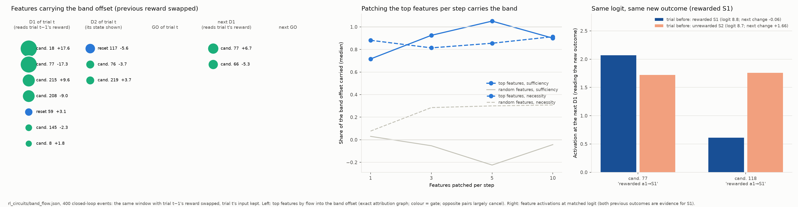

**The bands in the attribution graph** (`band_flow.py`). A point moves between bands when only the trial before
changes, so the contrast is the same closed-loop window with trial t−1's reward (or state, or trial t−2's reward)
swapped and trial t's own input kept. Each pair is oriented so the original's history favours a1 more. Exact flows
(all three gates' features) into L(t), into L(t+1), and into the **band offset**: how far each run's logit change
sits from its input type's average curve, original minus edited. It can be written as d(ΔL) − s·d(L(t)) with s the
slope of the curve between the two runs' logits, a constant per pair, so it is linear in h and its flow is exact too
(error ≤ 1.2e-3). 400 events per contrast. (A first version used the curve's slope at one point instead; the logit
moves by about 5 here and the curve bends, so that version counted part of the bending as band and overstated the
offset by about 70%.)

| contrast | d L(t) | d L(t+1) | kept one trial later: agent / ideal observer | mean \|offset\| |
|---|---|---|---|---|
| trial t−1's reward | 4.7 | 3.1 | 0.49 / 0.30 | 1.1 |
| trial t−1's state | 5.5 | 3.5 | 0.49 / 0.30 | 0.9 |
| trial t−2's reward | 2.9 | 1.8 | 0.42 / 0.16 | 0.7 |

- **Decay is not the band.** A Bayesian keeps less of an earlier outcome one trial later than the agent does (its
  belief saturates, so two histories that both end at the ceiling look the same). What a one-dimensional Bayesian
  cannot have is the offset: a dependence of the next change on history beyond L.
- **A few features carry the offset.** Patching the top 3–5 offset features per step from the other run carries
  0.81–1.12 of it (median, sufficiency and necessity, all three contrasts). Random changed features carry less but
  not nothing: up to 0.31 for trial t−1's reward and up to 0.52 for the other two (the offsets are small, about one
  logit, so these medians are noisy).
- **They are where the previous outcome changes how the current trial is processed.** The offset's main features
  are absent from L(t)'s graph and present in L(t+1)'s (trial t−1's reward contrast):
  - the next-D1 detectors of the previous outcome (candidates 18, 77, 215, 208, in cancelling pairs of ±9 to ±18);
  - trial t's own state writers at its D2 (reset 117 −5.6, candidates 76 −3.7, 219 +3.7);
  - the detectors that read trial t's outcome at the next D1 (candidate 77 +6.7, 66 −5.3), and the GO features.
- **The same input is read by history-specific detectors.** Compare trials with the same logit (about 8.7) and
  the same new outcome, where the trial before was either a rewarded S1 or an unrewarded S2 (both are evidence for
  S1, so the belief is the same):
  - a new rewarded S1 is read more by candidate 118 ("rewarded a1→S1 trial") after an unrewarded S2
    than after a rewarded S1 (1.76 vs 0.61; candidate 77: 1.72 vs 2.07), and the logit then rises by 1.66 instead of
    not at all (−0.06);
  - a new unrewarded S1 is read more by candidate 114 (1.95 vs 0.59);
  - for a new rewarded S2 (logit about −8.5), candidate 8 fires more after a rewarded S2 and candidates 215 and 95
    after an unrewarded S2;
  - not every band works this way: a new unrewarded S2 is read alike whatever came before (candidate 208 about
    5.2), yet the logit rises by 1.46 vs 0.29; there the difference comes from the D2 and GO features.
- So the bands are history-dependent processing: the update for an outcome depends on the outcome before it,
  through which detectors read it and how the state is written, not only through the belief. An exact Bayesian
  update depends on the belief alone.

**What the one-step split adds.** The logit at GO is an exact sum of the memory carried into the step,
w · (1 − z) h (mean |·| 4.2), and the GO step's write, w · z n (4.5). Given the gates, 0.15% of the GO write reaches
the next trial's logit (median), 33% of the carried part: the logit is recomputed at every GO from a belief kept in
other directions of h. At the same L the GO write's share depends on the previous outcome (candidate 121: +1.2 after
a rewarded S1, −2.3 after an unrewarded S2; candidate 146 makes up the difference), and it explains 0.61 of the band
spread by regression. This is part of the same picture; the graph shows the GO features are only one of the routes.
Pushing a single feature by +1 keeps 7–26% of its logit change one trial later (GO features) and 11–47% (D1
detectors): most of any push to the logit is gone a trial later.

**Is the second dimension model-based RL's?** h does hold more than the belief: MB-RL's Q(S1) + Q(S2), which a
belief does not have, is decoded beyond the belief with R² 0.53 even before the reward is shown. But it organises
the bands less well (0.46) than the previous trial's outcome alone (0.71), and the MB-RL model fits the choices
worse. The extra dimension is a short memory of the last outcome, not a second learned value, and the graphs say
how it acts: through the detectors and state writers of the next trial (above).

### One belief, or two values?

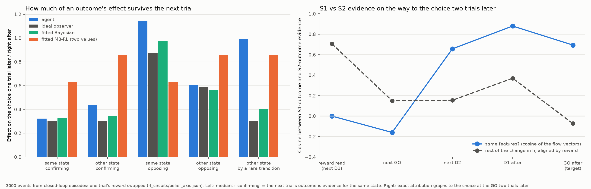

**Why we ran this.** The two candidate algorithms store different things. A Bayesian agent keeps one number: how
likely it is that S1 is the good state. A reward in S1 and no reward in S2 both push that one number the same way.
Model-based RL keeps two numbers, a value for S1 and a value for S2; an outcome changes only the value of the state
where it happened, and the two are compared only when choosing. The model fits above favour the Bayesian, but they
depend on the exact model forms, and decoders cannot tell the two apart (both the belief and the value difference
are read from h almost perfectly). So we asked the network itself, in two ways (`belief_axis.py`, 3000 events from
closed-loop episodes).

**Test 1: does an outcome's effect last longer if the next trial visits the other state?** We swapped one trial's
reward and measured how much of its effect on the choice was still there one trial later. With two values, visiting
the other state leaves the first state's value alone, so the effect should last longer than after a visit to the
same state. With one belief, which state is visited does not matter; what matters is whether the next outcome
agrees or disagrees (agreeing evidence pushes a belief that is already near certain to its limit, so the earlier
outcome stops making a difference).

| next trial (common transition) | agent | ideal observer | fitted Bayesian | fitted two-value RL |
|---|---|---|---|---|
| same state, agreeing | 0.32 | 0.30 | 0.33 | 0.63 |
| other state, agreeing | 0.44 | 0.30 | 0.34 | 0.86 |
| same state, disagreeing | 1.15 | 0.87 | 0.98 | 0.63 |
| other state, disagreeing | 0.61 | 0.59 | 0.56 | 0.86 |

- The agent follows the one-belief pattern: its main dependence is agreeing vs disagreeing (0.32 vs 1.15), not same
  vs other state. Two-value RL predicts the opposite pattern.
- Cases where the next trial reached the other state by a **rare** transition seem to keep much more (0.99, against
  0.40 for the fitted Bayesian). The follow-up below shows this is a selection effect, not special handling of rare
  transitions.

**How evidence from S1 and from S2 outcomes is carried.** *Why:* the belief is one number (P(S1 is the good
state)), and an outcome at either state is evidence about it: a reward at S1 or a missed reward at S2 both point to
S1. "S1 evidence" and "S2 evidence" below mean evidence from an outcome observed at S1 or at S2; both should update
the same belief, and equally. We followed one outcome through time to see how the network carries each. Events: one
trial's reward swapped (1,200–3,000 events from closed-loop episodes); effects oriented so the evidence counts as
positive. "Next choice" is the choice right after the outcome is shown; "the choice after" is the one a trial later.

1. **Reading the outcome.** Different detectors read each state's outcome: S1 outcomes candidates 18, 77, 66; S2
   outcomes 215, 208, reset 59. *How:* attribution graph; the two entry patterns do not overlap (flow-pattern cosine
   0.00, at chance).
2. **The next choice.** Both are pushed onto the choice read-out, unequally. When the agent is already confident
   (|choice logit| ≥ 6, most trials), an S1 outcome moves the choice by 4–5 logits and an S2 outcome by about 1.2;
   when it is unsure the two are similar (6–9). *How:* the real GRU rerun with the outcome swapped. Not the logit
   running out of room: its range is the same on both sides (about ±11.5).
3. **Right after the choice.** S1 evidence is wiped off the choice read-out (5.4 → 0.6 logits on it, mean); S2
   evidence is kept (3.3 → 3.6), mostly by the carry. *How:* the change in h at each step split exactly into the
   carried part (1 − z)·Δh, the candidate's write and the update gate's change.
4. **Between the choices.** S1 evidence is re-created by features: passed to the next state-writers (at the next trial's D2:
   candidates 219, 76; resets 117, 80, 98), then to the next outcome's readers (77 / 66, 208). S2 evidence waits in
   memory on the read-out: about 40% of it reaches the choice through the carry alone, touching no feature. *How:*
   the graph's flow from the reading detectors split by where it goes first (straight to the choice through the carry,
   or into the features of a later step); and patching in the real GRU: the features carrying the most flow remove
   all of S1 evidence but only about 0.3 of S2 evidence.
5. **The choice after.** S1 evidence is written back onto the read-out by the GO features and the update gate (update
   55, 206; candidates 121, 146); S2 evidence is read straight from memory. Their later effects end up similar (1.7 vs
   1.2 logits, medians). *How:* removal: taking the evidence's component on the read-out away between the two
   choices leaves 0.87 of S1's later effect and 0.31 of S2's; the belief decoder's direction and random directions
   remove nothing.
6. **The consequences for behaviour.**
   - *Unequal weighting:* over two choices, an S1 outcome typically counts about 2–3× an S2 outcome (about 6.3 vs 2.5
     logits); the ideal observer and the fitted Bayesian weigh them equally (2.3 / 0.7 and 3.1–3.2 / 1.2).
   - *The switching lag* (§4): switching away from S1 the agent is as fast as the ideal observer (−0.15 trials; later
     in 2% of reversals); switching away from S2 it is about 1.5 trials late (later in 94%). The news that S2 has gone
     bad arrives as S2 outcomes, which barely move a confident agent (step 2); carrying S2 evidence (step 3) lets
     those weak pushes add up instead of vanishing.
   - *Survival ratios:* small starting effects plus kept evidence inflate S2's survival in Test 1, which probably
     accounts for part of the agent's departures from the observer there.
7. **Still one quantity.** Both end on the same readers and choice writers, and each interacts with the next outcome
   whatever its state: S1 evidence passes through the S2-outcome readers (candidates 8, 208, 165; 0.83–1.29 of its
   effect) when the next trial visits S2, which two separate values would not do. *How:* graph version of Test 1;
   where the two use features, their flow patterns overlap far above chance from the next D2 on (cosine 0.67–0.88;
   shuffled features up to 0.24; p < 0.001), though not completely (below the 0.99 within-group ceiling and every
   label shuffle).

**Still unknown:** why the network wipes S1 evidence and keeps S2 evidence (one idea, that S2 evidence rides the
memory's "S2 reached" signal, was tested and rejected: clamping that direction removes none of it); why it reads S2
outcomes weakly when confident; and whether that weak reading causes the lag (test: boost the S2 missed-reward
readers, such as candidate 208, after long runs). The task is symmetric between S1 and S2, so the asymmetry is
probably one of two equally good solutions picked in training; testing that needs other trained networks.

Code and results (`rl_features/rl_circuits/`): `evidence_patch.py` (patching), `flow_cosine_null.py` (cosine nulls and
intervals), `test1_flow.py` (graph Test 1), `state_channel.py` (the rejected idea), `storage_asymmetry.py` and
`storage_cause.py` (behaviour, restoration and removal, step-by-step read-out), `switch_lag.py` (lag by direction).

**The rest of the change in h** is something else: a trace of whether a reward came at all, the same for S1 and S2. It is
  strongest when the reward is read and fades within a trial or two. It is not a second value; the follow-up below
  tests whether it carries the bands (about 40% of them).

### Follow-ups: rare transitions and the reward trace

`rare_and_trace.py`, closed-loop episodes.

**Why an outcome seemed to last longer after a rare transition.** *Why we ran this:* a Bayesian has no reason to
treat it differently, so either the agent weighs the next outcome less after a rare transition, or a separate path
carries the earlier evidence. 2000 events: one trial's reward swapped, the next trial reached the other state.

| next trial reached the other state by | effect right after the swap | effect two trials on | ratio |
|---|---|---|---|
| a common transition | 6.3 | 3.7 | 0.60 |
| a rare transition | 3.3 | 2.6 | 0.95 |

- The ratio is high only because the effect right after was small. In absolute terms less of the earlier outcome
  is left after a rare transition (2.6 vs 3.7).
- The outcome that follows a rare transition is not weighed less: it moves the choice more (6.3 vs 5.2).
- The two groups are really "stayed" and "switched". The transition happens after the choice, and the effect "right
  after" is measured at that choice, before the transition. Reaching the other state by a rare transition means the
  agent had chosen to go back to the earlier state (stayed), which it does mostly after a reward there: 87% of these
  cases had a rewarded earlier outcome, against 10% of the common-transition cases.
- So there is no evidence of special handling of rare transitions here; the difference comes from which trials end up
  in each group.

**Does the reward trace carry the bands?** *Why we ran this:* the bands (the next update depending on the trial
before, at the same logit) need a memory of the previous outcome beyond the belief, and the "was I just rewarded"
trace is a candidate. We took the band contrast (the previous trial's reward swapped, the current trial unchanged;
1200 events). After the current trial's choice (so its logit is fixed), we removed the trace part of the difference
between the two runs from the hidden state and let the network run on. The trace part: the main 1–5 directions of
that difference across events (found on half the events, tested on the other half), kept clear of the belief
direction and the choice read-out.

The band offset here is exact: how far each run's logit change sits from its input type's average curve, original
minus edited.

| removed from the hidden state | band offset removed, per event (median) | average size of the offset |
|---|---|---|
| nothing | | 1.6 |
| the trace, top 1 / 3 / 5 directions | 0.69 / 0.80 / 0.81 | 0.97 / 0.97 / 1.04 |
| everything except the belief direction and the choice read-out (46 directions) | 0.78 | 1.06 |
| random directions, 1 / 3 / 5 (average of 5 draws) | −0.01 / 0.03 / 0.09 | |

- Removing the trace difference takes away a median 70–80% of the offset in an event, and random directions take
  away almost none. The average offset shrinks less (from 1.6 to 1.0), because in some events the removal overshoots.
- Removing everything outside the belief direction and the choice read-out does no better than removing the trace.
- But this removal also takes away information the action preference holds: the preference is carried in other
  directions between choices (see "One belief, or two values?"). So we repeated it removing only the part of the
  trace difference that the agent's action preference (its choice logit after the current GO) and the belief
  read-out cannot explain. About half of the trace difference is of that kind (53–55%), and removing it takes away a
  median 33–45% of the offset (random directions: 11% or less). So the genuine reward trace, the part the action
  preference does not reflect, carries about 40% of the bands; the rest goes with information tied to the action
  preference itself, that is, with how the preference was reached.
- Is the rest a belief difference the logit hides? No: at the same logit, the belief read from h and the ideal
  observer's belief are the same whatever the previous outcome was (for a rewarded S1 at logit 8–9, after a rewarded
  S1 vs after an unrewarded S2: 3.34 vs 3.35 and 3.42 vs 3.32), yet the next change differs (0.00 vs +1.75).
- A first version of this test used the straight-line offset of the band graph's first version and found only
  about 40%; the difference was the curve's bending, counted as band.

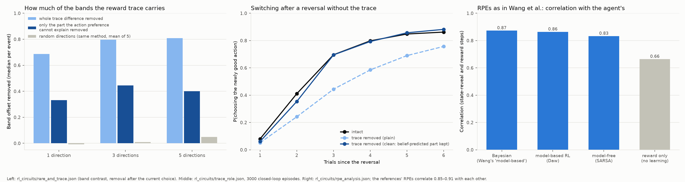

**What is the trace for?** *Why we ran this:* the trace makes the agent depart from an exact Bayesian, so either
it does a job or it is a harmless leftover of holding the reward input for a moment. (`trace_role.py`; "outcome"
below always means the state reached and whether it was rewarded.) Three tests, then a check of the belief itself:

1. *Does the agent behave worse without it?* We let the agent play 3000 episodes with the trace removed on every
   trial, in two ways, and compared it with the intact agent and with the same removal of random directions.
   - **Plain removal:** after each GO, the hidden state's part along the trace directions is set to its average.
   - **Clean removal:** that part is set to what the agent's belief predicts it to be (fitted from two belief
     readings of the hidden state, the choice logit and a linear read-out of the ideal observer's belief, which the
     edit leaves unchanged). This removes only what the belief cannot explain. It was needed because 41–48% of the
     trace directions' variation turned out to be predictable from the belief, so plain removal also removed
     belief.

| | intact | plain removal | clean removal | clean removal, random directions (3 draws) |
|---|---|---|---|---|
| P(choosing the newly good action), 1 / 2 / 3 / 6 trials after a reversal | 0.08 / 0.41 / 0.70 / 0.86 | 0.05 / 0.24 / 0.44 / 0.76 | 0.06 / 0.35 / 0.70 / 0.88 | 0.08–0.09 / 0.43–0.45 / 0.70–0.72 / 0.86–0.88 |
| reward per trial | 0.697 | 0.689 | 0.700 | 0.698–0.699 |
| choices that match the ideal observer | 96.7% | 94.2% | 97.1% | 96.8–97.3% |
| share of the bands explained by the trial before | 0.71 | 0.53 | 0.46 | 0.75–0.82 |

   - Plain removal slows switching a lot, but the clean removal does not (apart from a little in the first two
     trials after a reversal). The slowdown came from removing belief, not from the trace.
   - The clean removal still shrinks the bands (0.71 to 0.46). So the part of the trace the belief cannot explain
     makes the bands, and the agent behaves just as well without it: it is mostly a harmless by-product.

2. *Does it feed the value?* Removing the trace takes away 0.6–1.1 of the small difference in value (at most 0.17,
   on a scale of about 7.8) that the previous trial's reward leaves at the next steps; random directions take away
   −0.3 to 0.4. So it feeds the value a little. (Removing any directions, random ones too, also makes the value a
   worse predictor of the return in closed-loop play, so that measure says nothing about the trace.)

3. *How often do the bands change the choice itself?* Rarely: the band changes which action the agent prefers on
   1.1% of trials, and changes the probability of choosing a1 by more than 0.1 on 3.3%. Mostly the bands change how
   sure the agent is, not what it does.

**Is the belief update itself sub-par?** *Why we ran this:* the agent switches later than the ideal observer (0.7
trials on average; one trial late on half the reversals); if not the trace, something in the belief or the choice must be slower. Two terms, used from here on:
- **belief information**: the ideal observer's belief as read from the agent's hidden state by a straight-line
  read-out (after GO). It shows what information the memory holds, not that the agent uses it.
- **action preference**: the part of the memory the choice is read from (found below). The test at the end of this
  part shows that this, not the belief information, is what the agent acts on, so it is the agent's working belief.

We compared the belief information's change from one trial to the next with the ideal observer's.

- The belief information is updated close to ideally. After an outcome against a confident belief (the case that
  matters after a reversal) it changes by 97% of the ideal amount (−2.22 vs −2.28 belief logits). After agreeing
  outcomes at middling confidence it changes a little less (0.50 vs 0.65).
- The lag is between the belief information and the choice. After a reversal:

| trials since the reversal | 1 | 2 | 3 | 6 |
|---|---|---|---|---|
| ideal observer's belief favours the new good state | 10% | 80% | 80% | 90% |
| the belief information (read from the agent's hidden state) favours it | 12% | 74% | 80% | 87% |
| the agent's choice favours it | 8% | 44% | 71% | 86% |

  Two trials after a reversal the belief information has flipped in 74% of cases but the choice in only 44%: on
  average the belief information there is +0.43, which normally goes with a choice logit of about +1, yet the logit is −1.6. The
  choice carries a pull towards the previous choice that the belief does not have (the fitted Bayesian model also
  needs a positive perseveration term).
- A first attempt to locate that pull failed: removing the part of the hidden state along the choice read-out
  (keeping the belief direction) before each GO made the agent switch sooner at first but broke much else (reward
  0.631, 80% agreement with the ideal observer, a scrambled stay table), so that direction carries more than the
  pull.

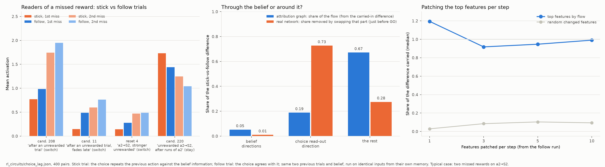

**Where the lag comes from** (`choice_lag.py`). *Why we ran this:* to find, in the circuit, what makes the choice
stick to the previous action when the belief information already says switch.

*Step 1: which history predicts it?* The belief explains 97% of the choice logit. Of the rest, the clearest
predictor is a pull towards the previous choice that depends on the previous trial's reward: +1.1 logits after an
unrewarded trial, −0.6 after a rewarded one (the length of the run of that choice and the time in the episode add
little). The choice disagrees with the belief information on 2.4% of trials, and in 87% of those it repeats the
previous choice. So the lag is "sticking with the last choice after a missed reward", which is exactly the situation
just after a reversal.

*Step 2: the attribution graph.* Two kinds of trial, both with the belief information already favouring the other
action: a **stick trial**, where the agent still chooses the same action as on the previous trial (its choice goes
against its belief), and a **follow trial**, where its choice agrees with its belief. We paired each stick trial with
a follow trial from another episode, with the same choices, states and rewards on the two trials before and the
same belief (ideal observer within 0.3). Both were run on identical inputs from their own carried-in
memory, so the only difference between them is what each carried in; the exact graph shows which features turn it
into the stick (400 pairs; logit difference 1.5 towards the previous choice).

- The typical case is two missed rewards in a row on the same choice (a2 reached S2 and was not rewarded, twice).
- The difference is carried by the D1 detectors that read those missed rewards, and by the state written at D2.
  Patching the top 3–5 features per step from the follow run into the stick run carries 92–95% of the difference;
  random features carry 10% or less.
- At the D1 steps the same miss is read by two kinds of detector, and their balance differs:

| detector (at the D1 that reads the miss) | stick | follow |
|---|---|---|
| candidate 208, "after an unrewarded trial" (pushes to switch) | 0.77 / 1.74 | 0.99 / 1.95 |
| candidate 11, "after an unrewarded trial; fades late in the episode" (pushes to switch) | 0.15 / 0.60 | 0.49 / 0.76 |
| reset 4, "after a2 reached S2, stronger when unrewarded" | 0.14 / 0.47 | 0.28 / 0.49 |
| candidate 220, "after an unrewarded a2→S2, strongest after runs of a2 choices" (pushes to stay) | 1.73 / 1.25 | 1.44 / 1.04 |

  (first number: reading the first miss; second: reading the second.)
- So when the choice sticks, the "switch" readers of a missed reward respond less and the "stay" reader responds
  more. What tilts the balance is carried in from before; the stick trials come after slightly longer runs of the
  same choice (23 vs 21 trials) and slightly later in the episode (trial 54 vs 49), and candidate 11 fades late in
  the episode.

**Does the lag go through the belief or around it?** *Why we ran this:* in the stick and follow trials the measured
belief is almost the same (−0.90 vs −1.05), yet the choice differs; either the D1 detectors change a part of the
memory the choice reads besides the belief, or our belief read-out misses part of the agent's belief. Three parts of
the hidden state, defined first:
- the **belief directions**: four straight-line read-outs of the ideal observer's belief from the hidden state, one
  fitted at each step of a trial (each tracks the belief closely, R² 0.88–0.99);
- the **choice read-out direction**: the direction of the hidden state the choice head reads, minus any overlap
  with the belief directions;
- **the rest**: everything else.

We split the stick-vs-follow difference into these parts in two ways:

| | belief directions | choice read-out direction | the rest |
|---|---|---|---|
| attribution graph: flow of each part of the carried-in difference to the choice (total 1.54) | 0.08 | 0.29 | 1.04 |
| real network: share of the difference removed by giving the stick run the follow run's part, just before the choice | 1% | 73% | 28% |

(In the graph the remaining 0.13 of the total comes from the transcoders' errors.)

- The pull goes around the belief, not through it. Matching the belief changes almost nothing.
- Just before the choice, the difference sits mostly along the choice read-out direction: the memory holds a "which
  action" component that is separate from the belief, and the choice is read from it.
- Earlier, in the carried-in memory, the difference is mostly in the rest; the D1 detectors (the "switch" and "stay
  anyway" readers above) turn it into that "which action" component.
- So the belief information and the choice are partly decoupled: normally the "which action" component (the
  action preference) is kept in line with the belief information, but after missed rewards following a long run of
  one choice, the readers update it less, and it lags.

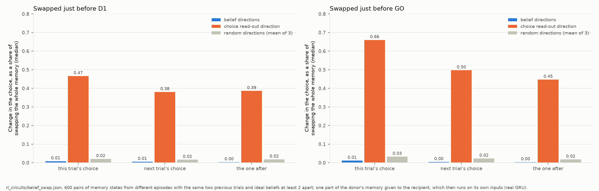

**Does the agent ever act on the belief information?** *Why we ran this:* just before a choice, the belief
information barely affects it (above). It might still act later, by feeding the action preference a trial on (then
the agent has a near-ideal belief that its action preference follows with a delay), or never (then it is information
the memory happens to carry, not the agent's belief). We swapped one part of the memory between two runs and let the
real network carry on (`belief_swap.py`, 600 pairs). Terms: a **recipient** and a **donor** are two memory states
from different episodes with the same two previous trials (choices, states reached, rewards) but ideal beliefs at
least 2 belief logits apart; the recipient is given one part of the donor's memory (the belief directions, the
choice read-out direction, a random part of the same size, or everything), just before D1 or just before GO, and
then runs on its own next inputs.

| part given from the donor | change in the choice at this GO / the next / the one after, as a share of giving everything | does the belief information move later? |
|---|---|---|
| belief directions | 1% / 0.4% / 0.3% | almost not at all (0.02, against 1.4 for everything) |
| choice read-out direction | 47–66% / 38–50% / 39–45% | yes (0.5–0.6 after this GO, 0.2–0.3 later) |
| a random part of the same size | 4.5% or less | little |

(Ranges: swapping just before D1 and just before GO.)

- The belief directions are never acted on, now or later. They do not even keep what was put there: one step later
  the belief information is back to what the rest of the memory implies. The straight-line read-out reflects the
  memory; it is not where the belief is kept.
- The choice read-out direction drives the choice now and later, and it moves the belief information that is read
  out afterwards.
- So the agent's working belief is its action preference: that is what the features update and what the choice
  reads, and it is what lags. The near-ideal belief information is a by-product the agent does not use.

**So the lag is in how a missed reward updates the action preference.** The readers that turn a miss into a push to
switch are weaker, and a "stay anyway" reader stronger, after the agent has committed to a choice for a while. That
discounts the first misses after a reversal and delays the switch by about a trial. The ideal belief can be read
from the memory almost perfectly, but the agent acts on the action preference, not on that read-out.

### Which features hold the belief, and which update it?

*Why we ran this:* the belief information is a straight-line read-out of the ideal observer's belief from the hidden
state. That says the information is there, not which features carry or compute it (and, as the swap test above
shows, not that the agent acts on it) (`belief_features.py`, 1500
closed-loop episodes; "outcome" = the state reached and whether it was rewarded).

**Holding it.** For every feature of all three gates, at each step of a trial, we measured how its activity moves
with the ideal observer's belief, and then how it moves with the belief beyond what the agent is doing (this trial's
choice and state reached, and the previous outcome).

- Most of the belief is carried by what the agent is doing: those three things explain 95% of the belief's
  variation in normal play. So the features that follow the belief most (for example candidate 119 at GO,
  correlation −0.92, "the agent prefers a2") are mostly choice and outcome features.
- The rest, the graded confidence, is held by a few features at particular steps: candidate 119 at GO ("prefers
  a2, graded by the strength of the preference"; −0.64 beyond the agent's choice and outcomes), reset 97 at D2
  ("after choosing a2 while the preference is weak"; 0.58) and update 241 at D2 ("a2→S2 when the preference is only
  weak"; 0.45). At D1 the link is weaker (0.37 at most).
- So there is no single belief feature: the belief is spread over step-specific features, mostly combined with the
  current choice and outcome, with a few graded "how sure" features.

**Updating it.** In the attribution graph we swapped one trial's reward and took the belief read-out right after the
next D1 as the target (480 held-out windows). The read-out moves by 3.0 (exact to 1e-5), all of it from the reward
input through features, mainly the D1 outcome detectors of §3: candidate 208 ("after an unrewarded trial"; +2.4),
candidates 8 and 77 ("rewarded S2" / "rewarded S1"), 165, 66, 34, 118, 24, 145 and 187. These are the same detectors
that do the credit assignment: they read "reward or not" together with the remembered state and write the update.

(A one-step split of the belief read-out after D1 into kept state, feature writes and bias / error is in the
results file, but it is hard to read: the update gate scales a large constant term, so the pieces swing widely.)

**So:** the network's memory carries belief information about which state is good, fed by both states' outcomes
through shared features and updated almost like the ideal observer, but the agent acts on a separate action
preference. That preference is updated by the same outcome detectors, S1 and S2 evidence move it alike (one
preference, not two values), and it lags: after a long run of one choice,
the detectors that read a miss as "switch" respond less, and a "stay anyway" detector more. A short-lived "was I
just rewarded" trace carries about 40% of the bands but barely affects behaviour. That is a Bayesian-like
design with a recency term, not model-based RL with two values.

Statistics here (the model fits, the band shares, the decoders) are behavioural or regression results; the
mechanism (offset paths, patching, history-specific detectors, the shared path of S1 and S2 evidence) comes from the
attribution graphs.

### Reward prediction errors, as in Wang et al. (2018)

(Figure: right panel of `trace_rpe.png`, above.)

*Why we ran this:* Wang et al. ("Prefrontal cortex as a meta-reinforcement learning system") called the meta-RL
agent model-based partly because its reward prediction errors (RPEs) matched a model-based algorithm's. Our value
output barely reacts to single outcomes over trials (§6), so we checked what that analysis actually measures
(`rpe_analysis.py`, 3000 closed-loop episodes).

Terms: the agent's **RPE** at a step is the change in its own value output plus the reward, r + γV(next) − V(now)
(γ = 0.97), as in Wang et al. It is compared at two steps of each trial: **reveal** (when the state reached is shown)
and **reward** (when the reward comes). The **reference RPEs** are what four algorithms would compute on the same
trials:
- **Bayesian**: Wang et al.'s "model-based" reference, which in fact tracks the belief about which state is good, as
  the ideal observer does;
- **model-based RL**: Daw et al.'s original version, which learns a value for each state and plans the first choice
  from the transition probabilities;
- **model-free**: SARSA(0), which learns values of actions and states directly;
- **reward only**: no learning at all, just the reward minus its average.

| reference RPE | correlation with the agent's RPE: both steps / reveal / reward |
|---|---|
| Bayesian | 0.87 / 0.84 / 0.90 |
| model-based RL | 0.86 / 0.81 / 0.89 |
| model-free | 0.83 / 0.72 / 0.88 |
| reward only | 0.66 / — / 0.80 |

- The test hardly separates the algorithms: their RPEs are nearly the same signal (Bayesian vs model-based RL 0.91,
  vs model-free 0.85), and most of the agreement comes from the reward itself (no learning at all already gives 0.80
  at reward steps).
- The Bayesian reference fits best, but only just. Wang et al.'s check for a model-free part (the model-free RPE
  with the Bayesian part regressed out) is not zero here: the agent's RPE correlates 0.17 with it (and 0.17 with the
  model-based RL residual). Together, the Bayesian, model-based RL and model-free references get weights of 0.52,
  0.21 and 0.19.
- Comparing with Wang et al.: their near-zero model-free result (Fig. 5G, r² = 6e-7) is this residual test, not the
  raw correlation, which they do not show (their two references correlate with r² = 0.46, Supplementary Fig. 4A).
  The comparable numbers are their r² = 0.89 with the model-based reference vs our r = 0.87, and their r² ≈ 0 with
  the model-free residual vs our r = 0.17 (r² 0.03). Our raw model-free correlation (0.83) is high because every
  algorithm's RPE is dominated by the reward term (more so with rewards of 0.9 / 0.1: our Bayesian and model-free
  references correlate 0.85, r² 0.73), and because we chose the model-free learning rate to fit the agent best (with
  α = 0.5 the correlation is 0.76; with 0.9, 0.59). The small residual is a real difference: our agent's RPE keeps a
  little of something model-free-like, which fits the history effects found above.
- The value does not need to track the belief for these correlations: its jump when the state is revealed (§6:
  +0.13 if the believed-good state is reached, −0.45 if not) and the reward term are enough.
- So the RPE correlation cannot tell Bayesian inference from model-based RL; the circuit tests above do (one action
  preference fed alike by both states' evidence, effects lasting by agreement rather than by state).

### What this adds to the paper

The paper found the bands from the agent's behaviour (its logit and logit change) and attributed them to a history
effect that distorts exact Bayesian inference. Here is what the analyses above add, with the features involved,
the circuit, and the kind of evidence. Four kinds of evidence, defined first:
- **attribution graph**: the exact contrastive flow through the transcoder features of all three gates, between two
  runs that differ in one thing (it says which features carry a difference, step by step);
- **feature patching**: in the real network, setting a handful of features to their values in the other run, to
  test whether they carry the difference (sufficiency) and whether it needs them (necessity);
- **hidden-state intervention**: in the real network, replacing or removing a part of the hidden state (a direction
  or a set of directions, not features) and letting the network run on;
- **regression**: statistics over many trials (no causal test).

| finding | features and circuit | evidence |
|---|---|---|
| The bands are mostly the previous trial: its outcome explains 71% of the spread around the curves (75% with its transition); its reward matters more (58%) than its state (29%). | none | regression |
| A few features carry each band: patching the top 3–5 per step reproduces the band offset (0.81–1.12 of it; random features up to 0.31–0.52). | the next-D1 detectors that read the previous outcome (candidates 18, 77, 215, 208), the current trial's state writers at D2 (reset 117, candidates 76, 219), the detectors that read the current outcome at the next D1 (candidates 77, 66), and GO features | attribution graph, feature patching |
| How the history acts: the previous outcome changes which detectors read the next outcome. At the same logit, a new rewarded S1 is read more by candidate 118 ("rewarded a1→S1 trial") after an unrewarded S2 than after a rewarded S1 (1.76 vs 0.61), and the logit then rises by 1.66 instead of not at all; a new unrewarded S1 is read more by candidate 114 (1.95 vs 0.59); a new rewarded S2 by candidate 8 after a rewarded S2, by candidates 215 and 95 after a setback. | the outcome detectors at D1 | feature activations at matched logit, located by the attribution graph |
| What carries the history: about 40% of the bands is a "was I just rewarded" trace that the action preference does not reflect; the rest goes with information tied to the action preference. | a few directions of the hidden state (not features) | hidden-state intervention |
| The bands barely matter for behaviour: they change the chosen action on about 1% of trials; removing the trace in play leaves reward, switching and agreement with the ideal observer unchanged. | | hidden-state intervention, closed-loop play |
| One belief, not two values (Bayesian-like, not model-based RL): an outcome's effect lasts according to whether the next outcome agrees, not which state is visited; S1 evidence passes through the S2-outcome readers when the next trial visits S2. | next-outcome readers 8, 208, 165; 77 / 66 | counterfactual reruns of the network (Test 1); attribution graph (graph version) |
| Evidence from the two states is carried differently: S1 evidence is wiped off the choice read-out after each choice and re-created by features (patching them removes all of it); S2 evidence waits in memory on the read-out (40% reaches the choice through the carry alone; removing its read-out component between choices leaves 0.31 of its later effect). A confident agent reads S2 outcomes weakly (1.2 vs 4–5 logits), so an S1 outcome counts 2–3× an S2 outcome and the agent switches late only when leaving S2 (+1.5 trials vs −0.15). | S1: 18, 77, 66 → 219, 76, resets 117, 80, 98 → 77 / 66, 208 → updates 55, 206, candidates 121, 146; S2: 215, 208, reset 59, then the carry | attribution graph (path split), feature patching, hidden-state removal and restoration, step-by-step split of h, reruns |
| The decodable ideal belief is not what the agent acts on: replacing the belief part of the memory changes later choices by about 1% of what replacing the whole memory does, and the belief read-out itself snaps back; the agent acts on a separate action preference (the part of the memory the choice is read from), which drives choices now and later (38–66%). | belief directions and choice read-out direction of the hidden state (not features); the graph split below names the features | hidden-state intervention; attribution graph (the stick-vs-follow difference: 0.08 through the belief directions, 0.29 through the choice read-out direction, 1.04 through the rest) |
| Why the agent switches a trial late: after a long run of one choice, the detectors that read a missed reward as "switch" respond less and a "stay anyway" detector more, so the action preference lags the belief information by about a trial. Patching the top 3–5 features per step carries 92–95% of the stick-vs-follow difference (random 10% or less). | "switch" readers: candidate 208 ("after an unrewarded trial"), candidate 11 ("after an unrewarded trial, fades late in the episode"), reset 4; "stay anyway" reader: candidate 220 ("after an unrewarded a2→S2, strongest after runs of a2 choices"); state writers at D2 (reset 115, candidates 167, 115) | attribution graph, feature patching |
| The credit circuit behind the Bayesian-like behaviour: credit to the state 11.5 logits, to the action 0.6. D2 features write the state reached (the action is mostly cancelled there); next-D1 conjunction detectors combine the reward with the remembered state; GO features, including update-gate features, write the choice. | D2: candidates 219, 147, 210, 167, resets 80, 98, 10; D1: candidates 77, 215, 208, 18, resets 120, 59; GO: updates 55, 206, 5, candidates 121, 146 | attribution graph, feature patching, label-level steering (§2–3, §5) |
| The belief information is updated by the same detectors: swapping a reward moves the belief read-out by 3.0, all through the D1 outcome detectors; a few graded features hold the confidence beyond the choice and outcomes. | update: candidates 208, 8, 77, 165, 66, 34, 118; confidence: candidate 119 at GO, reset 97 and update 241 at D2 | attribution graph; partial correlations |

What the features and attribution graphs gave beyond the paper's level of description: named, testable parts (which
detectors read an outcome, which write the state, which write the choice), causal tests of them (patching a few
features reproduces each effect), and the distinction between what the memory holds (a near-ideal belief) and what
the agent acts on (a lagging action preference), which a decoder alone got wrong at first. Not every step used
features: the band-share statistics are regression, and the belief-vs-action-preference swaps act on directions of
the hidden state.

## 8. Relation to systems neuroscience (interpretation)

*Why this section:* Wang et al. (2018) frame the meta-RL agent as a model of prefrontal cortex, basal ganglia and
thalamus. Our network is one 48-unit GRU, and its features are a dictionary fitted to it, so nothing here maps onto
brain areas or anatomy. What can be compared is how information is coded and combined. These are resemblances, not
evidence about the brain. The references were checked against their abstracts or full texts (list at the end of this
section). Mechanistic checks are in `neuro_analogues.py` (2000 closed-loop episodes).

**1. Outcome detectors are coincidence detectors.** *Parallel:* prefrontal neurons often respond to combinations of task
variables ("mixed selectivity", Rigotti et al. 2013). In a mouse two-step task, ACC represents the states and
transitions, and its "reward representations were specific to the state where the reward was received"; inhibiting
ACC "reduced the influence of the state transition (common or rare) on the subsequent choice" (Akam et al. 2021).
*Check:* a D1 detector's input splits exactly into a part from the current input (the reward) and a part from the
memory, plus a large negative bias (−6.3 to −8.5, with a threshold near 0). The input part alone never makes a
detector fire (0% in every case); it fires mainly in its own cell, when the input and the memory add up (candidate
208, "unrewarded S2", fires in 100% of unrewarded-S2 cases and about 0% of the others). The reward acts twice: it is
added directly, and it also changes the reset gate, which decides what is read from memory. That gating matters: with
the reset gate the opposite reward would give, candidate 18 ("unrewarded a1→S1") would fire in 75% of rewarded-S1
cases instead of 0%, and candidate 220 in 46% of rewarded-S2 cases instead of 0%. So each detector is an AND built
by adding the reward to a reward-gated read of memory and thresholding: coincidence detection with gain modulation
by the outcome.

**2. Credit to the remembered state needs a held state.** *Parallel:* after OFC lesions, monkeys are impaired at
"contingent learning", assigning a reward to the choice that caused it; credit spreads instead to choices made close
in time (Walton et al. 2010); holding the chosen option's identity
until the outcome arrives is the ingredient credit assignment needs (an eligibility trace). *Check:* on
rare-transition trials, where the state reached cannot be inferred from the choice, a straight-line read-out of
the hidden state recovers the state with 100% accuracy at D2, through the next D1 (where it meets the reward) and
the next GO (99% a trial later, which may be indirect). So the circuit holds the state across the delay, and the D1
detectors bind the reward to it (§3).

**3. Codes change from step to step, with a partly shared part.** *Parallel:* information held in prefrontal working
memory moves between population patterns across a trial ("dynamic coding", Stokes et al. 2013), often with a stable
subspace alongside (e.g. Murray et al. 2017). *Check:* read-outs trained after one step of a trial and tested after
another (correlation of prediction and target; 1 = the same code):

| variable | D1 → GO | GO → D1 | GO → D2 | D2 → GO | D1 → D2 | D2 → D1 |
|---|---|---|---|---|---|---|
| belief information | −0.23 | −0.31 | 0.11 | 0.83 | 0.61 | 0.27 |
| action preference | −0.63 | 0.95 | 0.86 | 0.99 | 0.91 | 0.28 |
| previous reward | 0.40 | 0.85 | 0.04 | 0.16 | 0.01 | 0.75 |

The action preference has a largely shared code between GO and D2 (and the GO code works at D1), but the D1 code
is different; the belief information and the previous reward are held in largely different patterns at different
steps. At the level of features the turnover is complete (no overlap between the top features at different steps),
but candidate features are mostly step-specific, so that part is expected.

**4. Choice history: losses are discounted more the longer a choice has been kept.** *Parallel:* animals and humans
show choice-history effects in this task (perseveration), often linked to dorsal striatum and motor cortex, and
habit models treat them as a reward-independent repetition tendency ("habits without values", Miller, Shenhav &
Ludvig 2019). *Check:*

| kept the current choice for | 1–2 trials | 3–5 | 6–10 | 11–20 | 21+ |
|---|---|---|---|---|---|
| pull towards that choice after a missed reward (logits beyond the belief information) | +1.20 | +1.28 | +1.53 | +1.68 | +1.75 |
| the same after a reward | −0.46 | −0.27 | −0.13 | +0.03 | +0.04 |
| "stay anyway" reader (candidate 220) at the D1 reading a miss | 0.32 | 0.42 | 0.43 | 0.48 | 0.63 |
| "switch" reader (candidate 208) at that D1 | 2.38 | 2.02 | 1.96 | 1.90 | 1.58 |

The pull grows with how long the choice has been kept, but only after a miss: it is not a reward-independent habit
but a growing discount of losses with commitment, built from a "stay" reader that strengthens and "switch" readers
(also candidate 11: 0.55 → 0.22; reset 4: 0.25 → 0.07) that weaken.

**Other parallels** (not checked further): the belief information is held but not used for the choice, as in rats
doing the two-step task OFC value signals peak at the outcome and silencing OFC then (but not during the choice)
disrupts the next trial's planning (Miller, Botvinick & Brody 2022: value representations "drive learning, not
choice"); update-gate features
that scale how much gets written at GO echo basal-ganglia / thalamic gating of prefrontal updates (O'Reilly & Frank
2006), but a GRU gate is a gate by construction; the late-onset features and the trial counter resemble time cells
and ramping timing signals (e.g. MacDonald et al. 2011), in a task with an artificial fixed horizon; features scaled by
surprise resemble state prediction errors (Gläscher et al. 2010).

**Mismatches.** The value at the choice step is mostly an episode clock and does not dip after a reversal, unlike
dopamine-like value; at the reveal of a state it shows only a partial inferred-value effect, carried by the choice
circuit rather than a separate valuation (§6).

**Predictions for neural data** (e.g. rat two-step recordings): a belief-like signal and a separate action-preference
signal, with only the second causally driving choice; outcome responses that depend on the previous outcome at
matched confidence (the bands); outcome detectors that combine the reward with the remembered state by coincidence,
with the reward also gating what is read from memory; and, after long runs of one choice, weaker "switch" responses
and stronger "stay" responses to a missed reward, predicting a slower switch.

**References** (checked):
- Akam T. et al. (2021). The anterior cingulate cortex predicts future states to mediate model-based action
  selection. *Neuron* 109(1): 149–163. doi:10.1016/j.neuron.2020.10.013
- Bromberg-Martin E. S., Matsumoto M., Hong S., Hikosaka O. (2010). A pallidus-habenula-dopamine pathway signals
  inferred stimulus values. *Journal of Neurophysiology*.
- Gläscher J., Daw N., Dayan P., O'Doherty J. P. (2010). States versus rewards: dissociable neural prediction error
  signals underlying model-based and model-free reinforcement learning. *Neuron* 66(4): 585–595.
  doi:10.1016/j.neuron.2010.04.016
- Ji-An L., Benna M. K., Mattar M. G. (2025). Discovering cognitive strategies with tiny recurrent neural networks.
  *Nature* 644: 993.
- MacDonald C. J., Lepage K. Q., Eden U. T., Eichenbaum H. (2011). Hippocampal "time cells" bridge the gap in memory
  for discontiguous events. *Neuron* 71(4): 737–749. doi:10.1016/j.neuron.2011.07.012
- Miller K. J., Botvinick M. M., Brody C. D. (2022). Value representations in the rodent orbitofrontal cortex drive
  learning, not choice. *eLife* 11: e64575.
- Miller K. J., Shenhav A., Ludvig E. A. (2019). Habits without values. *Psychological Review* 126(2): 292–311.
  doi:10.1037/rev0000120
- Murray J. D. et al. (2017). Stable population coding for working memory coexists with heterogeneous neural dynamics
  in prefrontal cortex. *PNAS* 114(2): 394–399.
- O'Reilly R. C., Frank M. J. (2006). Making working memory work: a computational model of learning in the prefrontal
  cortex and basal ganglia. *Neural Computation* 18(2): 283–328. doi:10.1162/089976606775093909
- Rigotti M. et al. (2013). The importance of mixed selectivity in complex cognitive tasks. *Nature* 497: 585–590.
  doi:10.1038/nature12160
- Stokes M. G. et al. (2013). Dynamic coding for cognitive control in prefrontal cortex. *Neuron* 78(2): 364–375.
  doi:10.1016/j.neuron.2013.01.039
- Walton M. E. et al. (2010). Separable learning systems in the macaque brain and the role of orbitofrontal cortex in
  contingent learning. *Neuron* 65(6): 927–939. doi:10.1016/j.neuron.2010.02.027
- Wang J. X. et al. (2018). Prefrontal cortex as a meta-reinforcement learning system (bioRxiv 295964; *Nature
  Neuroscience* 21: 860–868).

## 9. Method notes and pitfalls

- **Frozen gates hide the computation here.** The copy-task graphs froze the gates (1–2 logits in the gate term).
  Here a frozen-gate graph left 3–7 logits of a 6–9 change in gates; the midpoint split makes gate features nodes.
- **A live transcoder error is not small on mixed states.** Patching kind 2 (real gate + the patched features'
  change, error live) failed: with the gate from one run and the input from the other, the candidate transcoder's
  error is about 1.4 instead of 0.05, and it carries the change. Patched steps therefore use each gate's
  reconstruction plus its error held at the patched run's clean value, as the graphs treat error nodes.
- **Patched gates can leave their range.** Partial patches can turn on a feature and its unpatched near-duplicate
  together; the reconstruction then overshoots (3–13% of patched gate values outside the range, median excess 0.06).
  They are clipped to the GRU's range; without clipping the state and reward results are the same within 0.03, and
  14-step reversal windows diverge.
- **Random gate-feature controls are destructive.** Several random update features per step change the carry and
  move the choice a lot; the fair control uses the same gate as the steered features.

## 10. Open items

- Why the a1 side carries larger features than the a2 side (asymmetric training history, or a code relative to a1).
- The repeat bias is negative (−0.6): where it comes from.
- The update gate's role at GO (55, 206) as a gain on the choice-coded candidate: test by clamping it alone.
- Why V's last trials fall too slowly although the counter is accurate to a trial.
- Why the agent lags the ideal observer by a trial: its evidence decays faster than the observer's (hazard 0.025).
