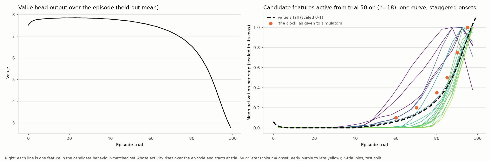
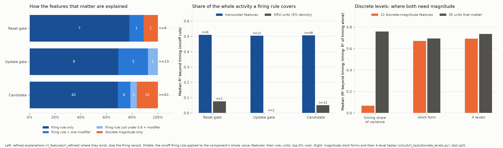
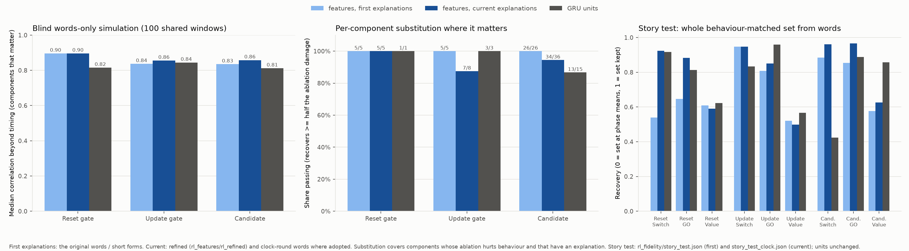

# Do transcoders make the two-step-task GRU more interpretable?

Model: a GRU agent with 48 hidden units on the two-step task (`data/models/rl_train/run_two_step_init_low_r1`).
Transcoders replace one gate each, JumpReLU: reset (128 features), update (256) and candidate (256). Baseline: the
GRU's own 48 units per gate, either thresholded so each unit "fires" on a fixed share of steps (firing rules) or
as raw gate values (magnitude explanations). Copy-task counterpart: `docs/interpretability_findings.md`; worked
examples of RL explanations: `docs/rl_well_explained_examples.md`; circuits (model-based credit, switching after a
reversal): `docs/rl_circuits.md`.

Code is in `circuit/rl_task/` (each script's docstring has its command line); results are in `rl_features/`
(not tracked), indexed in `rl_features/README.md`, with run logs in `rl_features/*RUNS.md`. Figures:
`docs/figures/rl/` (index: `docs/figures/rl/README.md`; `python -m circuit.rl_task.plots`); figures of abandoned
analyses are indexed in `docs/figures/rl/archived/README.md`.
Throughout, three values separated by slashes are for the reset / update / candidate gates unless labelled otherwise.

## Summary

- **Most of what matters is a firing rule.** 83 features matter individually for the agent's choices or value.
  72 of them (87%) are explained by "fires when X", alone (58) or with one small size modifier (14; 4 of these
  have firing F1 just under 0.8). The other 11 need a magnitude explanation, and every one of those is discrete
  ("high when X, low when Y"). None needs a curve.
- **Units cannot be explained this way.** A gate unit is never off. Binarised at the features' own firing rate,
  its top tail gets a firing rule about half as often as a feature does. Even then, the rule describes only that
  tail: it accounts for a median 0.00–0.08 of the unit's activity beyond timing, against 0.50–0.51 for a feature.
- **Where both need magnitude, units do as well.** Units' values collapse into 4 discrete levels about as well
  as the 11 magnitude-only features do (R² beyond timing 0.74 vs 0.69). But for reset and candidate units, about
  85% of the variance is a timing profile (phase × stage of the episode). Their short explanation covers only the
  remainder.
- **The explanations are predictive.**
  - **Blind simulators** reproduce the features that matter better than the units that matter from words alone
    (median correlation beyond timing 0.90 / 0.86 / 0.86 vs 0.82 / 0.84 / 0.81).
  - **Per-component substitution:** replacing one component by its explanation, where it matters, passes about
    equally often for features and units (46 of 49 vs 17 of 19).
  - **Story test:** replacing the whole behaviour-matched set by its words recovers the agent's switches and GO
    choices better with features (switch 0.92 / 0.95 / 0.96 vs units 0.92 / 0.83 / 0.42). Units recover the
    **value** better (0.59 / 0.50 / 0.63 vs 0.62 / 0.57 / 0.86).
- **The features encode the task's structure.**
  - 50 of the 83 detect the previous trial at D1: the state it reached and whether it was rewarded, often also the
    choice that got there.
  - They weight rare transitions differently from common ones, the signature of model-based learning.
  - They tile the episode in time. The late-onset ones share one curve, with staggered onsets, and that curve
    mirrors the value head's late fall.
- **Where units are more compact.** Units reproduce behaviour with fewer components (behaviour-matched sets 33 / 12
  / 30 units vs 55 / 113 / 102 features), and a single unit tracks the agent's belief and choice better than any
  single feature. But a random rotation of the units does just as well, so this reflects the dense code, not
  interpretable units.

## 1. Setup and protocol

**Task.** Each trial has three steps:
- **D1:** fixate; the previous trial's reward is shown.
- **GO:** choose a1 or a2.
- **D2:** the reached state is shown. a1 leads to S1 and a2 to S2 with probability 0.8 ("common"), otherwise to
  the other state ("rare").

The reached state pays a reward with probability 0.9 if it is the hidden good state, 0.1 otherwise. The good state
reverses a few times per 100-trial episode. The agent's value head stays at about 7.8 until trial 50, then falls,
faster and faster, to 2.8 at trial 99.

**Data.** A step table of held-out trace windows: up to 5 trials each, 2.3M steps
(`circuit/rl_task/autointerp.py build`). Dev = even episodes (development); test = odd episodes (every reported
score). Window-start D1 steps show the reward input, but the previous trial lies outside the window (§2.6).

**Variables an explanation may use.** Observed task variables only:
- the previous trial's choice, state and reward, and the trial before that;
- the current input;
- the trial number in the episode;
- `belief`: an ideal observer's P(S1 is good), computed from the inputs (reversal hazard 0.025);
- `surprisal`: how unexpected the previous outcome was under that belief, split into transition and reward parts.

The model's own value or choice is not allowed: it would leak the decision being explained. Future variables
are not allowed either. (The first round of firing explanations allowed them if flagged; for the features that matter
they have since been replaced, §3. Other features' and units' first-round rules can still use them.)

**Explanations.**
- **Firing explanation.** A predicate (numpy expression) for when the component is active, scored by held-out F1.
  Developed by one agent per component, then checked by a skeptic agent
  (`circuit/rl_task/autointerp_workflows/`).
- **Magnitude explanation.** A short form of at most 3 terms (no hand-set constants, no lookup tables), each with a
  fitted weight on top of a timing baseline. Scored by R² beyond timing.
  - **The timing baseline:** the component's mean at each phase × episode decile, 30 numbers.
  - **R² beyond timing:** the share of what timing misses that the terms recover.
- **Curve fitting.** Allowed to develop hypotheses, but never as the explanation. Every explanation has a short
  verbal statement, and that statement is what the words-only tests use.

**Units.**
- **Firing rules:** units binarised at 1%, at the features' median density for that gate ("matched": 3.6% / 1.0% /
  2.9%), and at 5% (`circuit/rl_task/neuron_baseline.py`). Candidate units are interpreted at both ends (high and
  low), since they range from −1 to 1.
- **Magnitude explanations:** raw unit values, with the same tools.

## 2. What the features encode

### 2.1 Previous-trial outcome detectors dominate

Of the 83 features that matter, 50 fire at D1 on one pattern of the previous trial:
- **16 on the state reached × reward**, e.g. "after an unrewarded S1 visit". In 4 of these (candidates 8, 66, 208,
  215) the route changes only the size: they are stronger after a rare transition.
- **34 on the choice × state reached × reward**, i.e. the transition (common or rare) matters too, e.g. "after an
  unrewarded common a1→S1 trial".

6 of the 50 fire only when the history also favours one state (the ideal observer's belief; candidates 52, 62, 83,
179, 181, 230). The rest fire at GO (12), at D2 (17), or mark the phase or episode time (4). Counts are from each
feature's current explanation (`rl_autointerp/`, `rl_refined/`, `rl_magnitude/`). For example:
- **Candidate 208, the single most important feature.** Removing it on its worst pattern flips 99.7% of GO choices.
  It fires after an unrewarded trial that did not end in S1, and is about 3× stronger after a rare a1→S2 trip.
- **Candidate 66:** fires after a rewarded S1 visit.
- **Update 5:** fires at GO after an unrewarded common a1→S1 trial.

### 2.2 Rare transitions are treated differently

Many features separate rare from common transitions, by size or by onset: candidates 8, 36, 66, 95, 120, 185, 204,
208, 215, and reset 18. That is what model-based credit assignment needs: a reward after a rare transition is
evidence about the other state. Candidate 66 fires after a rewarded S1 visit, and its size tracks how unexpected
that visit was. A rare transition raises it about 2.6× more than a surprising reward does.

### 2.3 Features tile the episode in time; the late ones share one clock

**Time is everywhere.** How many explanations use the episode's trial number (`ep_trial`, `ep_bucket` or "the
clock"), by gate (reset / update / candidate):

| | Reset | Update | Candidate | Total |
|---|---|---|---|---|
| Features that matter (current explanation) | 1 of 9 | 7 of 13 | 33 of 61 | 41 of 83 (49%) |
| Accepted firing predicates | 26 of 55 | 45 of 58 | 68 of 107 | 139 of 220 (63%) |
| All firing predicates | 68 of 128 | 163 of 256 | 152 of 256 | 383 of 640 (60%) |
| Magnitude short forms | 12 of 35 | 26 of 66 | 32 of 74 | 70 of 175 (40%) |

Among the features that matter, time is mostly a candidate-gate property: reset features almost never use it.

**Two kinds of time feature.**
- **Late-onset features** switch on at staggered trials (40, 60, 70, 72, 80, 85, 88, 92, 97) and then grow.
- **Fading features** are strongest early and cut off at trials 50, 70 or 80 (candidates 11, 95, 120, 212).

**Onsets depend on the pattern.**
- Candidate 36 fires after a rewarded S1 visit from trial 70 by the rare route, but only from trial 80 by the
  common route. The rare route is always about 10 trials ahead.
- Update 181 is the reverse, for unrewarded S1 visits: common route from trial 72, rare route from 88.

**The late features share one curve.** 18 candidate features become active from trial 50 or later, and they
follow one curve with staggered onsets. That curve has the shape of the value head's late fall: correlation with
the value's fall 0.84–1.00 for 17 of them (median 0.97). These features are the agent's horizon clock. They matter
more for value than for choice (§6.3), and they are where words lose the most (§6.3).

### 2.4 Belief and surprise modulate size

Several features fire on a fixed pattern but step low / medium / high with the observer's belief: update 5,
candidates 11, 114, 185. Candidate 66's size follows how surprising the reward was (§2.2).

### 2.5 The 11 magnitude-only features: weak background firing

These features fire weakly over a broad region and strongly in one named condition. For example:
- **Candidate 66:** 99% of steps fire after a rewarded rare a2→S1, but also about 40% after a common a1→S1 reward,
  at a fifth of the size.
- **Reset 112:** fires on 11% of all steps.
- **Candidate 200:** fires at most D2 steps.

No cut between "fires" and "doesn't" separates them: the cell-union ceiling on firing F1 is 0.47–0.77. Raising the
firing threshold doesn't help either.

### 2.6 A data artifact: window-start steps

At the first D1 or GO of a window, the reward input is visible but the previous trial is not. Those steps hold
12–18% of the activation mass of several features. They cap the recall of firing rules for the 4 features just
under F1 0.8 (candidates 60, 114, 183; update 181). `surprisal` is computed from the whole episode, so it recovers
the previous trial for 45% of them. Filling the previous trial in from the episode traces is open (§8).

## 3. Firing-level explanations

**Share of components with an accepted firing explanation (F1 ≥ 0.8 plus skeptic):**

| | Reset | Update | Candidate |
|---|---|---|---|
| Features (own density) | 42% | 26% | 43% |
| Units at matched density | 21% | 8% | 24% |
| Units at 1% | 12% | 8% | 10% |
| Units at 5% | 40% | 27% | 38% |

Counted over all interpreted features and units; candidate units count each end separately. At their own density
(matched), features get firing explanations 1.8–3.3× as often. Units approach features only at 5%, a looser threshold
that turns the unit's top tail into a larger, easier target.
Figure: `docs/figures/rl/interp_f1_vs_rate.png`.

**On the components that matter (§5)**, features have firing explanations far more often: 8 of 9 / 12 of 13 / 48
of 61. Units that matter: 0 of 3 / 0 of 8 / 0 of 24 at 1%; 1 of 3 / 0 of 8 / 3 of 24 at matched density; 1 of 3 /
2 of 8 / 6 of 24 at 5%. (Candidate units count only if both ends are explained; with either end, 13 of 24 at 5%.)

**How much of the component a firing rule covers.** Apply the on/off rule to the component's whole value and
measure R² beyond timing:
- Features (median): 0.51 / 0.50 / 0.51.
- Units at 5% (median): 0.08 / 0.00 / 0.05.

A feature is zero when its rule is false, so the rule covers everything the feature does. A unit's rule covers its
top 5% of steps, and says nothing about the other 95%.
Code: `circuit/rl_task/firing_coverage.py`; results: `rl_fidelity/firing_coverage.json`.

**Refinement.** 24 important features first needed more than a firing rule: 21 had no accepted firing explanation,
and 3 had one but needed their size explained too (update 5; candidates 8, 204). After refinement, 14 of the 24 are
a firing rule plus one modifier (4 of them just under F1 0.8). So 11 moved from magnitude-only to firing-based
(agents per feature, dev only, test scored once). What was missing was one of three things:
- **an onset or cutoff trial:** candidate 36 from trial 70 / 80; candidate 212 before trial 80;
- **the true boundary:** candidate 208, "not in S1" instead of "any unrewarded", F1 0.70 → 0.93;
- **a belief condition in place of a banned model output:** update 18, previously F1 0.78 using the upcoming
  choice; now 0.89 with observed variables only.

`circuit/rl_task/refined_explanations.py` (the explanations), `rl_features/rl_refined/`, `rl_features/rl_refined_RUNS.md`.

**Observed variables only.** *Why:* the first-round firing rules could use the model's own outputs (its choice
logit, chosen action or value) and its upcoming choice, if flagged. A rule like "D1 after a reward, when the agent is
about to choose a1" partly describes the model's output rather than what the feature responds to, so it overstates
how well the feature is explained. 31 of the 83 features that matter had such a rule:
- 23 used a model output or the upcoming choice in the main rule (e.g. candidate 118, update 55, candidate 230);
- 8 used the upcoming choice only on window-start steps, as a stand-in for the previous trial that lies outside
  the window.

*How:* one agent per feature (the 23) found the best rule using only what the agent had observed by that step
(the history, the trial number, the ideal observer's `belief`), dev split only, test scored once; the scoring tool
rejects anything else (`autointerp score --observed`). A skeptic agent then tried to refute each rule; 7
corrections were adopted. For the 8, the window-start stand-in was swapped for `belief` (a1 → belief > 0.5, a2 →
belief < 0.5). Update 235 was re-explained in the main session.

*Result:* 30 of the 31 are still explained (test F1 ≥ 0.8), median F1 0.89 (was 0.91). Mostly `belief`, or the
previous trial's choice and route, replaces the model's choice: e.g. candidate 118 is now "D1 showing a reward earned
by a1 reaching S1" (F1 0.91, was 0.95). Two got clearly better (candidate 181, reset 95). Candidate 33 lost its
firing rule: 28% of its active steps are common a1→S1 trips made while the agent's policy leans a2, and no observed
variable recovers that (observed rules reach F1 0.80–0.81, against 0.86 with the model's choice). It keeps its observed-only
magnitude explanation (§4) and is counted as magnitude-only. Records: `rl_features/rl_observed/` (with the skeptic
verdicts); `rl_autointerp/` now holds these rules, each with its earlier one under `with_model_outputs`.

## 4. Magnitude-level explanations

**None needs a curve.**
- **Formulas collapse into tables.** For every recorded magnitude explanation, cutting each graded factor into a
  few bins and merging the cells into 4 levels scores within 0.03 of the formula for 89% / 98% / 91% of features.
  Code: `circuit/rl_task/discrete_levels.py`.
- **The 11 magnitude-only features** are each either "size fixed per condition" or "off / low / medium / high by a
  stated rule".

**Modifiers come in five shapes.** Firing rules with a modifier, and the magnitude-only explanations, use one of:
- **levels by one cue:** belief (update 5; candidates 11, 114, 185);
- **a fixed ratio between two cases:** "about a quarter as strong after the common route" (candidate 8; reset 18);
- **steady growth or fading from an onset:** candidates 183, 212; update 181;
- **"follows the clock":** the shared late-episode profile (§2.3; candidates 60, 182, 204, 215);
- **growth with surprise:** candidate 66.

**Scoring firing-based explanations "as worded".** The standard magnitude fit adds the timing baseline at every
step. For a feature that fires only late, its own late activity raises the baseline at every late step, so the fit
predicts a positive value where the feature is silent. The words say "zero outside the rule".
- **Scored as worded,** firing-based explanations get credit for that: zero outside the rule, fitted values
  inside, still compared against the timing baseline. Candidate 36 scores 0.77 as worded vs 0.65 with the standard
  fit.
- **The exception is candidate 204** (0.67 vs 0.80), whose words omit a small late trend that the baseline
  supplies.

## 5. Which features matter, and behaviour with the important set

**Conditional importance.** Every feature and unit is ablated alone, to its per-(phase, episode-decile) mean or to
zero, in the real GRU (`circuit/rl_task/conditional_tests.py`). A component used in one situation would be diluted
if its effect were averaged over every window. So the drop in GO-choice agreement, switch agreement and value
error is measured three ways:
- over all windows;
- over the windows where the component takes part;
- on the previous-trial pattern where it hurts most.

Figure: `docs/figures/rl/conditional_importance.png`.

**What "matters" means.** A component matters if any of these holds, under either ablation:
- its worst-pattern GO loss is at least 5%;
- its averaged GO loss is at least 1%, or its switch loss at least 5%;
- its worst-pattern value error rises by at least 0.05;
- in the windows where it takes part, its GO loss is at least 5%, its switch loss at least 10%, or its value error
  rises by at least 0.05.

That gives 87 features (9 / 15 / 63) and 35 units (3 / 8 / 24). Four of the 87 are negligible (update 131 and 144;
candidates 153 and 192). They entered through the active-window criterion on 1–2% of windows; update 131 entered on
a single window. They are excluded below, leaving **83** (9 / 13 / 61). A minimum-window floor for this criterion
is pending (§8).

**The final breakdown of the 83:**

| | Reset | Update | Candidate | Total |
|---|---|---|---|---|
| Firing rule only | 7 | 9 | 42 | 58 (70%) |
| Firing rule + one modifier | 1 | 3 | 6 | 10 (12%) |
| Firing rule just under 0.8, + one modifier | 0 | 1 | 3 | 4 (5%) |
| Discrete magnitude only | 1 | 0 | 10 | 11 (13%) |
| Unexplained | 0 | 0 | 0 | 0 |

**Behaviour-matched sets** (`circuit/rl_task/matched_sets.py`). These are the fewest features, and the fewest units,
that recover 90% of the way from "nothing kept" to the full transcoder on switch agreement, GO agreement and value
error, with every other component at its phase mean. Sizes: features 55 / 113 / 102, units 33 / 12 / 30. Units are
more compact here.

**The first explanations, by type** (`rl_fidelity/firing_vs_magnitude.json`). Switch recovery, from the first round
of explanations:
- **Keeping only firing-explained features:** 0.44 / 0.39 / −0.01.
- **Keeping firing- or magnitude-explained features:** 0.98 / 0.51 / 0.88.
- **Replacing those by their explanations:** 0.73 / 0.33 / 0.39.

So at that point, much of the behaviour lived in features that needed a magnitude explanation. The refinement in §3
moved 11 of the important ones to firing rules.

## 6. Are the explanations predictive?

### 6.1 Predicting the component

**Firing rules** are scored on held-out episodes: F1, and coverage by activation quartile
(`docs/figures/rl/specificity_by_activation.png`). Magnitude explanations: R² beyond timing.

**Blind words-only simulation** (`circuit/rl_task/simulation_scoring.py`). A separate agent sees only the words, and
predicts the component's value (0–10) at every step of held-out windows.

*Each component's own windows* (behaviour-matched sets), median correlation beyond timing:

| | Reset | Update | Candidate |
|---|---|---|---|
| Features | 0.86 | 0.84 | 0.87 |
| Units | 0.76 | 0.83 | 0.77 |

*The same 100 shared windows for every component* (the components that matter), median correlation beyond
timing:

| | Reset | Update | Candidate |
|---|---|---|---|
| **Features, current explanations** | **0.90** | **0.86** | **0.86** |
| Units | 0.82 | 0.84 | 0.81 |

Raw correlation favours units (0.95 / 0.92 / 0.95, against features 0.94 / 0.89 / 0.87). Most of a unit's variance
is timing, which a simulator gets almost for free.

The refined words simulate better than the first words for the 24 refined features: median 0.81 vs 0.74 beyond
timing; better for 16 of the 24. The largest gains are candidates 95 (0.43 → 0.93), 120 (0.25 → 0.90) and 183 (0.40
→ 0.87).

### 6.2 Predicting behaviour, one component at a time

**Per-component substitution.** Replace the component by its explanation's prediction, at every step, against
replacing it by its timing mean. Measure the GO choices after its worst pattern, or the value when the choice barely
moves. Pass = the explanation recovers at least half the ablation damage.
- **First round:** 53 of 55 passed (features 36 of 36, units 17 of 19;
  `docs/figures/rl/component_substitution.png`).
- **Current explanations** (refined where they changed): features pass 5 of 5 / 7 of 8 / 34 of 36 (46 of 49);
  units 1 of 1 / 3 of 3 / 13 of 15 (17 of 19).
- **Coverage:** the test only covers components whose ablation actually hurts behaviour and that have an
  explanation.
- **The three failing features:** candidate 114, update 150, and candidate 250 (recovery 0.48, just under the bar;
  its ablation barely moves the choice, but its value error recovers by 58%).

The earlier clamp test is superseded and not used. It drove each component high or low and asked whether behaviour
moved the way the explanation's natural contrast predicts. Components push consistently, but the natural contrast
doesn't predict the direction, so the test's prediction was flawed.

### 6.3 Predicting behaviour from words alone: the story test

`circuit/rl_task/story_test.py`. Every member of the behaviour-matched set is replaced, at every step of the 100
shared windows, by its blind simulation: the words-implied activation, mapped back to the component's own range,
with nothing fitted to behaviour. Recovery = how much of the way from "set at phase means" back to "set kept".

| | Switch | GO | Value |
|---|---|---|---|
| Reset: features, first / current | 0.54 / **0.92** | 0.65 / **0.88** | 0.61 / 0.59 |
| Reset: units | 0.92 | 0.81 | 0.62 |
| Update: features, first / current | 0.95 / 0.95 | 0.81 / 0.85 | 0.52 / 0.50 |
| Update: units | 0.83 | 0.96 | 0.57 |
| Candidate: features, first / current | 0.88 / **0.96** | 0.85 / **0.97** | 0.58 / 0.63 |
| Candidate: units | 0.42 | 0.89 | **0.86** |

**Features now lead or tie on switch for every gate, and lead on GO for two of three.** Two refinements did most of
it:
- reset 18 and 112, which close the reset switch gap;
- candidate 208, which alone lifts candidate switch recovery from 0.88 to 1.00.

**Value is the units' strength, and the gap is in the clock.** A perfect-simulator screen
(`circuit/rl_task/story_screen.py`) gives the candidate features their true activation, rounded to 0–10:
- for **all** features, value is recovered completely (1.01), so the 0–10 scale is not the problem;
- for **only the time-dependent explanations**, it reaches 0.82;
- for **only the others**, it stays at 0.57.

So the value head sums many features' late-episode growth, and small errors in the words' onsets and growth rates
add up.

**One shared clock helps.** The fix is one shared definition of "the clock", given once to every simulator: the
value-fall profile, as a share of full strength, about 0.1 at trial 60, 0.2 at 70, 0.35 at 80, 0.5 at 85, 0.75 at
90 and full from 95. Each explanation then says only "follows the clock (from trial X)". With that, plus one-clause
level fixes ("about a quarter as strong after the common route"), candidate value recovery rose from 0.27 to 0.63
(0.58 with the first words).
- **Not adopted:** 2 of the 10 edits made the set worse (candidate 130: value −0.04; candidate 77: switch −0.08).
  The second corrected a real error (its old words predicted 6–9 where the feature is about 0.2). The set-level
  test has interactions between members' errors.
- **Where the rest of the gap lies:** the remaining value loss is spread thinly over many features.

## 7. Units compared: how easily each can be worked with

- **Units are dense and mostly timing.**
  - The timing profile (phase × episode decile) is a median 77% / 58% / 84% of a unit's variance over all 48 units
    per gate, and 86% / 44% / 85% for the units that matter. For the features that matter (those with a magnitude
    explanation), it is 16% / 11% / 9%.
  - Unit values have only about 3 effective dimensions per gate (participation ratio 2.8 / 2.9 / 2.7; 3.8 / 3.7 /
    4.3 beyond timing).
- **Discrete levels work for units too.** The 35 units that matter collapse into 4 levels at a median R² beyond
  timing of 0.74, against their short forms at 0.69. The 11 magnitude-only features: 0.69 and 0.67. 94% of units
  that matter keep their score within 0.03. On format alone, units and features tie.
- **The difference is coverage.** The timing profile is 85% of a reset or candidate unit's variance. A unit's
  4-level explanation recovers 74% of the remaining 15%, about 11% of the total. So a full verbal account of a unit
  needs the 30-number timing profile as well as the levels. A feature's short explanation describes most of what it
  does.
- **Readout of decision variables** (`circuit/rl_task/readout_test.py`). Linear readouts after removing timing, at
  D1 and GO steps.
  - **Jointly, features and units carry the same information:** belief R² 0.85–0.88 for both; choice 0.96–1.00.
  - **A single unit tracks belief and choice better than any single feature:** at GO, belief best single 0.76–0.78
    for units vs 0.39–0.71 for features; choice 0.92–0.99 vs 0.50–0.85. But the units in a random rotation do
    equally well (0.76–0.78 and 0.90–0.99). So this reflects the dense code (every direction carries some of the
    global belief and choice signal), not interpretable units.
  - **Features localise last-trial evidence at D1:** best single component 0.38 / 0.14 / 0.24 for features vs 0.16
    / 0.11 / 0.09 for units.
- **Behaviour-matched sets are smaller for units** (33 / 12 / 30 vs 55 / 113 / 102). Fewer units are needed, but
  each needs the timing profile plus levels to explain.

Overall: on explanation format alone, where both need magnitude, units and features tie. Features are the more
interpretable basis, because most of what matters is a feature that is off except in a stated situation. A unit is
never off, and its short explanation is a correction to a dominant timing profile.

## 8. Open items

- **The previous trial at window starts.** Fill it in from the episode traces. This would likely lift the 4 firing
  rules just under 0.8, and could simplify the belief clauses in reset 18 and update 150.
- **A minimum-window floor for "matters"**, so the 4 negligible features drop out formally.
- **Model outputs outside the features that matter.** First-round firing rules of other features (81 of the 220
  accepted use value, choice or model_act) and of units (13 of 20 / 17 of 32 / 27 of 65 accepted at 1% / matched /
  5%) still use them, so the all-component shares in §3 count them. The per-component substitution test
  (`component_substitution.png`) also used the earlier rules for the 31 features re-explained in §3.
- **A matching refinement pass on the 35 important units.** Units got one firing pass at each density and one
  magnitude pass; features got the extra refinement in §3.
- **The value channel.** Tighter time descriptions for the value-heavy candidate features beyond the 8 adopted
  clock edits.
- **Two weak explanations,** under both their old and refined explanations:
  - candidate 114 (firing F1 0.797; fails substitution);
  - update 150 (fails substitution; its belief clause also lost the most in blind simulation).
